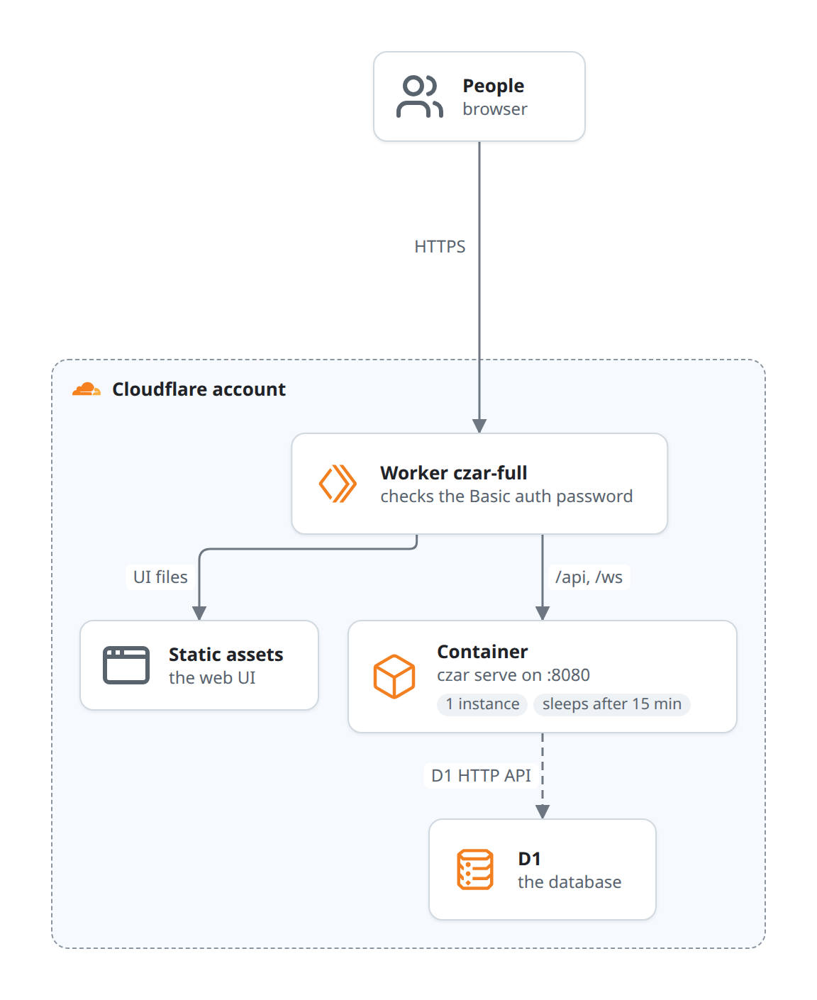

# Cloudflare

_Updated at: 2026-10-02_

[`deploy/cloudflare/full`](../../deploy/cloudflare/full/) runs czar on Cloudflare: a Worker in front, `czar serve` in a Cloudflare container, and D1 as the database. Nothing to keep running yourself; the container sleeps when nobody uses it.

## Examples Covered

1. [Cloudflare deployment example](../../examples/deployments/cloudflare/)

## The pieces

| Piece | What it does |
|---|---|
| Worker `czar-full` | Checks an HTTP Basic auth password on every request. Serves the web UI's files itself, and forwards `/api` and `/ws` to the container. Answers 503 until the password and the D1 settings are configured. |
| Container | Runs `czar serve` on port 8080 (the API, the Scheduler and the process executor), built from the [Dockerfile](../../deploy/cloudflare/full/Dockerfile) with only the `d1` and `process` features. One instance; it sleeps after 15 minutes without requests. |
| D1 | The database. The container reaches it through the D1 HTTP API, with an account id, a database id and an API token. |

Workflows are baked into the image (`/app/cloudflare-workflows`) and loaded when the container starts.

## Limits

- **It doesn't start as configured today:** the container runs `czar serve` on `0.0.0.0` without an `--auth` mode, and czar refuses that. See [known issues](../dev/architecture/known-issues.md#the-cloudflare-container-has-no-auth-mode).
- **One password for everyone**, checked by the Worker; czar itself sees no users.
- **Scheduled runs only fire while the container is awake:** the Scheduler lives in the container, which sleeps after 15 minutes.
- Tasks run inside the container, so only commands and Python available in its image work.

## Running it locally

`just up-cloudflare-full` starts the Worker and container with Wrangler and a local D1; `just down-cloudflare-full` stops them.
