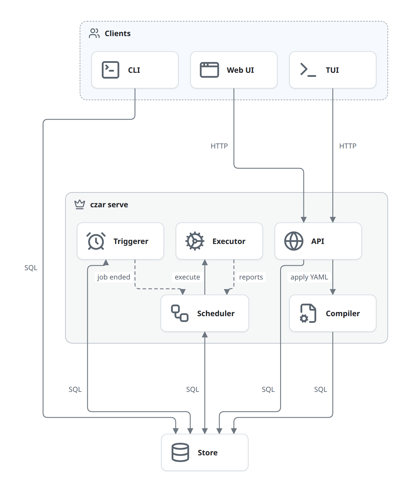
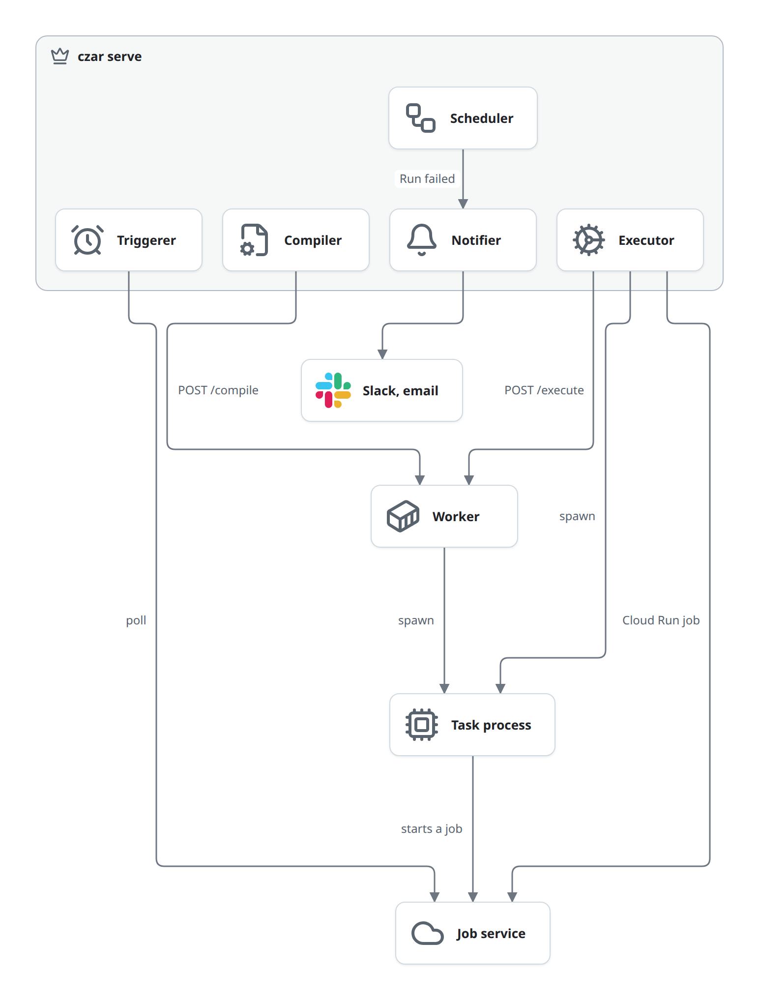

# Building blocks

czar is a handful of building blocks around one database. The clients (CLI, Web UI, TUI) change state through the API or straight in the Store; the Scheduler notices on its next tick and moves Runs and Tasks forward; Executors start the work and report back. No two blocks call each other to share state: they read and write the same tables.

This page says what each block owns, what it never does, which entities it creates or changes, and where its code is. The entities are defined in [domain-model.md](domain-model.md); how the blocks work together is in the [flows](flows/README.md).

This map shows the blocks inside czar and how they reach the Store. Each box is a section below.

Solid arrows are calls or queries; dotted arrows are in-memory channels inside one process. The Web UI authenticates with a session cookie and the TUI with a bearer token ([access](flows/access.md)). The CLI opens the Store itself, and runs the Compiler in its own process for `czar load`, `czar workflow deploy` and `czar run FILE`. Which block writes which entity is in [storage.md](storage.md#entities-and-who-writes-them).

The second map shows what leaves the server: where task code runs, and who talks to outside services.

The Executor starts Task processes itself, asks a [Worker](#worker) to start them, or starts a Cloud Run job ([execute](flows/execute.md)). A Task process may start its own job, which the Triggerer then polls ([deferred](flows/deferred.md)). The Compiler calls a Worker's `/compile` during worker sync ([define](flows/define.md)). The Notifier sends a message when a Run fails.

## Processes in a deployment

A process that hosts the Scheduler always hosts all of it: `czar serve` has no option to run only the API or only the Scheduler. For an API-only process, use `czar-web`.

| Process | Blocks inside | Notes |
|---|---|---|
| `czar serve` ([serve.rs](../../../crates/czar-cli/src/commands/serve.rs)) | API (and the Web UI files), Compiler, Scheduler, Triggerer, Executors, Notifier | Runs migrations, loads the Worker registrations, optionally applies the definitions directory (`CZAR_BOOTSTRAP_WORKFLOW_DEFINITIONS`), starts worker sync, serves the API, and runs the Scheduler in the foreground. The process lives as long as the Scheduler loop. |
| `czar dev` ([dev.rs](../../../crates/czar-cli/src/commands/dev.rs)) | Same as `czar serve` | Without `--workers-file` and `--allowed-origin`. |
| `czar run FILE` ([execute.rs](../../../crates/czar-cli/src/commands/execute.rs)) | CLI, Compiler, and a Scheduler with Executors | Applies the YAML and creates a Run. If no other Scheduler starts that Run within about one second, it starts its own (10 ms tick by default). That Scheduler serves every pending Run in the Store, not only this one, and has no Worker tokens. Stops when every Task of this Run has ended. |
| Other `czar` commands ([commands/](../../../crates/czar-cli/src/commands/)) | CLI (and the Compiler for `load` and `workflow deploy`) | Short-lived. They open the Store directly and exit. |
| `czar-web` ([main.rs](../../../crates/czar-web/src/main.rs)) | API, Compiler | No Scheduler. Pair it with a Scheduler on the same Store. |
| `czar-worker` ([main.rs](../../../crates/czar-worker/src/main.rs)) | Worker, Compiler, Executors | Next to the task code. No Store. |
| `czar-tui` ([main.rs](../../../crates/czar-tui/src/main.rs)) | TUI | A client of the API. |

Run one Scheduler per Store. Pending Tasks are selected without row locks, so two Schedulers on one Store would dispatch the same Task twice. `czar run FILE` checks for another Scheduler before it starts its own.

## The blocks

### CLI

The `czar` command.

- **Owns:** choosing the Store backend; the `serve`, `dev` and `run FILE` host processes; the commands that work straight on the Store: `load`, `workflow deploy|list|status|delete|update`, `trigger`, `run start|list|status|logs|cancel|retry`, `status`, `tasks`, `logs`, `init`.
- **Creates or changes:** Workflow (through the Compiler; schedule fields), Snapshot (flow Runs), Run (create, cancel, retry), Task (cancel, retry resets).
- **Never:** calls the API. Every command except `validate-workflow` and `schema` opens the Store itself, so Store credentials are full access.
- **Code:** [czar-cli](../../../crates/czar-cli/): [main.rs](../../../crates/czar-cli/src/main.rs), [registry.rs](../../../crates/czar-cli/src/commands/registry.rs) (the command list), [bootstrap.rs](../../../crates/czar-cli/src/bootstrap.rs) (backend choice).

### Web UI

The React app in the browser.

- **Owns:** views of Workflows, Runs, task graphs and logs; starting, cancelling, pausing and resuming Runs; reloading definitions; the token login page.
- **Creates or changes:** nothing directly; everything goes through the API.
- **Never:** talks to anything but the API. It polls; it does not use `/ws`.
- **Code:** [czar-web-react](../../../crates/czar-web-react/), API client [api/index.ts](../../../crates/czar-web-react/src/api/index.ts). The API finds the built `dist/` at runtime, or has it embedded at build time when `crates/czar-web/ui/` holds a bundle ([build.rs](../../../crates/czar-web/build.rs)).

### TUI

The terminal client.

- **Owns:** a terminal view of Workflows, Runs, task graphs and logs; start, cancel, pause, resume and reload.
- **Creates or changes:** nothing directly; everything goes through the API.
- **Never:** opens the Store.
- **Code:** [czar-tui](../../../crates/czar-tui/): [api.rs](../../../crates/czar-tui/src/api.rs), [app/worker.rs](../../../crates/czar-tui/src/app/worker.rs) (all API calls), [app/event_loop.rs](../../../crates/czar-tui/src/app/event_loop.rs).

### API

The HTTP API that serves the clients, plus the Web UI's files.

- **Owns:** the `/api` routes and `/ws`, the request guard and API auth ([access.md](flows/access.md)).
- **Creates or changes:** Run (create, cancel, pause, resume), Task (cancel, pause, resume), Snapshot (one per started flow), Workflow (through the Compiler; schedule), Task state (on cancel).
- **Never:** runs Tasks or advances Runs. Every action writes rows and returns; the Scheduler does the rest on its next tick.
- **Code:** [czar-web](../../../crates/czar-web/): router [api.rs](../../../crates/czar-web/src/api.rs), handlers in [api_routes/](../../../crates/czar-web/src/api_routes/) and [handlers/](../../../crates/czar-web/src/handlers/), [request_guard.rs](../../../crates/czar-web/src/request_guard.rs), [auth.rs](../../../crates/czar-web/src/auth.rs), [ui_bundle.rs](../../../crates/czar-web/src/ui_bundle.rs).

| Route | Handler | Effect |
|---|---|---|
| `GET /api/runs?limit&offset&search&status&workflow&since&until` | `list_runs` | A page of Runs with Workflow names. |
| `POST /api/runs` | `start_run` | Resolves flow and selection, stores a Snapshot, inserts a `pending` Run ([start.md](flows/start.md)). |
| `GET /api/runs/{id}[?slim=true]` | `run_detail` | The Run, its Tasks (logs, output and error unless `slim`), the Workflow graph and Task states ([observe.md](flows/observe.md)). |
| `POST /api/runs/{id}/cancel`, `/pause`, `/resume` | `cancel_run`, `pause_run`, `resume_run` | Status writes; 409 when the current status does not allow it ([control.md](flows/control.md)). |
| `POST /api/tasks/{id}/pause`, `/resume` | `pause_task`, `resume_task` | Same, for one Task. |
| `GET /api/workflows?limit&offset&search`, `POST /api/workflows` | `list_workflows`, `create_workflow` | List visible Workflows; apply YAML from the body ([define.md](flows/define.md)). |
| `GET /api/workflows/{name}`, `/task-states` | `workflow_detail`, `workflow_task_states` | Workflow tasks, groups and flows from the stored YAML; Task states. |
| `PATCH /api/workflows/{name}/schedule` | `update_workflow_schedule` | Body `{schedule, enabled}`. Stored as given; the cron expression is not checked. |
| `GET /api/workflows/definitions-root`, `POST /api/workflows/reload` | `workflow_definitions_root`, `reload_workflow_definitions` | Where reload looks; apply every workflow file there. |
| `POST /api/workers` | `register_worker` | Sync one Worker now ([define.md](flows/define.md)). |
| `POST /api/auth/login`, `/logout`, `GET /api/auth/status` | `auth::login`, `logout`, `status` | Token login; always open ([access.md](flows/access.md)). |
| `GET /ws` | `websocket_handler` | Events broadcast by the API's own handlers ([observe.md](flows/observe.md)). |
| `/assets`, `/config.js`, any other path | UI bundle | The Web UI's files and page fallback; no guard, no auth. |

### Compiler

Turns workflow YAML into Workflow tasks and a Snapshot.

- **Owns:** loading YAML and running `generate:` scripts, dbt imports, flows and task groups, validation, var interpolation, Python signature inspection, and the one function every caller uses to store a Workflow.
- **Creates or changes:** Workflow, Workflow task (replaced as a whole), Snapshot, Hook (stored as Workflow task rows).
- **Never:** runs task code. It does start helper processes: `uv run python` to inspect Python task signatures, `generate:` scripts, and `dbt parse` when a dbt project has no `target/manifest.json`.
- **Code:** [czar-core](../../../crates/czar-core/): [workflow.rs](../../../crates/czar-core/src/workflow.rs) and [workflow/](../../../crates/czar-core/src/workflow/), [compiled.rs](../../../crates/czar-core/src/compiled.rs), [workflow_source.rs](../../../crates/czar-core/src/workflow_source.rs), [services/workflow_yaml.rs](../../../crates/czar-core/src/services/workflow_yaml.rs), [services/worker_sync.rs](../../../crates/czar-core/src/services/worker_sync.rs).

### Scheduler

The loop that advances Runs and Tasks. It runs inside `czar serve` (and `czar run FILE`).

- **Owns:** cron triggers, turning pending Runs into Tasks, picking ready Tasks, fan-out, dispatch, recording every StatusUpdate, retries, timeouts, upstream failure, Run completion, Hooks and notifications ([schedule.md](flows/schedule.md)).
- **Creates or changes:** Run (create from cron, `running`, `success`, `failed`), Task (every status change that is not a user command), Task state, Deferred job (create), Workflow (cron times).
- **Never:** starts task work itself; that is the Executor's job. It never calls the API.
- **Code:** [scheduler.rs](../../../crates/czar-core/src/scheduler.rs) and [scheduler/](../../../crates/czar-core/src/scheduler/), [task_execution.rs](../../../crates/czar-core/src/task_execution.rs), [schedule_processor.rs](../../../crates/czar-core/src/schedule_processor.rs), [hooks.rs](../../../crates/czar-core/src/hooks.rs), [config.rs](../../../crates/czar-core/src/config.rs).

### Triggerer

Polls Deferred jobs. It is a background loop inside the Scheduler's process, started by the Scheduler unless `ENABLE_TRIGGERER=false`.

- **Owns:** polling Job services through job trackers, and telling the Scheduler when a Deferred job ends ([deferred.md](flows/deferred.md)).
- **Creates or changes:** Deferred job (`polling`, `completed`, `failed`). The Task it belongs to is finished by the Scheduler.
- **Never:** changes a Task or Run itself.
- **Code:** [triggerer.rs](../../../crates/czar-core/src/triggerer.rs), [job_tracker.rs](../../../crates/czar-core/src/job_tracker.rs) (custom HTTP), [czar-gcp job_tracker/](../../../crates/czar-gcp/src/job_tracker/) (BigQuery, Cloud Run, Dataproc).

### Executor

Starts a Task's work and reports on it. The Scheduler picks one per Task ([execute.md](flows/execute.md)).

- **Owns:** starting work (a process, a library or Wasm call, a Cloud Run job, a request to a Worker), reading its output and logs, and pushing StatusUpdates to the Scheduler.
- **Creates or changes:** nothing in the Store. Executors only report; the Scheduler records.
- **Never:** writes to the Store, or stops work it started: no Executor can kill a Task.
- **Code:** [czar-executors](../../../crates/czar-executors/): [manager.rs](../../../crates/czar-executors/src/manager.rs) (choosing), [process.rs](../../../crates/czar-executors/src/process.rs), [python/](../../../crates/czar-executors/src/python/), [wasm/](../../../crates/czar-executors/src/wasm/), [library/](../../../crates/czar-executors/src/library/), [cloud_run/](../../../crates/czar-executors/src/cloud_run/), [worker/](../../../crates/czar-executors/src/worker/); the trait in [executor.rs](../../../crates/czar-core/src/executor.rs).
- **Build features:** the default `czar-cli` build has the `process`, `library`, `wasm-embedded` and worker Executors and the `sqlite` and `postgres` Stores. `cloudrun`, `gcp` (the GCP job trackers) and `d1` are opt-in ([Cargo.toml](../../../crates/czar-cli/Cargo.toml)).

### Worker

A remote worker: an HTTP server packaged with one workflow and its task files, usually as a container image ([execute-worker.md](flows/execute-worker.md)).

- **Owns:** compiling its one workflow (`/compile`), running a Task with the same Executor code as czar (`/execute`), `/health`, and an optional bearer token.
- **Creates or changes:** nothing in the Store.
- **Never:** touches the Store or schedules anything. It keeps no state between requests.
- **Code:** [czar-worker](../../../crates/czar-worker/): [routes.rs](../../../crates/czar-worker/src/routes.rs), [handlers/](../../../crates/czar-worker/src/handlers/), [auth.rs](../../../crates/czar-worker/src/auth.rs). HTTP contract: [czar-worker-api.md](../czar-worker-api.md).

### Task process

The Task's own code: a shell command, a Python function, a binary built with the Rust SDK, a container, a Wasm module or a shared library.

- **Owns:** the actual work, and the text protocol it speaks with the Executor: input in `CZAR_INPUT_JSON`, output as a `CZAR_OUTPUT:` line ([task-sdks.md](task-sdks.md)).
- **Creates or changes:** nothing in the Store directly. Its output may ask for Deferred jobs.
- **Never:** talks to czar over the network.
- **Code:** user code; [czar](../../../crates/czar/) for Rust, the `czar` package in [python-sdk/](../../../python-sdk/) for Python, the runners in [runtime/python/](../../../crates/czar-executors/runtime/python/).

### Store

The database: SQLite, Postgres, Cloudflare D1, or files ([storage.md](storage.md)).

- **Owns:** every entity except Worker registrations, and the migrations.
- **Never:** holds rules beyond queries. One exception: the query that returns pending Tasks already skips Tasks whose dependencies have not ended.
- **Code:** [czar-store](../../../crates/czar-store/) and the backend crates; the trait in [database.rs](../../../crates/czar-core/src/database.rs).

### Job service

Outside work that a Task hands off or that an Executor starts: BigQuery, Dataproc, Cloud Run jobs, or any HTTP endpoint with a status field. czar only starts Cloud Run jobs itself; everything else is started by the Task process and polled by the Triggerer.

### Notifier

Sends a message when a Run fails: a Slack webhook POST, or email through `sendmail -t`. Configured under `notifications.on_failure` in the `czar serve --config` file, or in the project's `czar.yaml`. Code: [notifications.rs](../../../crates/czar-core/src/notifications.rs).

## Deployments

| Deployment | Store | Who can call the API | Docs |
|---|---|---|---|
| Local machine (`czar serve`, `czar run FILE`) | SQLite file, or Postgres | This machine; or anyone with the token (`--auth token`) | [deployment/local.md](../../deployment/local.md), [deployment/api-auth.md](../../deployment/api-auth.md) |
| Cloudflare: a Worker script serves the UI and forwards `/api` and `/ws` to a container running `czar serve` | D1 | Anyone with the HTTP Basic auth password the Cloudflare script checks | [deploy/cloudflare/full](../../../deploy/cloudflare/full/) |

The Cloudflare container cannot start as configured today; see [known-issues.md](known-issues.md#the-cloudflare-container-has-no-auth-mode).

## Limits

- One Scheduler per Store; no leasing or high availability.
- No backfill: a missed cron slot fires once, not once per slot.
- No asset or partition model.

## In the code

- [crates/README.md](../../../crates/README.md) and [docs/dev/crates/](../crates/): one page per crate.
- [czar-core lib.rs](../../../crates/czar-core/src/lib.rs): the core modules.

## Related

- [README.md](README.md): how czar works.
- [domain-model.md](domain-model.md): the entities these blocks create and change.
- [concepts.md](concepts.md): the rules every block follows.
- [flows/README.md](flows/README.md): the flows.
