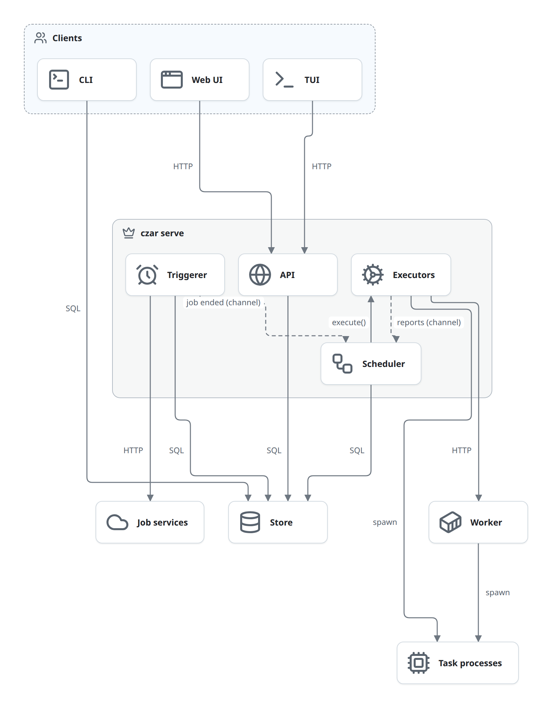
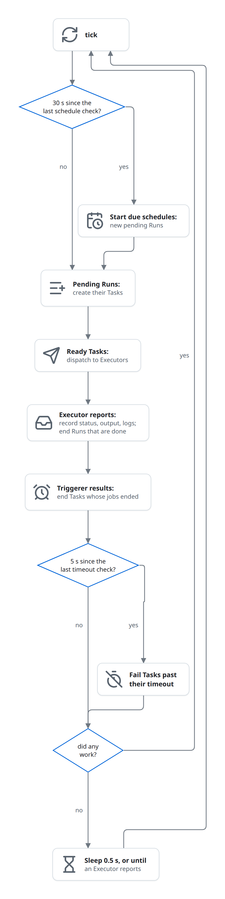

# Concepts

The ideas every part of czar relies on. Each one explains a behaviour you will meet in several flows; the flows link back here instead of explaining it again.

## The database is the only shared state

The processes never call each other. The CLI, the API and the Scheduler each read and write the Store, and that is how they cooperate:

- **Starting a Run is inserting a row.** `czar trigger` and `POST /api/runs` write a `pending` Run and return. The Scheduler sees it on its next tick.
- **Commands are writes.** Cancel, pause and resume change a status. Nothing signals a running process; see [control](flows/control.md).
- **Any process can stop and start again.** Everything that matters is in the Store, so a restarted server continues where it was, with one gap: work that was out with an Executor ([failures](flows/failures.md#restart-and-shutdown)).
- **The CLI needs the database, not the server.** It opens the Store directly, so it works without `czar serve` running, and it trusts whoever can reach the database.

**Why:** one source of truth makes every process restartable and lets the CLI work with no server running. The price is latency (a change waits for the next tick) and that every rule lives in code, not in the database.

The two dotted arrows are the exception: inside `czar serve`, Executors and the Triggerer report to the Scheduler over in-memory channels. Those reports are lost if the process dies before the Scheduler records them.

## One loop drives every Run

The Scheduler is a single loop. Each pass is a **tick**, and a tick does the same steps in the same order:

- A tick takes a few milliseconds when there is nothing to do. When idle, the loop sleeps 0.5 seconds, but an Executor report wakes it at once, so a fast task's dependents start right away.
- Schedules are checked every 30 seconds and timeouts every 5 seconds, not on every tick.
- At most 100 ready Tasks are picked per tick, and at most 10 are dispatched at the same time.
- The Triggerer is a second loop in the same process. It polls Deferred jobs every 10 seconds and hands results to the Scheduler.

**Why:** one loop in a fixed order means no two pieces of code race on the same Run, so the rules need no locks. The price is that a slow step (a Slack call, a Worker call) delays the whole tick; see [known issues](known-issues.md).

Everything that changes a Run happens in this loop, in this order. That is why the flows say "on the next tick": a Run started by the API waits for the next tick to get its Tasks.

## One Scheduler per database

Nothing locks a Task between "the Scheduler picked it" and "the Scheduler recorded it as dispatched". Two Schedulers on one database would both dispatch it. So:

- Run one `czar serve` (or `czar dev`) per database.
- `czar run FILE` starts its own Scheduler only if none picks up its Run within about a second.
- For more API capacity, run extra `czar-web` processes: they serve the API without a Scheduler.

## Reports, not writes

Executors start work and report what happens: `running`, log lines, progress, and a result. They never write to the Store. The Scheduler turns reports into statuses, and that is the only place the rules live: retries, output checks, upstream failures, Run completion. The Triggerer works the same way for Deferred jobs.

A report says what the work did; the Scheduler decides what it means for the Task.

**Why:** with one writer, the rules for retries and completion exist in one place, and an Executor can be written without knowing them. A `failed` report becomes `pending` again when retries are left.

## Versions are pinned

A Run reads its tasks from a [Snapshot](domain-model.md#snapshot), and Snapshots never change. Deploying a workflow while it runs creates a new Snapshot for the next Run; the running one carries on with its own. Snapshots are found by the hash of their content, so deploying an unchanged workflow creates nothing.

**Why:** a Run's graph, commands and settings must not change under it, and a finished Run must still show what it ran.

## Where work runs

An Executor decides where a Task's code runs; the Scheduler doesn't care. The choice comes from the Task's `executor` field, and for a Workflow synced from a Worker, every Task goes to that Worker:

| Where | Executors | Page |
|---|---|---|
| A child process of the server | `process`, `python`, `container`, custom executors | [execute-local](flows/execute-local.md) |
| Inside the server's process | `library` (a shared library), `wasm` | [execute-local](flows/execute-local.md) |
| A remote Worker over HTTP | any, when the Workflow came from a Worker | [execute-worker](flows/execute-worker.md) |
| A Cloud Run job | `cloudrun` | [execute-cloud-run](flows/execute-cloud-run.md) |
| A Job service the task started | any, by returning Deferred jobs | [deferred](flows/deferred.md) |

What a binary can do depends on its build: the default `czar-cli` has SQLite, Postgres, the local executors and the Worker executor. Cloud Run, the Google Cloud trackers and D1 are cargo features ([building blocks](building-blocks.md)).

## Task code talks through stdout

A task process gets its input in the `CZAR_INPUT_JSON` environment variable and answers on stdout: a line `CZAR_OUTPUT:<json>` is its result, `CZAR_PROGRESS:<json>` its progress, `CZAR_METRIC:<json>` a metric, and every other line is a log line. The SDKs wrap this; any program that prints those lines is a czar task. Library and Wasm tasks get the same JSON through memory instead. See [task SDKs](task-sdks.md).

## Where settings come from

Settings come from, in order: command-line flags, environment variables, the server config file (`czar serve --config`, for Workers and notifications), and the project's `czar.yaml` (for `env_file`, validation, custom executors and notifications). Each part reads the environment variables it needs where it uses them.

## Who may call

- **The API** listens on `127.0.0.1` by default and needs no login there. On any other address `czar serve` refuses to start until you choose `--auth token` (a shared token, used by the UI login and the TUI) or `--auth none` on purpose. Every request is also checked against cross-site and DNS-rebinding tricks.
- **Workers** check a bearer token of their own, which the server sends from its Worker registration.
- **The CLI** has no login: database access is the permission.

See [access](flows/access.md).

## What you can see

| What | Where it's kept | Where it shows |
|---|---|---|
| Task logs | `tasks.logs`, appended per tick | UI, TUI, `czar logs` |
| Task progress | `tasks.progress` | UI, TUI |
| Task output | `tasks.output`, and the last one in Task state | UI, downstream Tasks |
| Errors | `tasks.error`, `runs.error` | UI, TUI, `czar status` |
| Server logs | stderr of `czar serve` | the terminal or your log collector |
| Database timings | stderr, with `CZAR_DB_TRACE` set | the terminal |

The UI and TUI poll the API for changes ([observe](flows/observe.md)).
