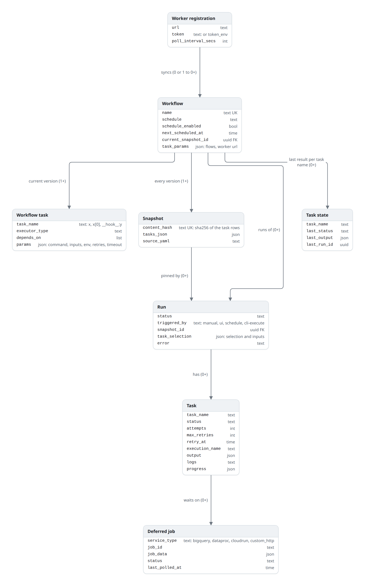
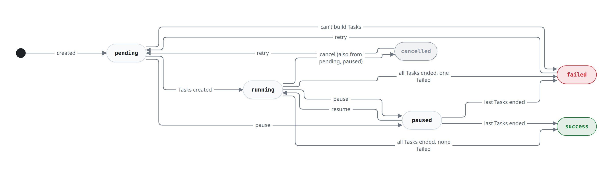
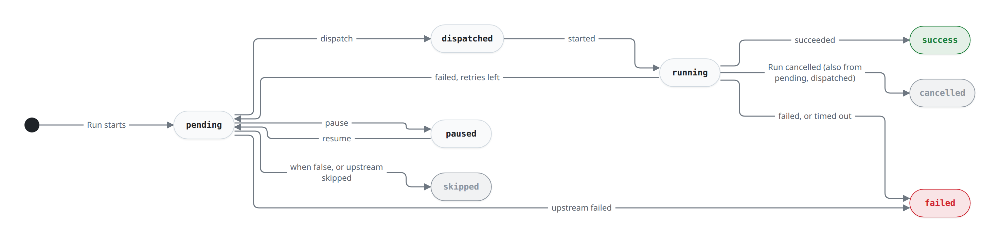
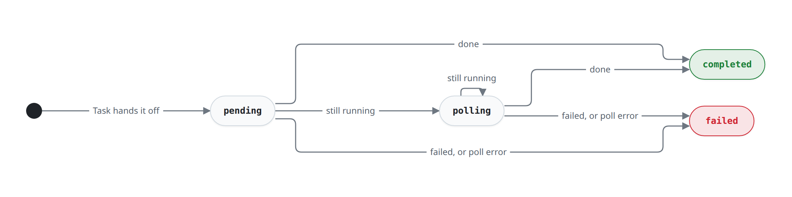

# Domain model

Everything czar knows is in a handful of entities, stored in the database. Every flow reads and writes these, and nothing else. This page defines them, says which building block may change each one, and shows their lifecycles.

## An example first

A workflow file `daily_etl.yaml` has three tasks: `extract`, `transform` (depends on `extract`) and `load` (depends on `transform`), and runs at 02:00.

1. `czar workflow deploy daily_etl.yaml` stores a **Workflow** named `daily_etl` with its schedule, three **Workflow tasks**, and **Snapshot** S1, a frozen copy of those three tasks. The Workflow points at S1 as its current version.
2. At 02:00 the Scheduler creates **Run** R1, pinned to S1, with status `pending`.
3. On its next tick the Scheduler creates three **Tasks** for R1, one per task in S1, all `pending`, and sets R1 to `running`.
4. `extract` has no dependencies, so it is ready: the Scheduler hands it to an Executor and it becomes `dispatched`, then `running`, then `success` with an output. The Scheduler also records it as `extract`'s latest **Task state**.
5. Someone edits the file and deploys again while R1 runs. That replaces the Workflow tasks and creates Snapshot S2. R1 doesn't notice: it is pinned to S1. The next Run uses S2.
6. `transform` starts a BigQuery query and returns it as a **Deferred job** instead of waiting. The Triggerer polls BigQuery until the query ends, then `transform` becomes `success`.
7. When `load` ends, every Task of R1 has ended, so the Scheduler sets R1 to `success`.

## Entities

### Workflow

A named workflow: what the user deploys and triggers. Table `workflows`, unique by `name`.

- **Holds:** the schedule (`schedule`, `schedule_enabled`, `next_scheduled_at`), the current Snapshot (`current_snapshot_id`), and `task_params`: the flows and task groups from the YAML, where the file came from, and the URL of the Worker it was synced from.
- **Created by:** the Compiler, the first time a workflow with that name is applied ([define](flows/define.md)).
- **Changed by:** the Compiler on every apply (new current Snapshot), schedule commands from the CLI and API, and the Scheduler when a schedule fires (`next_scheduled_at`).
- **Deleted by:** `czar delete-workflow`.

### Workflow task

One compiled task of the Workflow's **current** version. Table `workflow_tasks`, unique by Workflow and `task_name`.

- **Holds:** everything an Executor needs, already resolved: `executor_type`, `depends_on`, and `params` (command or file, input bindings, env, `when`, retries, timeout, output contract).
- **Names:** a task with a static `parallel: 3` is stored as three rows, `x[0]`, `x[1]`, `x[2]`. A hook is stored as a row named `__hook__:<name>` (see [Hook](#hook)).
- **Created by:** the Compiler, which replaces all of a Workflow's rows at once on every apply.
- **Read by:** the API and CLI, to build a flow's Snapshot and to draw the graph; the Scheduler only for Runs without a Snapshot (old data).

### Snapshot

An immutable copy of a Workflow's tasks: one version. Table `workflow_snapshots`, unique by Workflow and `content_hash` (the SHA-256 of the task rows).

- **Holds:** the task rows (`tasks_json`) and the expanded YAML (`source_yaml`), from which the API resolves flows and task groups.
- **Created by:** the Compiler on apply, and by the API and CLI when a Run is started for a flow (a Snapshot of that flow's tasks, with the flow's overrides; see [start](flows/start.md)). A selection of tasks doesn't make a Snapshot: it is stored on the Run and applied when the Scheduler creates the Tasks.
- **Reused:** applying an unchanged workflow finds the existing Snapshot by its hash and creates nothing.
- **Never changes.** This is what makes Runs repeatable: a Run reads its tasks from its Snapshot, not from the Workflow.

### Run

One execution of a Workflow, or of part of it. Table `runs`.

- **Holds:** `status`, `snapshot_id`, `triggered_by` (`manual`, `ui`, `schedule`, `cli-execute`), `task_selection` (which tasks, and the run inputs), `error`, and times.
- **Created by:** the CLI, the API, or the Scheduler for a schedule, always as `pending` ([start](flows/start.md)).
- **Changed by:** the Scheduler (it builds the Tasks and decides the result), and the User through the API or CLI (pause, resume, cancel, retry). See the [Run lifecycle](#run-lifecycle).

### Task

One task of one Run. Table `tasks`, one row per task name in the Run. This is what the UI shows as a box in a run's graph.

- **Holds:** `status`, `attempts` and `max_retries`, `retry_at`, `timeout_seconds`, `execution_name` (the Executor's handle on the work), `params` (copied from the Snapshot), `output`, `error`, `logs`, `progress`, and times.
- **Created by:** the Scheduler, all of a Run's Tasks at once, when it starts the Run. A task that fans out at run time (`parallel` or `foreach` from an upstream output) is replaced by `x[0]` … `x[n-1]` when it becomes ready.
- **Changed by:** the Scheduler. Executors and the Triggerer never write a Task; they report to the Scheduler, which writes. The exceptions are User commands (pause, resume, cancel, retry), which change the row directly. See the [Task lifecycle](#task-lifecycle).

### Deferred job

Outside work a Task waits on: a BigQuery query, a Dataproc job, a Cloud Run execution, or anything with an HTTP status endpoint. Table `deferred_jobs`.

- **Holds:** `service_type`, `job_id`, `job_data` (what the tracker needs to ask about it), `status`, `last_polled_at`.
- **Created by:** the Scheduler, when a Task's output lists deferred jobs ([deferred](flows/deferred.md)).
- **Changed by:** the Triggerer. See the [Deferred job lifecycle](#deferred-job-lifecycle).

### Task state

The last result of a Workflow task, across all Runs. Table `workflow_task_states`, one row per Workflow and task name.

- **Holds:** `last_status`, `last_output`, `last_error`, and the Run and Task it came from.
- **Changed by:** the Scheduler whenever a Task ends, and the API when it cancels a Run.
- **Used for:** a Run of only some tasks. If `load` runs alone, its input from `transform` comes from `transform`'s Task state. The UI also shows it per task.

### Worker registration

A remote Worker the server knows about: its URL, its token (or the environment variable holding it), and how often to sync. Not a table: it comes from the `workers:` list of the server config and `--workers-file`, and lives in memory in `czar serve`.

- The Workflow it syncs is stored like any other, with the Worker's URL in `task_params`. That URL is what sends the Workflow's Tasks to the Worker ([execute on a worker](flows/execute-worker.md)).

### Hook

A task run when something happens to a Run or a Task: `run.start`, `run.success`, `run.failed`, `task.start`, `task.success`, `task.failed`, `task.skipped`. Stored as a Workflow task row named `__hook__:<name>`, and in the Snapshot.

- Hooks fire from the Run's Snapshot. A flow's Snapshot holds no hooks, so Runs started for a flow (every Run started from the UI or TUI) fire none; see [known issues](known-issues.md).
- A hook has no Task row. The Scheduler starts it through a normal Executor in the background, and its result changes nothing ([schedule](flows/schedule.md#hooks-and-notifications)).

## Who changes what

Each entity has one owner that decides its lifecycle. Other blocks only make the changes listed.

| Entity | Created by | Changed by | Read by |
|---|---|---|---|
| Workflow | Compiler | Compiler; CLI and API (schedule); Scheduler (next schedule time) | everyone |
| Workflow task | Compiler | Compiler (replaces all) | API and CLI (graph, flow Snapshots), Scheduler (old Runs) |
| Snapshot | Compiler; API and CLI (flow Runs) | nobody | Scheduler, API |
| Run | CLI, API, Scheduler (schedule) | **Scheduler**; User via API and CLI | everyone |
| Task | Scheduler | **Scheduler**; User via API and CLI | everyone |
| Deferred job | Scheduler | **Triggerer** | Triggerer |
| Task state | Scheduler | Scheduler; API (cancel) | Scheduler, API |

The Store holds all of them and enforces none of these rules: they are kept by the code that writes. See [concepts.md](concepts.md#the-database-is-the-only-shared-state).

## Lifecycles

### Run lifecycle

| From | To | Caused by | Flow |
|---|---|---|---|
| (none) | `pending` | CLI, API, or the Scheduler for a schedule | [start](flows/start.md) |
| `pending` | `running` | Scheduler: it created the Run's Tasks | [schedule](flows/schedule.md) |
| `pending` | `failed` | Scheduler: it couldn't build the Tasks (no Snapshot, unknown tasks in the selection, nothing to run) | [schedule](flows/schedule.md) |
| `running` | `success` | Scheduler: every Task is `success` or `skipped` | [schedule](flows/schedule.md) |
| `running` | `failed` | Scheduler: every Task has ended and at least one `failed` | [schedule](flows/schedule.md) |
| `pending`, `running` | `paused` | User, through the API | [control](flows/control.md) |
| `paused` | `running` | User resumes, through the API (`pending` if it has no Tasks yet) | [control](flows/control.md) |
| `paused` | `success`, `failed` | Scheduler: Tasks that were already out finished the Run | [control](flows/control.md) |
| `pending`, `running`, `paused` | `cancelled` | User, through the API or CLI | [control](flows/control.md) |
| any | `pending` | User, `czar run retry`, for a Run with `failed` or `cancelled` Tasks (the Run's own status isn't checked) | [control](flows/control.md) |
| `cancelled` | `success`, `failed` | **Bug:** late reports from work that was still out complete the Run ([known issues](known-issues.md)) | [control](flows/control.md) |

A paused Run dispatches nothing new, but Tasks already out keep reporting. A cancelled Run stops nothing that is already running; see [known issues](known-issues.md).

### Task lifecycle

| From | To | Caused by | Flow |
|---|---|---|---|
| (none) | `pending` | Scheduler, when it starts the Run | [schedule](flows/schedule.md) |
| `pending` | `dispatched` | Scheduler: the Task was ready and an Executor accepted it | [schedule](flows/schedule.md), [execute](flows/execute.md) |
| `pending` | `skipped` | Scheduler: `when` is false, or a dependency was skipped | [schedule](flows/schedule.md) |
| `pending`, `paused` | `failed` | Scheduler: a dependency failed, or the dispatch failed with no retries left | [failures](flows/failures.md) |
| `pending` | `pending` | Scheduler: the dispatch failed and retries are left; `retry_at` is set | [failures](flows/failures.md) |
| `dispatched` | `running` | Executor reports that the work started | [execute](flows/execute.md) |
| `dispatched`, `running` | `success` | Executor reports success and the output matches the declared type | [execute](flows/execute.md) |
| `dispatched`, `running` | `pending` | Executor reports failure and retries are left; `retry_at` is set | [failures](flows/failures.md) |
| `dispatched`, `running` | `failed` | Executor reports failure with no retries left, or the Scheduler times it out | [failures](flows/failures.md) |
| `dispatched`, `running` | (stays) | Executor reports success with Deferred jobs; the Task ends when they do | [deferred](flows/deferred.md) |
| `pending` | `paused`, and back | User, through the API | [control](flows/control.md) |
| `pending`, `dispatched`, `running` | `cancelled` | User cancels the Run | [control](flows/control.md) |
| `failed`, `skipped`, `cancelled` | `pending` | User, `czar run retry` | [control](flows/control.md) |
| `cancelled` | any | **Bug:** a late report from work that was still out overwrites `cancelled` ([known issues](known-issues.md)) | [control](flows/control.md) |

A Task is **ready** when it is `pending`, its Run is `running`, its `retry_at` has passed, and every dependency has ended (`success`, `failed` or `skipped`). The Scheduler then decides between dispatch, skip and fail; see [schedule](flows/schedule.md).

### Deferred job lifecycle

| From | To | Caused by |
|---|---|---|
| (none) | `pending` | Scheduler: a Task's output listed the job |
| `pending`, `polling` | `polling` | Triggerer: the Job service says it is still running |
| `pending`, `polling` | `completed` | Triggerer: the Job service says it is done; the Scheduler then sets the Task to `success` |
| `pending`, `polling` | `failed` | Triggerer: the job failed or the poll errored; the Scheduler then sets the Task to `failed` |

## Rules that always hold

- **A Run never changes version.** Its Tasks come from its Snapshot, and Snapshots never change.
- **Only the Scheduler decides results.** Executors and the Triggerer report; the Scheduler writes Task and Run results. User commands are the only other writers.
- **A Task's dependencies are names, not ids.** `depends_on` lists task names within the same Run, so a Run's graph is the Snapshot's graph.
- **Finished is final,** except for `czar run retry`, which puts finished Tasks back to `pending` on purpose, and the bugs listed in [known issues](known-issues.md).

## In the code

- Entities: [models.rs](../../../crates/czar-core/src/models.rs) (`Workflow`, `WorkflowTask`, `Run`, `Task`, `DeferredJob`, the status enums). [types.rs](../../../crates/czar-core/src/types.rs) has a second `RunStatus` and `TaskStatus` used by the scheduler's in-memory types.
- Storage contract: the `Database` trait in [database.rs](../../../crates/czar-core/src/database.rs).
- Tables and columns: [schema.md](../schema.md) and the migrations of each backend; see [storage.md](storage.md).
