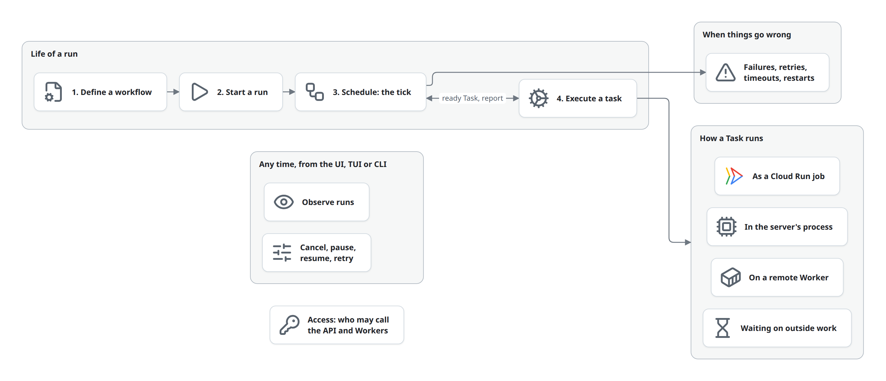

# Flows

A flow is something czar does, followed across the building blocks from start to end. All flows use the same [building blocks](../building-blocks.md) as participants and the same [entities](../domain-model.md), and each one moves those entities through their [lifecycles](../domain-model.md#lifecycles).

Start with the [life of a run](life-of-a-run.md): it walks one workflow from its YAML file to a finished Run, in five phases. Every other flow zooms into one of those phases, or happens beside them.

| Flow | Zooms into | Changes |
|---|---|---|
| [Life of a run](life-of-a-run.md) | (the whole) | everything below, in order |
| [1. Define a workflow](define.md) | Define | Workflow, Workflow tasks, Snapshot |
| [2. Start a run](start.md) | Start | Run → `pending`; Snapshot for a flow or selection |
| [3. Schedule: the tick](schedule.md) | Schedule and Finish | Run → `running` → `success` or `failed`; Tasks created, dispatched, ended; Task state |
| [4. Execute a task](execute.md) | Execute | Task → `dispatched` → `running` → reported result |
| ↳ [In the server's process](execute-local.md) | Execute | process, Python, container, custom, library and Wasm executors |
| ↳ [On a remote Worker](execute-worker.md) | Execute | the Worker executor and `czar-worker` |
| ↳ [As a Cloud Run job](execute-cloud-run.md) | Execute | the `cloudrun` executor |
| ↳ [Wait on outside work](deferred.md) | Execute | Deferred jobs; Task waits, then ends |
| [Failures, retries, timeouts, restarts](failures.md) | Schedule, Execute | Task → `pending` (retry) or `failed`; dependents `failed` |
| [Cancel, pause, resume, retry](control.md) | beside the run | Run and Task → `paused`, `cancelled`, back to `pending` |
| [Observe runs](observe.md) | beside the run | nothing: reads Runs, Tasks, logs |
| [Access](access.md) | in front of everything | nothing: decides who may call the API and Workers |

Every flow page has the same parts: at a glance, the diagram, the state changes it makes, its rules, failure and edge cases, the code, and related flows. See [writing.md](../writing.md).
