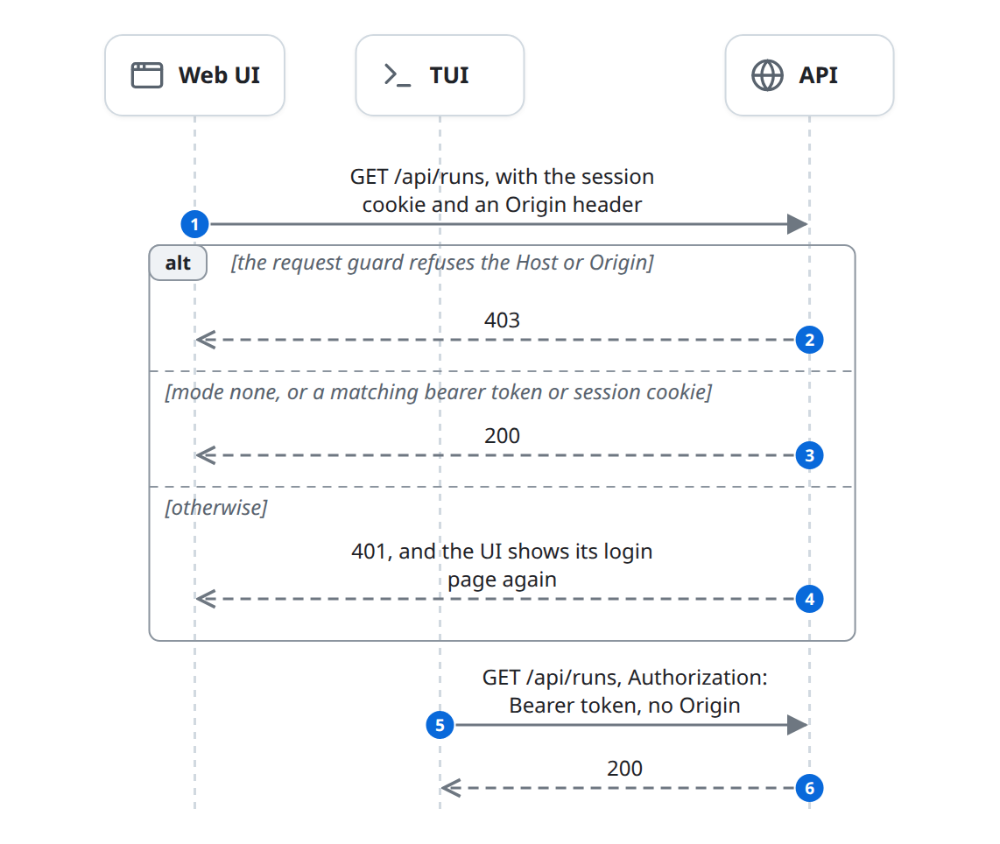
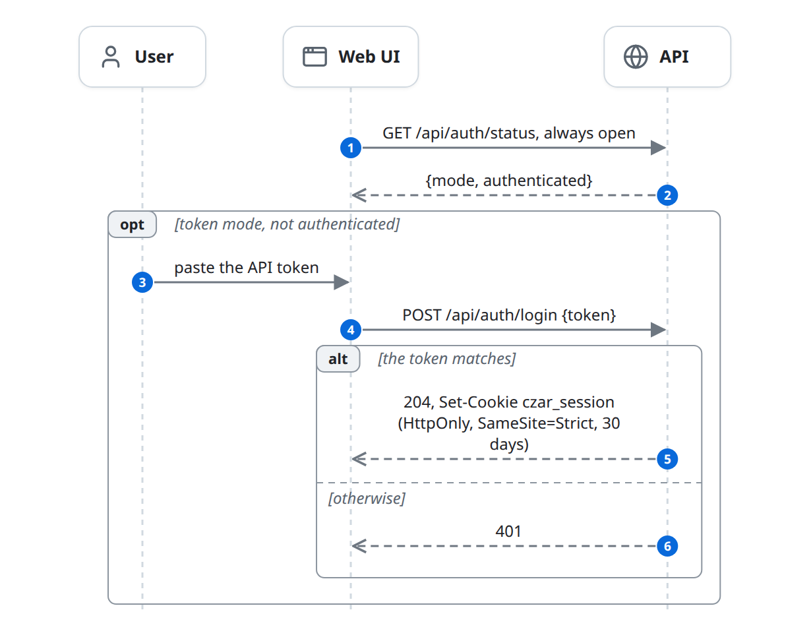
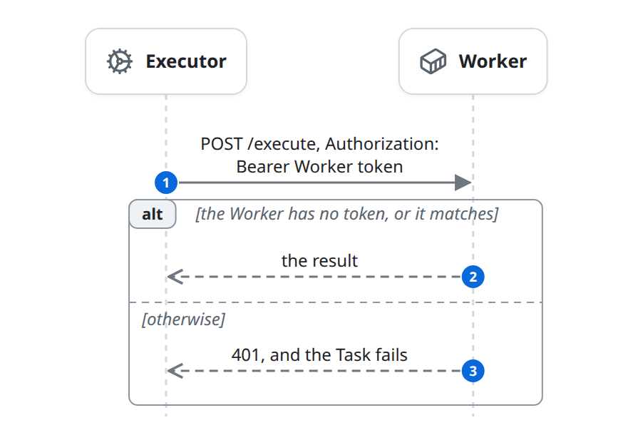
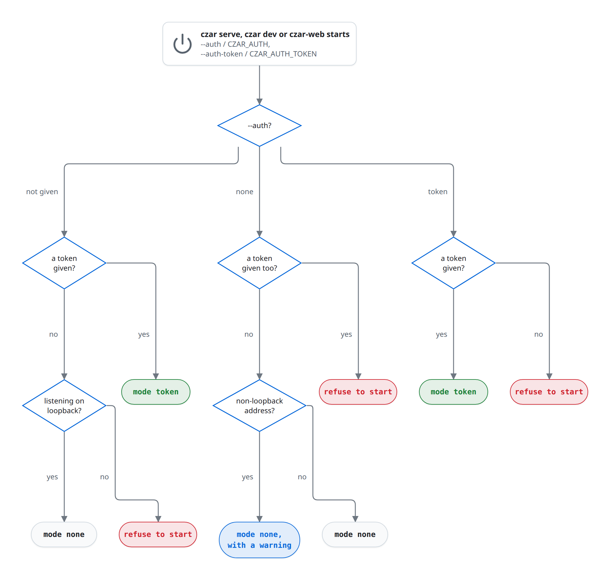

# Access

Three things call into czar over the network: browsers and the TUI call the API, and the Executor calls Workers. The API checks every `/api` and `/ws` request twice: a request guard that blocks cross-site and DNS-rebinding requests, then an auth check that is either off (`--auth none`) or a shared token (`--auth token`). Workers check their own bearer token. The CLI skips all of this: it talks to the Store, so Store credentials are full access. This flow sits in front of everything in the [life of a run](life-of-a-run.md); it ends with a request let through or refused.

## At a glance

| | |
|---|---|
| Starts | Any request to `/api`, `/ws` or a Worker; and server startup, which fixes the auth mode |
| Blocks | User, Web UI, TUI, API, Executor, Worker |
| Reads and writes | [Worker registration](../domain-model.md#worker-registration) (the Worker token); no entity is written |
| Ends | The request reaches its handler, or gets 401 or 403 |

## The diagram

Every `/api` and `/ws` request passes two checks, in this order: the request guard, then the auth check for the mode chosen at startup ([the auth mode](#the-auth-mode)). Browsers carry a session cookie and an `Origin`; the TUI carries a bearer token and no `Origin`.

### Web UI login

In `token` mode the Web UI trades the token for a session cookie once, through the always-open `/api/auth/*` routes ([the auth check](#the-auth-check)).

### Worker token

The Executor sends the Worker token with every call to a Worker ([Worker tokens](#worker-tokens)).

## State changes

| Entity | From | To | Caused by |
|---|---|---|---|
| (none) | | | This flow only decides who may call. The browser's session cookie is not stored by czar: it is a hash of the token. |

## Rules

### The auth mode

The API's modes are `none` and `token`, from `--auth` (`CZAR_AUTH`) and `--auth-token` (`CZAR_AUTH_TOKEN`), shared by `czar serve`, `czar dev` and `czar-web`:

### The request guard

It runs before the auth check, on `/api` and `/ws`. The Web UI's files (`/assets`, `/config.js`, the page fallback) are served without either check; they hold no workflow or Run data. The guard answers 403 when:

- the server listens only on loopback and the `Host` header names anything but `localhost`, a loopback IP, or the host of an allowed origin (DNS rebinding);
- an `Origin` header is present and is not loopback, not the same host and port as `Host`, and not in `--allowed-origin` (cross-site requests). An `Origin` that is not a URL, such as `null` from a sandboxed page, is refused. A loopback origin is always accepted, even on a public address.

Requests without `Origin` (the CLI's tools, the TUI, curl) pass the origin check. `--allowed-origin` exists on `czar serve` only, and accepts only `http(s)://host[:port]`.

### The auth check

- `/api/auth/*` is always open: `GET /api/auth/status` returns the mode and whether this request passes; `POST /api/auth/login` trades the token for a session cookie; `POST /api/auth/logout` clears it.
- In `token` mode a request passes with `Authorization: Bearer <token>` or the `czar_session` cookie. Comparisons are constant-time. A miss is 401 with `WWW-Authenticate: Bearer`.
- The cookie is HttpOnly, `SameSite=Strict`, 30 days, and `Secure` when the request came over HTTPS (`Origin: https://...` or `X-Forwarded-Proto: https`). It holds a SHA-256 of the token, so changing the token logs every browser out.

### Clients

- **Web UI.** It asks `GET /api/auth/status`; in `token` mode without a session it shows a login form. Any later 401 brings the form back.
- **TUI.** `czar-tui --auth-token` (or `CZAR_AUTH_TOKEN`) is sent as a bearer token on every request.
- **CLI.** No API, no token: it opens the Store with `DATABASE_URL` or the D1 credentials.

### Worker tokens

A Worker started with `--auth-token` (`CZAR_WORKER_AUTH_TOKEN`) requires `Authorization: Bearer <token>` on `/compile` and `/execute`; `/health` stays open. The Executor sends the token of the [Worker registration](../domain-model.md#worker-registration) whose URL is stamped on the Workflow ([execute-worker.md](execute-worker.md#rules)). A Worker without a token on a non-loopback address logs a warning and runs anything it is sent.

## Failure and edge cases

- **`--auth none` on a public address is remote code execution.** Anyone who can reach the port can `POST /api/workflows` with a `process` task and start it. The guard only stops other web pages, not other callers.
- **One token for everything:** no users, no roles, no read-only access.
- **`/ws` uses the same checks,** so a browser needs the session cookie.
- **Reverse proxies.** Add the public URL with `--allowed-origin` when the proxy rewrites `Host`, or when czar listens on loopback and the proxy passes the public `Host` through.
- **Hosted setups add their own gate:** the Cloudflare deployment puts HTTP Basic auth in front of the container ([building-blocks.md](../building-blocks.md#deployments)).
- Known issues: [the standalone API has no allowed-origin option](../known-issues.md#the-standalone-api-has-no-allowed-origin-option); [registering a Worker over the API sends no token](../known-issues.md#registering-a-worker-over-the-api-sends-no-token); [the Cloudflare container has no auth mode](../known-issues.md#the-cloudflare-container-has-no-auth-mode).

## In the code

1. Startup: [auth.rs](../../../../crates/czar-web/src/auth.rs) (`AuthArgs::resolve`), used by [serve.rs](../../../../crates/czar-cli/src/commands/serve.rs) and [czar-web main.rs](../../../../crates/czar-web/src/main.rs).
2. Layers: [api.rs](../../../../crates/czar-web/src/api.rs) (`build_router_with_ui_bundle`, `listening_on`).
3. Guard: [request_guard.rs](../../../../crates/czar-web/src/request_guard.rs) (`RequestGuard::check`, `parse_allowed_origin`).
4. Auth: [auth.rs](../../../../crates/czar-web/src/auth.rs) (`enforce`, `ApiAuth::allows`, `login`, `logout`, `status`).
5. Clients: [AuthGate.tsx](../../../../crates/czar-web-react/src/components/AuthGate.tsx), [czar-tui api.rs](../../../../crates/czar-tui/src/api.rs) (`with_token`).
6. Workers: [czar-worker auth.rs](../../../../crates/czar-worker/src/auth.rs) (`require_bearer_token`), [routes.rs](../../../../crates/czar-worker/src/routes.rs), [worker_client.rs](../../../../crates/czar-core/src/worker_client.rs) (`with_token`).

## Related

- In front of: [life-of-a-run.md](life-of-a-run.md), [observe.md](observe.md), [control.md](control.md), [execute-worker.md](execute-worker.md).
- User guide: [deployment/api-auth.md](../../../deployment/api-auth.md); reporting: [SECURITY.md](../../../../SECURITY.md).
