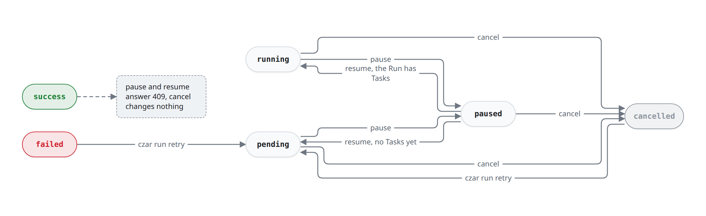
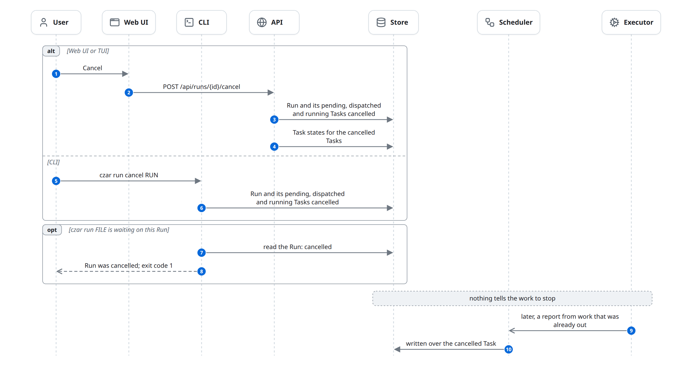
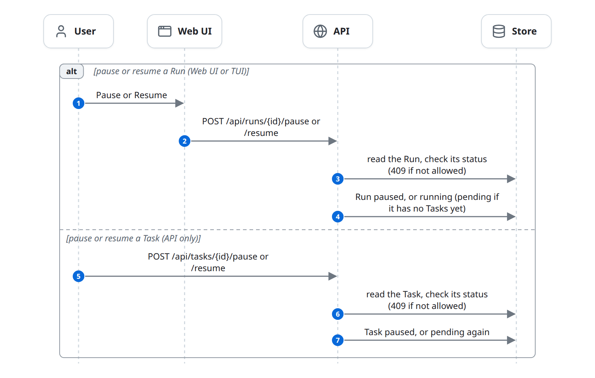
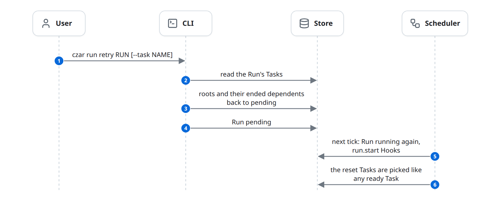

# Cancel, pause, resume and retry

A User can step into a Run at any time: cancel it, pause and resume it, pause and resume one of its Tasks, or retry the parts that failed. Each command is a status write by the API or the CLI; nothing calls the Scheduler or the Executors. The flow ends with the rows changed, and the Scheduler acts on them at its next tick. It happens beside the [life of a run](life-of-a-run.md).

## At a glance

| | |
|---|---|
| Starts | A User: Cancel, Pause or Resume in the Web UI or TUI; `czar run cancel`; `czar run retry`; `POST /api/tasks/{id}/pause` or `/resume` |
| Blocks | User, Web UI, TUI, CLI, API, Store, Scheduler, Executor |
| Reads and writes | [Run](../domain-model.md#run), [Task](../domain-model.md#task), [Task state](../domain-model.md#task-state) |
| Ends | The rows changed; the next tick picks the change up |

## The diagram

Each command moves a Run between statuses. This is the overview: which Run statuses each command accepts and where it takes the Run.

### Cancel

The API or the CLI marks the Run and its unfinished Tasks `cancelled`. Nothing stops the work, so a late report can overwrite a cancelled Task ([known-issues.md](../known-issues.md#late-results-overwrite-cancelled-tasks)).

### Pause and resume

The API checks the status first and answers 409 when the command doesn't fit it. A paused Run's Tasks are not picked as ready, but Tasks already out keep running and reporting.

### Retry

Only the CLI can retry. The roots are the `failed` and `cancelled` Tasks (or the one named with `--task`); their `failed`, `skipped` and `cancelled` dependents are reset too ([rules](#what-each-command-accepts)).

## State changes

| Entity | From | To | Caused by |
|---|---|---|---|
| Run | `pending`, `running`, `paused` | `cancelled` | User: API cancel, or `czar run cancel` |
| Task | `pending`, `dispatched`, `running` | `cancelled` | the same cancel, for every such Task of the Run |
| Task state | any | `cancelled` | API cancel only |
| Run | `pending`, `running` | `paused` | User: API pause |
| Run | `paused` | `running`, or `pending` if it has no Tasks yet | User: API resume |
| Run | `paused` | `success`, `failed` | Scheduler: Tasks already out ended the Run ([schedule.md](schedule.md#runs-complete)) |
| Task | `pending` | `paused` | User: `POST /api/tasks/{id}/pause` |
| Task | `paused` | `pending` | User: `POST /api/tasks/{id}/resume` |
| Task | `failed`, `cancelled`, and dependents that are `failed`, `skipped` or `cancelled` | `pending`, `attempts` + 1 | User: `czar run retry` |
| Run | any | `pending` | User: `czar run retry` |
| Run | `pending` | `running` | Scheduler, next tick after a retry ([schedule.md](schedule.md)) |

## Rules

### Who can send what

| Command | Web UI | TUI | CLI | API route |
|---|---|---|---|---|
| Cancel a Run | yes | yes | `czar run cancel RUN` | `POST /api/runs/{id}/cancel` |
| Pause or resume a Run | yes | yes | no | `POST /api/runs/{id}/pause`, `/resume` |
| Pause or resume a Task | no | no | no | `POST /api/tasks/{id}/pause`, `/resume` |
| Retry a Run | no | no | `czar run retry RUN [--task NAME]` | none |

### What each command accepts

- **Cancel** works on any Run; a finished Run is left as it is and the answer is still 200. `paused` Tasks are not cancelled. The API also records the cancelled Tasks as Task states; the CLI does not.
- **Pause a Run** answers 409 for a finished Run and 200 for one already paused. A paused Run's Tasks are not picked as ready; Tasks already out keep running and reporting.
- **Resume a Run** answers 409 unless the Run is `paused`.
- **Pause a Task** only accepts a `pending` Task (409 for `dispatched` or `running`); resume only a `paused` one.
- **Retry** takes as roots every `failed` and `cancelled` Task (or the one named with `--task`, which must be `failed` or `cancelled`), adds their `failed`, `skipped` and `cancelled` dependents, and resets each to `pending` without a delay. It then sets the Run to `pending` whatever its status. The next tick treats it like a new Run: existing Tasks are kept, the Run becomes `running`, and `run.start` Hooks fire again.
- The API checks the status, then writes; the two steps are not one statement. A 200 means the rows were written, not that any work stopped.

## Failure and edge cases

- **Nothing is stopped.** Processes, Worker calls, Cloud Run executions and Deferred jobs carry on after a cancel ([known-issues.md](../known-issues.md#cancel-and-timeouts-do-not-stop-work)).
- **Late results change cancelled Tasks,** and can then complete the cancelled Run as `success` or `failed` ([known-issues.md](../known-issues.md#late-results-overwrite-cancelled-tasks)).
- **A paused Task keeps its Run open:** the Run cannot complete until the Task is resumed, or fails because a dependency failed.
- **The WebSocket** announces these commands, but no client listens ([observe.md](observe.md)).
- **`czar run FILE` waiting on a Run that gets cancelled** prints "Run was cancelled", leaves the Run `cancelled` and exits non-zero.

## In the code

1. API: [api_routes_control.rs](../../../../crates/czar-web/src/api_routes/api_routes_control.rs) (`cancel_run`, `pause_run`, `resume_run`, `pause_task`, `resume_task`).
2. CLI: [run.rs](../../../../crates/czar-cli/src/commands/run.rs) (`RunCancel`, `RunRetry`, `build_reverse_dependencies`).
3. Store: `cancel_run`, `update_run_status`, `update_task_status`, `reset_task_for_retry` (for example [czar-store-postgres runs.rs](../../../../crates/czar-store-postgres/src/runs.rs) and [tasks.rs](../../../../crates/czar-store-postgres/src/tasks.rs)).
4. Clients: [czar-web-react api/index.ts](../../../../crates/czar-web-react/src/api/index.ts) (`cancelRun`, `pauseRun`, `resumeRun`), [czar-tui app/worker.rs](../../../../crates/czar-tui/src/app/worker.rs).

## Related

- Beside: [life-of-a-run.md](life-of-a-run.md).
- Affects: [schedule.md](schedule.md) (what the tick picks), [failures.md](failures.md).
- Neighbours: [observe.md](observe.md), [access.md](access.md).
