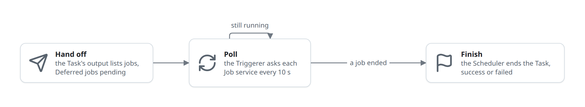
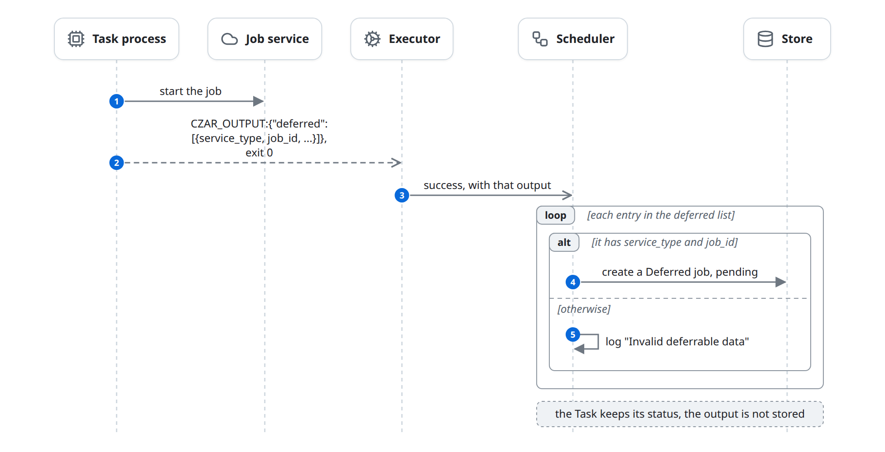
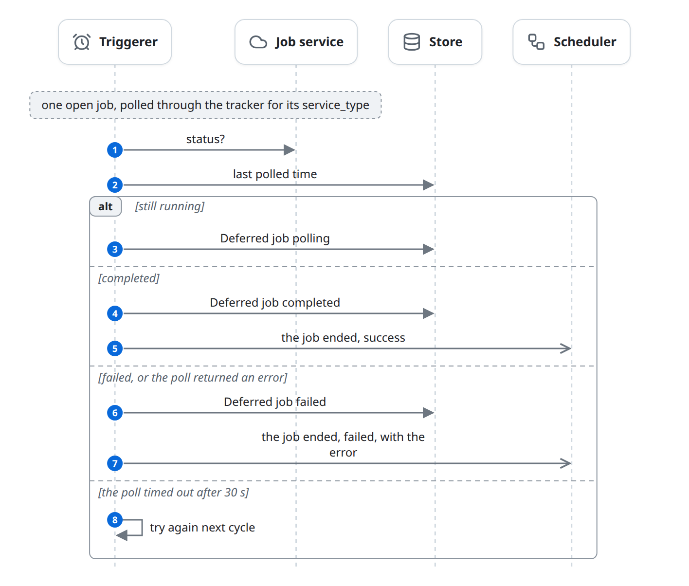
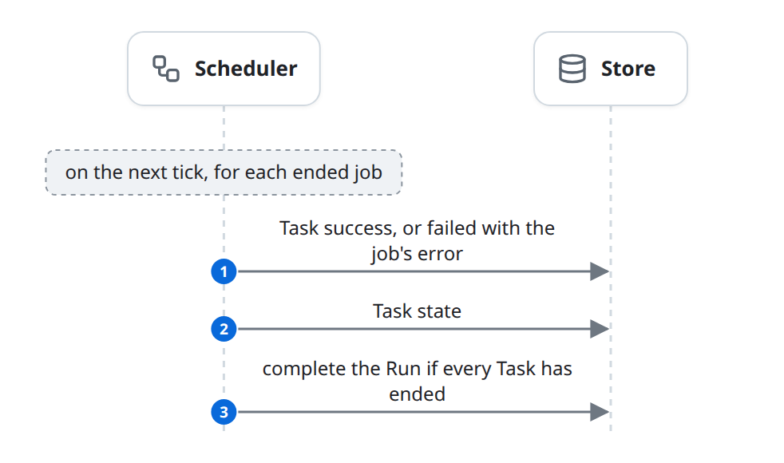

# Wait on outside work

Some task code only starts work somewhere else: a BigQuery query, a Dataproc job, a Cloud Run job, or anything with an HTTP status endpoint. Instead of waiting, it returns a list of jobs and exits. The Scheduler stores one Deferred job per entry, the Triggerer polls the Job service until each ends, and the Scheduler then finishes the Task. This happens inside phase 4 of the [life of a run](life-of-a-run.md), in place of the usual `success`.

## At a glance

| | |
|---|---|
| Starts | An Executor reports `success` with a `deferred` list in the output |
| Blocks | Task process, Job service, Executor, Scheduler, Triggerer, Store |
| Reads and writes | [Deferred job](../domain-model.md#deferred-job), [Task](../domain-model.md#task), [Task state](../domain-model.md#task-state) |
| Ends | The Task is `success` or `failed` |

## The diagram

A Deferred job goes through three steps: the Task hands it off, the Triggerer polls it, and the Scheduler ends the Task when it is done.

### Hand off

The Task process starts the job, then exits with the job in its output. The Scheduler stores one Deferred job per valid entry ([rules](#handing-off)).

### Poll

Every 10 seconds the Triggerer takes the 100 oldest open Deferred jobs and polls them in parallel, each with a 30-second timeout. This is one poll of one job ([rules](#polling)). A job whose `service_type` has no tracker is never polled ([known-issues.md](../known-issues.md#deferred-jobs-with-an-unknown-service-type-poll-forever)).

### Finish

The Scheduler ends the Task on its next tick ([rules](#finishing)).

## State changes

| Entity | From | To | Caused by |
|---|---|---|---|
| Deferred job | (none) | `pending` | Scheduler: an entry of the `deferred` list with `service_type` and `job_id` |
| Task | `dispatched`, `running` | (stays) | Scheduler: the `success` report carried a `deferred` list |
| Deferred job | `pending`, `polling` | `polling` | Triggerer: the Job service says it is still running |
| Deferred job | `pending`, `polling` | `completed` | Triggerer: the Job service says it is done |
| Deferred job | `pending`, `polling` | `failed` | Triggerer: the job failed, or the poll returned an error |
| Task | `dispatched`, `running` | `success` | Scheduler, on a `completed` job |
| Task | `dispatched`, `running` | `failed` | Scheduler, on a `failed` job; no retries |
| Task state | any | the Task's status | Scheduler, when it finishes the Task |

## Rules

### Handing off

- The output's `deferred` list holds one object per job. Each needs `service_type` (which tracker polls it) and `job_id`; the whole object is kept as the job's data for the tracker. Any Executor can hand off, including a Worker, which passes `deferred` back.
- The SDKs build these entries ([task-sdks.md](../task-sdks.md#deferrables)).
- The `success` report that carries the list changes nothing else: the Task keeps its status, and no output, Task state or Hook is recorded for it.

### Polling

- The Triggerer is a background loop in the Scheduler's process, started unless `ENABLE_TRIGGERER=false`. Every 10 seconds it loads the open Deferred jobs (`pending` or `polling`), oldest first, takes the first 100, and polls them in parallel, each with a 30-second timeout. A new job waits up to one cycle for its first poll.
- Trackers by `service_type`:

  | `service_type` | Needs | Notes |
  |---|---|---|
  | `custom_http` | `url`; optional `method` (GET, POST, PUT, DELETE), `headers`, `status_field` (default `status`), `success_value` (default `success`), `failure_value` | Reads the JSON field and compares it; any other value means still running. A non-2xx answer fails the job; a body that is not JSON is a poll error. `mock://success...` and `mock://failed...` answer without a request, for tests. Always registered. |
  | `bigquery` | `project`, `location`, `job_id` | Only in builds with the `gcp` feature. Token from application default credentials, or `CZAR_BIGQUERY_ACCESS_TOKEN`. |
  | `dataproc` | `project`, `region`, `job_id` | Same, with `CZAR_DATAPROC_ACCESS_TOKEN`. |
  | `cloudrun` | `project`, `region`, `job_name`, `execution_id` | Same, with `CZAR_CLOUDRUN_ACCESS_TOKEN`. |

### Finishing

- On the next tick the Scheduler sets the Task `success` or `failed` (with the job's error), updates its Task state, and completes the Run if every Task has ended ([schedule.md](schedule.md#runs-complete)).
- Each job's end sets the Task's status on its own. A Task with several jobs ends with the first that finishes; a later one can still change the status.
- A failed job fails the Task without retries and without `task.failed` Hooks. Downstream Tasks fail when they are next picked and see the failed dependency.

## Failure and edge cases

- **Timeouts still count.** The Task stays `running` (or `dispatched`) while it waits, so the Scheduler fails it after `timeout` seconds (default 300). Set `timeout` above the job's run time.
- **Cancel does not stop jobs.** Cancelling the Run leaves the Deferred jobs open; a later completion overwrites the Task's `cancelled` status ([control.md](control.md)).
- **More than 100 open jobs:** newer jobs wait until older ones end.
- **One Triggerer per Store.** Each Scheduler process starts its own; two would poll and finish the same jobs twice.
- **Restarts are safe for polling:** the jobs are in the Store.
- Known issues: [deferred Tasks keep no output](../known-issues.md#deferred-tasks-keep-no-output); [Deferred jobs with an unknown service type poll forever](../known-issues.md#deferred-jobs-with-an-unknown-service-type-poll-forever); [Rust SDK deferrables are rejected](../known-issues.md#rust-sdk-deferrables-are-rejected); [Python tasks cannot return a Deferrable object](../known-issues.md#python-tasks-cannot-return-a-deferrable-object).

## In the code

1. Recording the hand-off: [scheduler/status_processing.rs](../../../../crates/czar-core/src/scheduler/status_processing.rs) (`process_status_updates`, the `deferred` branch).
2. Starting the Triggerer: [scheduler.rs](../../../../crates/czar-core/src/scheduler.rs) (`start_triggerer`, `with_job_trackers`), [cloud.rs](../../../../crates/czar-cli/src/commands/cloud.rs) (`job_trackers`).
3. Polling: [triggerer.rs](../../../../crates/czar-core/src/triggerer.rs) (`Triggerer::poll_cycle`, `poll_job`, `TriggererConfig`), [job_tracker.rs](../../../../crates/czar-core/src/job_tracker.rs) (`JobTracker`, `CustomHttpTracker`), [czar-gcp job_tracker/](../../../../crates/czar-gcp/src/job_tracker/).
4. Finishing: [scheduler/status_processing_completion.rs](../../../../crates/czar-core/src/scheduler/status_processing_completion.rs) (`process_job_completions`, `check_run_completion`).
5. Store: `create_deferred_job`, `get_pending_deferred_jobs`, `complete_deferred_job`, `fail_deferred_job` (for example [czar-store-postgres deferred_jobs.rs](../../../../crates/czar-store-postgres/src/deferred_jobs.rs)).

## Related

- Parent: [execute.md](execute.md).
- Beside: [execute-cloud-run.md](execute-cloud-run.md) (the Cloud Run executor, tracked in memory instead), [failures.md](failures.md), [task-sdks.md](../task-sdks.md#deferrables).
