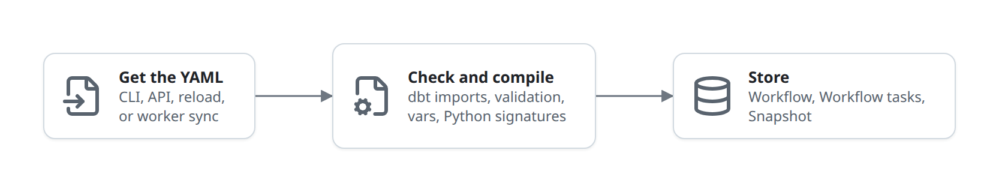
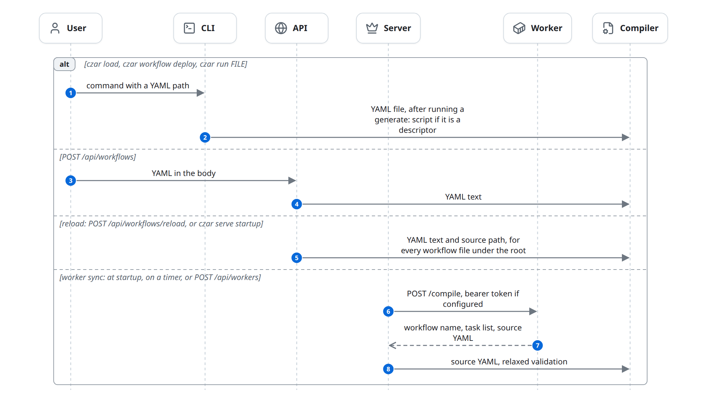
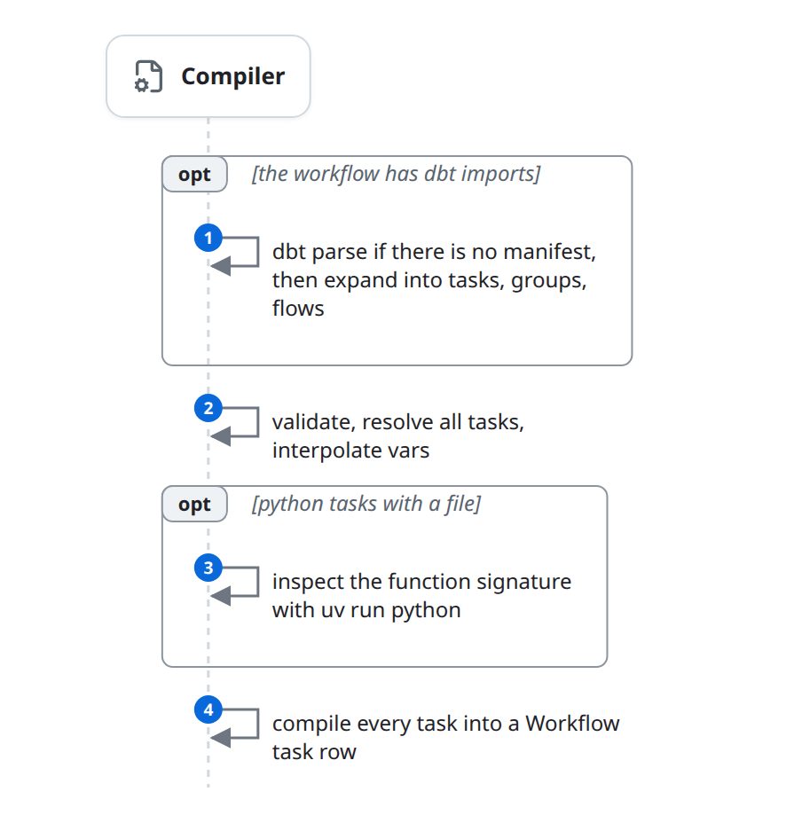
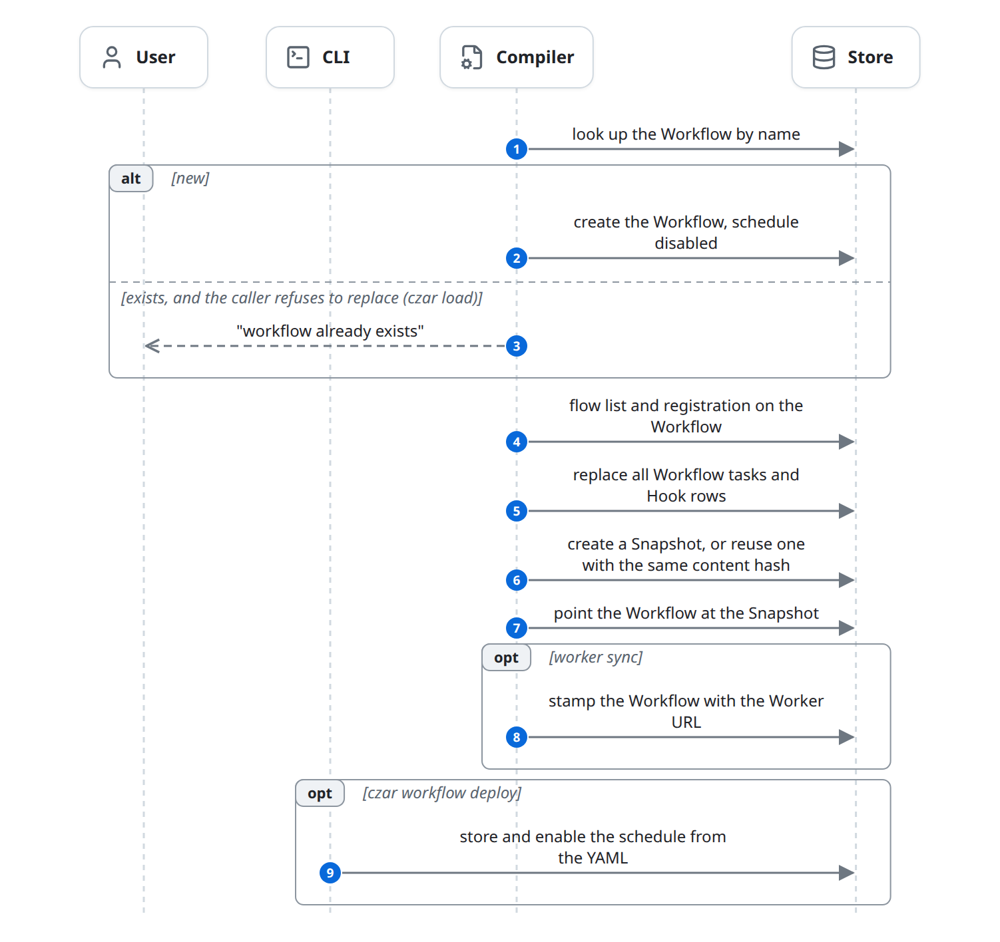

# Define a workflow

A user hands czar workflow YAML: with the CLI, through the API, by reloading a definitions directory, or by registering a Worker that carries its own workflow. The Compiler checks and compiles it, and the flow ends with a Workflow, its Workflow tasks and a Snapshot in the Store. Nothing runs yet: this is what every Run in the [life of a run](life-of-a-run.md) starts from.

## At a glance

| | |
|---|---|
| Starts | A User: `czar load`, `czar workflow deploy`, `czar run FILE`, `POST /api/workflows`, `POST /api/workflows/reload`; `czar serve` at startup (reload and worker sync); `POST /api/workers` |
| Blocks | User, CLI, API, Server, Worker, Compiler, Store |
| Reads and writes | [Workflow](../domain-model.md#workflow), [Workflow task](../domain-model.md#workflow-task), [Hook](../domain-model.md#hook), [Snapshot](../domain-model.md#snapshot), [Worker registration](../domain-model.md#worker-registration) (read) |
| Ends | The Workflow points at a Snapshot that holds every Workflow task and Hook |

## The diagram

Applying a workflow has three steps, whatever starts it. Each box has its own diagram below.



### Get the YAML

Four entry points hand the Compiler YAML text. The reload reads every workflow file under the definitions root; worker sync asks the Worker for its workflow ([rules](#loading-the-yaml)).



### Check and compile

The Compiler runs in the process that got the YAML. It may start helper processes: `dbt parse`, and `uv run python` to read Python signatures ([dbt imports](#dbt-imports), [validation](#validation), [compiling](#compiling)).



### Store

The result replaces the Workflow's tasks and gives it a current Snapshot. An existing Workflow keeps its row; only `czar load` refuses to replace one ([which entry point does what](#which-entry-point-does-what)).



## State changes

Workflows, Workflow tasks and Snapshots have no status. This flow creates and replaces them.

| Entity | From | To | Caused by |
|---|---|---|---|
| Workflow | none | created, schedule disabled | Compiler, first apply of a name |
| Workflow | existing | same row; new flow list, registration and current Snapshot | Compiler, any later apply (except `czar load`, which refuses) |
| Workflow | schedule disabled | schedule stored and enabled when the YAML has one | CLI, `czar workflow deploy` |
| Workflow | no Worker stamp | stamped with the Worker URL | Compiler, worker sync |
| Workflow task, Hook | previous rows | new rows, replaced as a whole | Compiler, every apply |
| Snapshot | none | created, or an identical one reused | Compiler, every apply |

## Rules

### Which entry point does what

| Entry point | If the Workflow exists | Schedule | Validation |
|---|---|---|---|
| `czar load FILE` | Refuses | Not stored | From the project `czar.yaml` |
| `czar workflow deploy FILE` | Replaces | Stored on create, then written and enabled | From the project `czar.yaml` |
| `czar run FILE` | Replaces; applies `--var` overrides; then starts a Run ([start.md](start.md)) | Not stored | From the project `czar.yaml` |
| `POST /api/workflows` | Replaces unless `replace: false` (then 409) | Stored on create, disabled | Strict |
| Reload, and the startup bootstrap when `CZAR_BOOTSTRAP_WORKFLOW_DEFINITIONS` is set | Replaces | Stored on create, disabled | Strict |
| Worker sync | Replaces, then stamps the Worker URL | Not stored | Relaxed |

An existing Workflow keeps its stored schedule: only `czar workflow deploy` and `PATCH /api/workflows/{name}/schedule` change the cron expression ([known-issues.md](../known-issues.md#replacing-a-workflow-does-not-update-its-schedule)). How schedules fire is in [start.md](start.md#rules).

### Loading the YAML

- Only `.yaml` and `.yml` files.
- A file whose only top-level key is `generate` stands for a script that writes the real workflow:

  ```yaml
  generate:
    kind: python        # or native: an executable
    script: gen.py      # relative to the descriptor
    args: [--env, prod] # strings, numbers or booleans
    output: out.yaml    # default: <stem>.generated.yaml next to the descriptor
    refresh: false      # true: run the generator on every load
  ```

  The script is called as `<script> --output <path> <args...>`. A `python` generator runs with `uv run python` in the nearest directory above it with a `pyproject.toml`; a `native` one runs in its own directory. An existing output file is reused unless `refresh: true`. An empty output, or another key next to `generate`, is an error.
- Reload walks the definitions root (`--workflows-dir`, else `CZAR_WORKFLOW_DEFINITIONS_DIR`, else the current directory). It skips `docs/`, `profiles/` and `workflow-schema-reference/` directories, hidden files, `czar.yaml`, `dbt_project.yml` and `profiles.yml`, and files without a concrete `name` and `tasks` (snippets). Each Workflow it stores records the root and its source file.
- Worker sync gets the YAML from the Worker's `/compile` ([execute-worker.md](execute-worker.md#rules)). `czar serve` syncs every configured Worker registration at startup, then every `poll_interval_secs` when set; `POST /api/workers` syncs one on demand.

### dbt imports

`imports: [{dbt: <project dir>}]` turns a dbt project into ordinary Workflow tasks.

- **Nodes.** Models, tests, seeds and snapshots from `target/manifest.json`, each switchable with `include_models`, `include_tests`, `include_seeds`, `include_snapshots` (all default true). Ephemeral models are left out. If the manifest is missing, `dbt parse` runs once; an existing manifest is never refreshed.
- **Selection.** `select` and `models` (merged) match a node's dotted path without the project name (`staging.stg_orders`), its file path without extension, its name, or its unique id. `*` is a wildcard, and `path:a/b` is matched as `a.b`. No selectors means every node.
- **Names.** `dbt.<label>.<path>` for models (for example `dbt.analytics.staging.stg_orders`), `dbt.<label>.seed.<path>`, `dbt.<label>.snapshot.<path>`, `dbt.<label>.test.<name>`. The label is the import's `label`, else the dbt project name, else the directory name.
- **Dependencies.** A task depends on the imported tasks its dbt node depends on directly. A task with none gets the import's `depends_on`. Dependencies on nodes that were not imported are dropped, not followed further up.
- **Groups and flows.** Each import adds `dbt.<label>.all`, `dbt.<label>.resource.<models|tests|seeds|snapshots>`, and one group per folder level (`dbt.<label>.path.staging`, `dbt.<label>.seed_path...`). Every group is also a flow.
- **Overrides.** A YAML task with an imported task's name may only change `depends_on`, `timeout`, `retries`, `retry_delay`, `on_failure` and `when`.
- **Execution.** Each imported task is a `python` task that calls `czar.dbt.run_node` from the Python SDK, with the project, profile, target, `threads` and selector as constant inputs.

### Flows and task groups

`task_groups` name lists of tasks. A flow (`flows.<name>.tasks`) is `"*"`, a list of task names, or a map whose entries may override `inputs`, `env`, `timeout`, `retries`, `retry_delay` and `on_failure`. A flow cannot change `depends_on`, and always includes the dependencies of its tasks. Applying stores every task; a flow is resolved when a Run starts ([start.md](start.md#rules)).

### Validation

The definition is checked, then the resolved, var-interpolated workflow is checked again. One switch, contract validation, separates strict from relaxed. CLI paths turn it off when the project `czar.yaml` says `validation: {enabled: false}`; worker sync always turns it off; the API always keeps it on.

| Check | Strict | Relaxed |
|---|---|---|
| Names, executors and their required fields, `inputs` and `env` shapes, secret mounts | yes | yes |
| Dependencies exist; no self or duplicate dependencies; no cycles | yes | yes |
| `parallel`, `foreach` and `concurrency` rules | yes | yes |
| Hooks | yes | yes |
| Type schemas are valid; tasks with `input_type` have matching `inputs` | yes | no |
| `when` parses, and only references tasks in `depends_on` with fields from their `output_type` | yes | no |
| A Python task's function signature matches `input_type` and `output_type` | yes | no |
| `output_type` is checked against each result at run time ([schedule.md](schedule.md#rules)) | yes | no |

Python signatures are inspected in both modes; only the comparison is skipped when relaxed.

### Compiling

- **Vars.** The workflow's `vars`, overridden by `CZAR_VAR_<NAME>` environment variables of the applying process, overridden by `--var` (`czar run FILE`).
- **Files.** Task files are resolved relative to the workflow's directory. Python tasks need a `pyproject.toml` at or above their file; that directory is where they run.
- **Rows.** Each Workflow task row carries everything an Executor needs in its params: command, file, input bindings, `env`, `when`, retry and timeout settings. Hooks become rows named `__hook__:<name>`.
- **Fan-out as stored:**

  | Written as | Stored as |
  |---|---|
  | `parallel: N` with N > 1 | N Workflow tasks `a[0]`..`a[N-1]`, each with its index, count and group, and `concurrency` as a limit. Tasks that depend on `a` depend on all copies. |
  | `parallel: 1` | One Workflow task `a`. |
  | `parallel: N` with `parallel_mode: cloud_run_tasks` | One Workflow task with `task_count: N`: one Cloud Run execution with N tasks. |
  | `parallel: <ref>` or `foreach: <ref>` | One placeholder, expanded by the Scheduler once the referenced output exists ([schedule.md](schedule.md#rules)). |

- **Snapshot.** The Snapshot is keyed by a SHA-256 of the Workflow task rows, so re-applying an unchanged workflow creates nothing new. It also keeps the expanded YAML, which is how flows and selections are resolved later.

### The project file `czar.yaml`

The nearest `czar.yaml` above the workflow can set `validation.enabled`, `notifications`, and `executors` (custom executors, [task-sdks.md](../task-sdks.md#custom-executors)). The CLI also loads its `env_file` at startup, from the `czar.yaml` above the current directory.

## Failure and edge cases

- **Errors become responses.** Bad YAML, an invalid workflow or a compile error is HTTP 400 in the API; "already exists" is 409; Store errors are 500. The CLI prints the message and exits non-zero.
- **Reload keeps going.** A bad file is reported with `outcome: "failed"`; the others still load. Snippets are skipped silently and not counted. Only an unreadable root fails the whole call.
- **The writes are not one transaction.** If one fails halfway, the Workflow tasks can be new while the Workflow still points at the previous Snapshot. Runs use the Snapshot, so they keep running the previous version until the next successful apply.
- **Hidden Workflows.** A Workflow stored by a reload of another definitions root, or whose source file is gone, is hidden from the API and skipped by cron.
- **Applying a local file over a worker Workflow** drops the Worker stamp, so its Tasks run locally again.
- **Files are read on the applying host:** file existence, Python signatures, `CZAR_VAR_*` and dbt manifests.
- **Slow applies.** Signature inspection and `dbt parse` run during the apply; a large dbt project or a cold `uv` cache makes it slow.
- Known issues: [reload walks every directory](../known-issues.md#reload-walks-every-directory); [worker sync needs Python task files on the orchestrator](../known-issues.md#worker-sync-needs-python-task-files-on-the-orchestrator); [a Worker registered over the API gets no token](../known-issues.md#registering-a-worker-over-the-api-sends-no-token).

## In the code

1. Entry points: [create_workflow_yaml.rs](../../../../crates/czar-cli/src/commands/create_workflow_yaml.rs) (`czar load`), [workflow.rs](../../../../crates/czar-cli/src/commands/workflow.rs) (`WorkflowDeploy`), [execute.rs](../../../../crates/czar-cli/src/commands/execute.rs) (`czar run FILE`), [create_workflow.rs](../../../../crates/czar-web/src/handlers/create_workflow.rs), [reload_workflow_definitions.rs](../../../../crates/czar-web/src/handlers/reload_workflow_definitions.rs) (`reload_workflow_definitions_for_db`, `classify_workflow_source`), [workers.rs](../../../../crates/czar-web/src/handlers/workers.rs) (`register_worker`), [serve/workers.rs](../../../../crates/czar-cli/src/commands/serve/workers.rs) (`spawn_worker_sync_tasks`).
2. Loading: [workflow_source.rs](../../../../crates/czar-core/src/workflow_source.rs) (`load_workflow_source`, generators).
3. Worker sync: [worker_sync.rs](../../../../crates/czar-core/src/services/worker_sync.rs) (`sync_worker`), [worker_client.rs](../../../../crates/czar-core/src/worker_client.rs) (`compile`), [worker_registry.rs](../../../../crates/czar-core/src/worker_registry.rs) (`with_worker_metadata`).
4. Apply: [workflow_yaml.rs](../../../../crates/czar-core/src/services/workflow_yaml.rs) (`apply_workflow_yaml`).
5. Parse and imports: [workflow_imports.rs](../../../../crates/czar-core/src/workflow/workflow_imports.rs) (`parse_yaml_with_root`, `expand_imports`, `expand_dbt_import`), [workflow_imports_support.rs](../../../../crates/czar-core/src/workflow/workflow_imports_support.rs).
6. Validation and flows: [workflow_definition_catalog.rs](../../../../crates/czar-core/src/workflow/workflow_definition_catalog.rs), [workflow_definition_impl.rs](../../../../crates/czar-core/src/workflow/workflow_definition_impl.rs) (`resolve_flow_with_options`), [workflow_definition_build.rs](../../../../crates/czar-core/src/workflow/workflow_definition_build.rs), [workflow_validation_impl.rs](../../../../crates/czar-core/src/workflow/workflow_validation_impl.rs), [runtime_types.rs](../../../../crates/czar-core/src/workflow/runtime_types.rs) (`ValidationOptions`).
7. Compile: [compiled.rs](../../../../crates/czar-core/src/compiled.rs) (`compile_with_options`), [python_contracts.rs](../../../../crates/czar-core/src/compiled/python_contracts.rs), [task_rows.rs](../../../../crates/czar-core/src/compiled/task_rows.rs) (`build_workflow_tasks`).
8. Visibility: [workflow_registry.rs](../../../../crates/czar-core/src/workflow_registry.rs) (`workflow_is_active_for_definitions_root`).
9. Project file: [czar-store bootstrap.rs](../../../../crates/czar-store/src/bootstrap.rs).

## Related

- Parent: [life-of-a-run.md](life-of-a-run.md).
- Next: [start.md](start.md), starting a Run from what this flow stored.
- Neighbours: [execute-worker.md](execute-worker.md) (how the Worker stamp routes Tasks), [access.md](access.md) (auth on `POST /api/workflows`).
