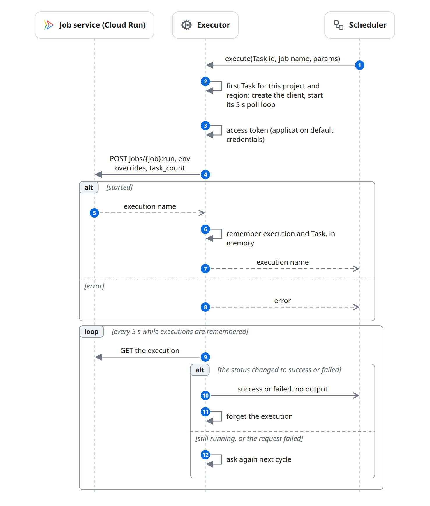

# Execute as a Cloud Run job

A Task with `executor: cloudrun` starts an existing Google Cloud Run job, and the Executor polls the execution until it ends. The execution is tracked in the Executor's memory, not as a Deferred job. Cloud Run is the only cloud Executor; BigQuery, Dataproc and Cloud Run jobs that the task code starts itself go through [deferred.md](deferred.md). This page only describes what differs from [execute.md](execute.md).

## At a glance

| | |
|---|---|
| Starts | The Scheduler calls `execute` on the Cloud Run executor |
| Blocks | Scheduler, Executor, Job service |
| Reads and writes | [Task](../domain-model.md#task) (through the Scheduler) |
| Ends | The poll loop saw the execution end and reported it |

## The diagram

## State changes

| Entity | From | To | Caused by |
|---|---|---|---|
| Task | `pending` | `dispatched` | The execution started |
| Task | `pending` | `failed` or `pending` | Starting it failed ([failures.md](failures.md)) |
| Task | `dispatched` | `success` | The poll loop saw it succeed; there is no `running` report and no output |
| Task | `dispatched` | `failed` or `pending` | The poll loop saw it fail |

## Rules

- **Build.** The default `czar-cli` build leaves the Cloud Run executor out. Build with `--features cloudrun`, or the Task fails with "CloudRun executor is unavailable on this build".
- **Where.** Project and region come from the Workflow (`czar load -p/-r`, `czar workflow deploy -p/-r`, or `project` and `region` in `POST /api/workflows`). The YAML `job` is the Cloud Run job name. One client is kept per project and region, each with its own poll loop.
- **Request.** The v1 `jobs/{job}:run` endpoint of `https://{region}-run.googleapis.com`, authenticated with application default credentials (`GOOGLE_APPLICATION_CREDENTIALS` or workload identity). The container gets env overrides: the Task's `env`, `task_input` as `CZAR_INPUT_JSON`, and every other string, number or boolean param under its own name. `task_count` (from `parallel: N` with `parallel_mode: cloud_run_tasks`) sets the number of Cloud Run tasks; the default is 1.
- **Polling.** Every 5 seconds the loop reads each remembered execution's first status condition. `completed` or `succeeded` is success, `failed` or `error` is failure, anything else is still running. Only a change is reported.
- **Output.** None. Downstream Tasks cannot read a Cloud Run Task's output; logs stay in Cloud Logging.

## Failure and edge cases

- **The Task timeout still applies.** The Scheduler fails the Task after `timeout` (default 300 s) even if the job is healthy; when the loop later sees the end, that report overwrites the failure. Set `timeout` above the job's run time.
- **Poll errors are retried forever;** each one is logged.
- **Cancel does not stop the execution.**
- Known issues: [Cloud Run status is read from the condition type](../known-issues.md#cloud-run-status-is-read-from-the-condition-type); [Cloud Run executions are lost on restart](../known-issues.md#cloud-run-executions-are-lost-on-restart); [Cloud Run Tasks from `czar run` and reload use project `local`](../known-issues.md#cloud-run-tasks-from-czar-run-and-reload-use-project-local).

## In the code

1. [manager.rs](../../../../crates/czar-executors/src/manager.rs) (`get_executor`: the client cache).
2. [cloud_run/client.rs](../../../../crates/czar-executors/src/cloud_run/client.rs): `execute_job`, `get_execution_status`, `poll_active_executions`, `start_polling_task`.

## Related

- Parent: [execute.md](execute.md).
- Siblings: [execute-local.md](execute-local.md), [execute-worker.md](execute-worker.md).
- Beside: [deferred.md](deferred.md) (Cloud Run jobs started by task code), [failures.md](failures.md).
