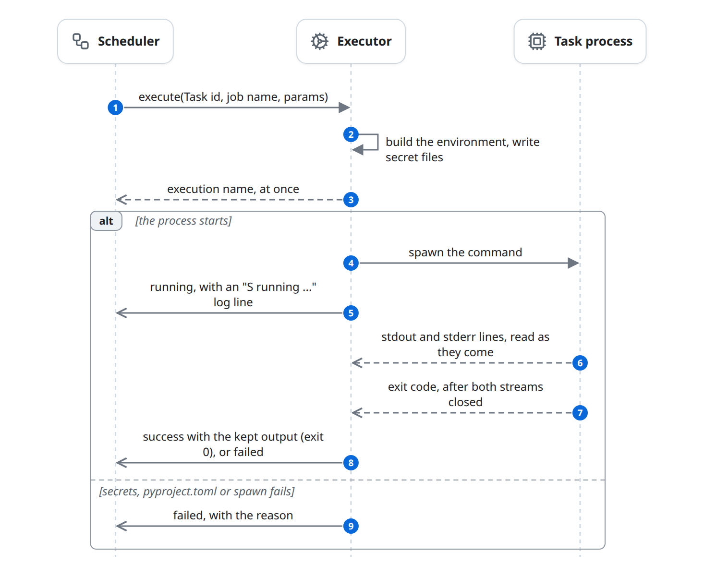
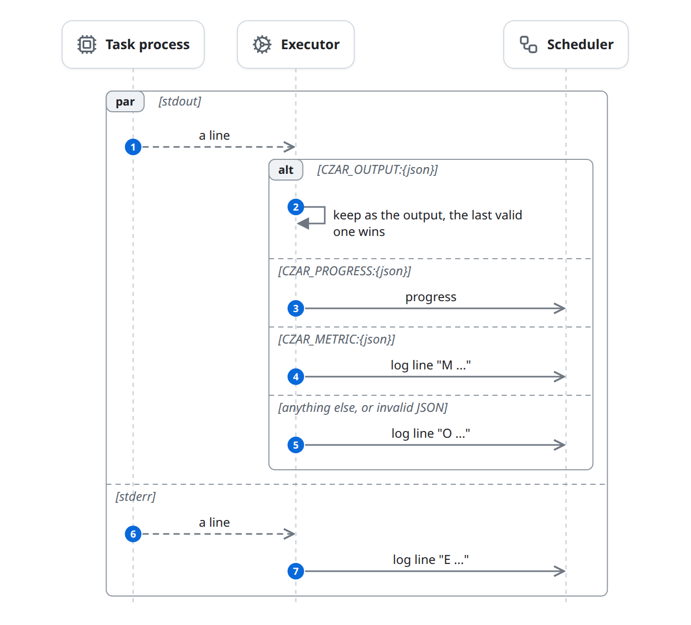
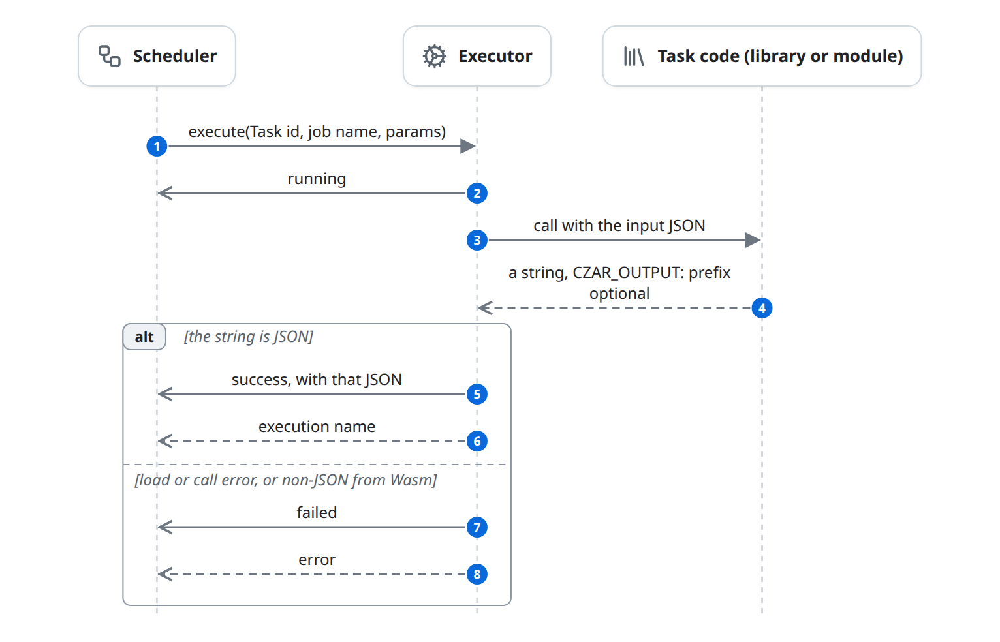
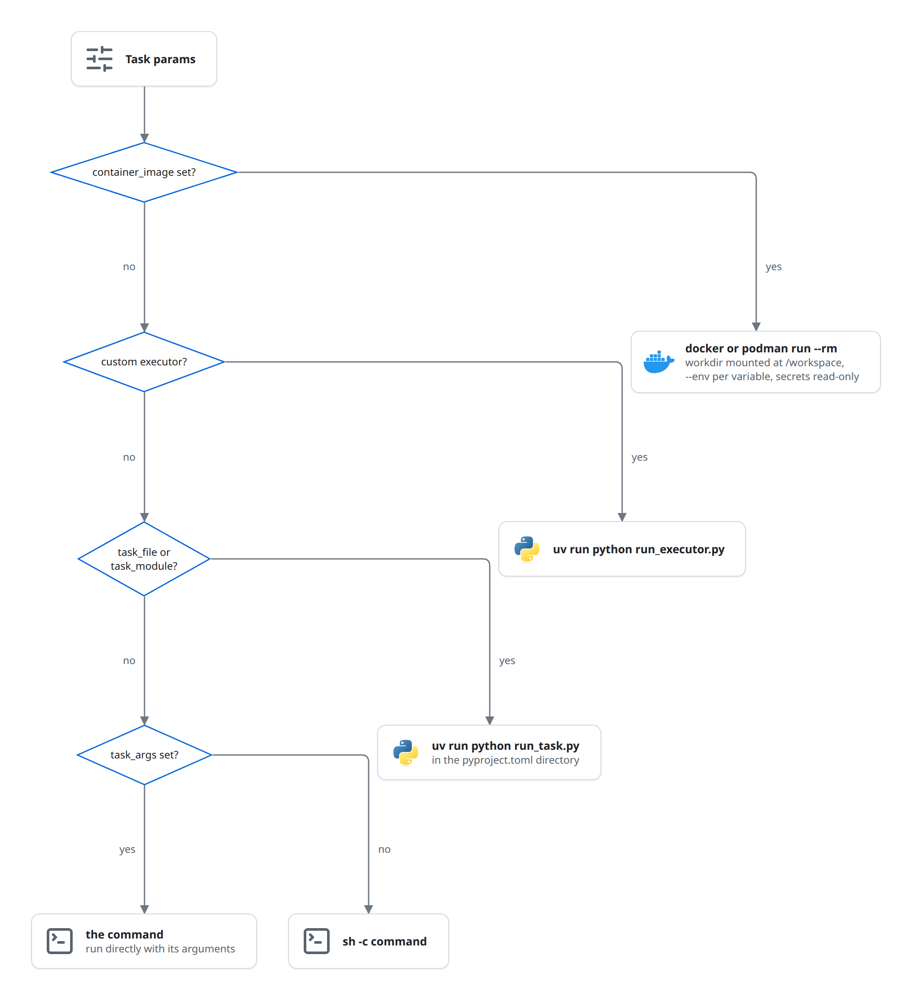

# Execute in the server's process

Most Tasks run on the machine that runs the Scheduler: `czar serve`, or `czar run FILE` on a laptop. The Executor either starts a child process (a shell command, `uv run python`, a container, `wasmtime`) or calls code loaded into czar itself (a shared library, an embedded Wasm module). This page only describes what differs from the contract in [execute.md](execute.md); it ends, like that flow, with a `success` or `failed` report.

## At a glance

| | |
|---|---|
| Starts | The Scheduler calls `execute` on the process, Python, library or Wasm executor |
| Blocks | Scheduler, Executor, Task process |
| Reads and writes | [Task](../domain-model.md#task) (through the Scheduler) |
| Ends | The process exited, or the call returned, and the Executor reported the result |

## The diagram

There are two shapes. Most kinds start a child process; `execute` returns at once and the Executor reports while the process runs:

Which command is spawned is in [Choosing the command](#choosing-the-command). While it runs, each output line becomes a log line, progress, or the output:

Library and embedded Wasm Tasks are calls inside czar; `execute` returns only when the call has ended:

A library that returns a string that is not JSON gets no report at all ([known-issues.md](../known-issues.md#a-library-task-with-non-json-output-never-finishes)).

## State changes

All transitions are the ones in [execute.md](execute.md#state-changes). What triggers them here:

| Entity | From | To | Caused by |
|---|---|---|---|
| Task | `pending` | `dispatched` | Child process kinds: `execute` returned before the process starts. Library and embedded Wasm: the call has already finished. |
| Task | `dispatched` | `running` | The process was spawned (or the library or module is about to be called) |
| Task | `dispatched`, `running` | `success` | Exit code 0; or the library or module returned JSON |
| Task | `dispatched`, `running` | `failed` or `pending` | Non-zero exit, spawn or setup error, or a library or module error ([failures.md](failures.md)) |

## Rules

### Building the environment

- The child inherits czar's own environment and stdin (a container only gets what is passed with `--env`).
- `task_input` becomes `CZAR_INPUT_JSON`; `env` entries become variables; `secrets` are written to files and their paths exported; every other string, number or boolean param is exported under its own name.
- The Executor adds `CZAR_TASK_ID`, `CZAR_EXECUTION_NAME`, `EXECUTION_ID`, `CZAR_TASK_NAME`, `CZAR_WORKFLOW_NAME`, `CZAR_RUN_ID`, `CZAR_PARALLEL_INDEX` and `CZAR_PARALLEL_COUNT`; the Scheduler has already set `CZAR_ATTEMPT`. Python processes also get `PYTHONUNBUFFERED=1`, `PYTHONPATH` with the project root first, and no `VIRTUAL_ENV`.

### Choosing the command

- **Container:** `docker` or `podman` (whichever is on `PATH`, or `CZAR_CONTAINER_RUNTIME`), `run --rm`, the working directory mounted at `/workspace`, every czar-built variable as `--env KEY=VALUE`, secret files mounted read-only.
- **Custom executor:** `uv run python run_executor.py`, with `CZAR_CUSTOM_EXECUTOR_JSON` and `CZAR_TASK_CONFIG_FILE` ([task-sdks.md](../task-sdks.md#custom-executors)).
- **Python:** `uv run python run_task.py` in the directory with the task's `pyproject.toml`, with `CZAR_TASK_FILE` or `CZAR_TASK_MODULE` and `CZAR_TASK_FUNCTION`. The Python executor first makes relative paths absolute. How the runner calls the function is in [task-sdks.md](../task-sdks.md#python).
- **Command with `args`:** run directly with those arguments. **Command without:** `sh -c <command>`, resolved against the working directory.
- The Python runners ship inside the binary and are written to `$TMPDIR/czar/runtime/` on first use.

### Reading the output

- stdout and stderr are read line by line. Stored log lines start with `S` (czar), `O` (stdout), `E` (stderr) or `M` (metric), then a time.
- The last valid `CZAR_OUTPUT:` line is the output and is not logged. A `CZAR_OUTPUT:` or `CZAR_PROGRESS:` line with invalid JSON is logged as an ordinary `O` line. stderr is never read for protocol lines.
- The result is reported only after both streams closed, so every log line arrives before it. The output counts only with exit code 0.

### Wasm

- `wasm_mode: embedded` (the default): the module runs inside czar on a blocking thread, the input JSON is passed in memory, and `execute` returns when it is done. The returned string may start with `CZAR_OUTPUT:`; anything that is not JSON fails the Task.
- `wasm_mode: cli`: `wasmtime run [--invoke <entrypoint>] <module>` (or `wasm_runtime`, or `CZAR_WASM_RUNTIME`) as a child process with `CZAR_INPUT_JSON`; its output is read like any child process.

### Library

The Executor loads the `.so` with `libloading`, calls `czar_task_run` (or the YAML `function`) with the input JSON as a C string, frees the returned string with `czar_task_free`, strips an optional `CZAR_OUTPUT:` prefix, and reports `success` with the JSON. The call runs inside `execute`.

## Failure and edge cases

- **Inline kinds block the tick.** Embedded Wasm and library Tasks finish inside `execute`, so a long one holds a dispatch slot. A library Task that crashes takes czar down with it.
- **No output.** Exit 0 without a `CZAR_OUTPUT:` line succeeds with no output, unless the Task declares an `output_type`.
- **Large inputs** in one environment variable can exceed the operating system's limit; the process then fails to start.
- **czar exits, children keep running** ([failures.md](failures.md#restart-and-shutdown)).
- Known issues: [a library Task with non-JSON output never finishes](../known-issues.md#a-library-task-with-non-json-output-never-finishes); [SDK error results count as success](../known-issues.md#sdk-error-results-count-as-success); [some failures are counted twice](../known-issues.md#some-failures-are-counted-twice); [invalid UTF-8 output stops log reading](../known-issues.md#invalid-utf-8-output-stops-log-reading).

## In the code

1. [process.rs](../../../../crates/czar-executors/src/process.rs) (`ProcessExecutor::execute_process`), [process/support.rs](../../../../crates/czar-executors/src/process/support.rs) (`build_env_vars`, `build_python_command`, `build_container_command`, `detect_container_runtime`), [process/secret_mounts.rs](../../../../crates/czar-executors/src/process/secret_mounts.rs).
2. [process/execution.rs](../../../../crates/czar-executors/src/process/execution.rs) (`spawn_process_execution`, `build_command`, `configure_command_environment`), [process/logs.rs](../../../../crates/czar-executors/src/process/logs.rs) (`spawn_stdout_log_task`, `spawn_stderr_log_task`).
3. [python/executor.rs](../../../../crates/czar-executors/src/python/executor.rs) (`resolve_python_params`), [python_runtime.rs](../../../../crates/czar-executors/src/python_runtime.rs), [runtime/python/](../../../../crates/czar-executors/runtime/python/).
4. [wasm/executor.rs](../../../../crates/czar-executors/src/wasm/executor.rs), [wasm/embedded.rs](../../../../crates/czar-executors/src/wasm/embedded.rs), [wasm/cli.rs](../../../../crates/czar-executors/src/wasm/cli.rs).
5. [library/executor.rs](../../../../crates/czar-executors/src/library/executor.rs).

## Related

- Parent: [execute.md](execute.md).
- Siblings: [execute-worker.md](execute-worker.md) (the same code inside a Worker), [execute-cloud-run.md](execute-cloud-run.md).
- Beside: [task-sdks.md](../task-sdks.md) (the task side), [deferred.md](deferred.md).
