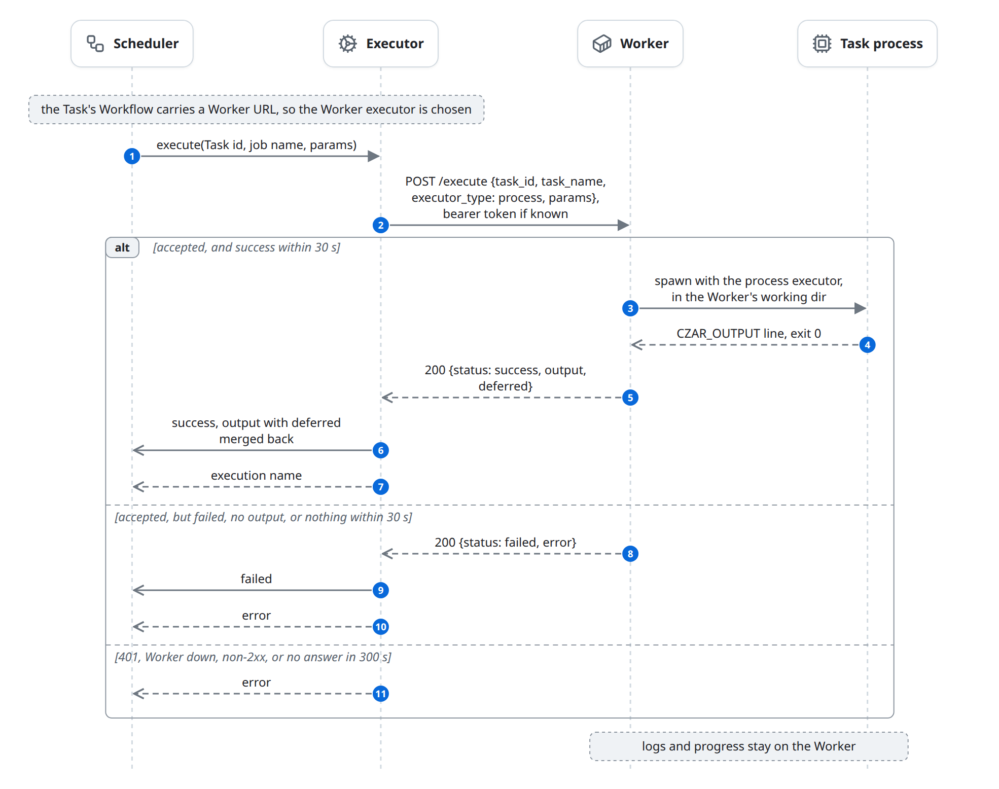

# Execute on a remote Worker

A Worker is a `czar-worker` HTTP server shipped next to one workflow's code, usually as a container image. When the Compiler imported the Workflow from a Worker ([define.md](define.md)), the Workflow carries the Worker's URL, and every Task of that Workflow is sent to the Worker instead of running locally. This page only describes what differs from [execute.md](execute.md); it ends with the Worker's answer reported to the Scheduler.

## At a glance

| | |
|---|---|
| Starts | The Scheduler calls `execute` for a Task whose Workflow carries a Worker URL |
| Blocks | Scheduler, Executor, Worker, Task process |
| Reads and writes | [Task](../domain-model.md#task) (through the Scheduler), [Worker registration](../domain-model.md#worker-registration) (read) |
| Ends | The Worker answered `success` or `failed`, or the call failed, and the Executor reported it |

## The diagram



## State changes

| Entity | From | To | Caused by |
|---|---|---|---|
| Task | `pending` | `dispatched` | The Worker answered `success`; `execute` only returns after the answer |
| Task | `pending` | `failed` or `pending` | The Worker answered `failed`, or the call failed ([failures.md](failures.md)) |
| Task | `dispatched` | `success` | The recorded `success` report; there is no `running` report |

## Rules

### Configuration

```yaml
# czar serve --config orchestrator.yaml, or a workers file given by --workers-file / CZAR_WORKERS_FILE
workers:
  - url: http://worker:8081
    name: etl-worker              # optional display name
    poll_interval_secs: 60        # optional re-sync interval
    token_env: CZAR_WORKER_TOKEN  # or token: <value>; must match the Worker's --auth-token
```

```bash
# on the Worker host or in its image
czar-worker --addr 0.0.0.0:8081 --workflow-path /workflow/workflow.yaml \
            --working-dir /workflow --auth-token "$CZAR_WORKER_TOKEN"
```

- Each entry is a [Worker registration](../domain-model.md#worker-registration). `czar serve` merges the `--config` file's list with the workers file. `token_env` is read at startup; an unset or empty variable prints a warning and the Worker gets no token; with both set, `token_env` wins.
- `czar-worker` defaults are `--addr 127.0.0.1:8081`, `--workflow-path workflow.yaml` and `--working-dir .`. Building a Worker image is in [remote-workers.md](../../remote-workers.md); the HTTP contract is in [czar-worker-api.md](../../czar-worker-api.md).

### Sync and routing

- `/compile` returns the Worker's workflow: name, task list and source YAML. The Compiler applies it relaxed and stamps the Workflow with the Worker's URL ([define.md](define.md)).
- The stamp routes every Task of that Workflow to the Worker executor, whatever its `executor`. The token comes from the Worker registration with exactly the stamped URL.

### The call

- `POST /execute` carries the Task id, the job name as `task_name`, the resolved params, and always `executor_type: process`. The HTTP client gives up after 300 seconds.
- The Worker runs it with the process executor, the same code as [execute-local.md](execute-local.md), in its `--working-dir`, with the directory of `--workflow-path` as the workflow root. It waits for the first `success` or `failed` report, for at most 30 seconds. A `success` without output is a failure on a Worker ("Execution completed without CZAR_OUTPUT JSON").
- The answer is always HTTP 200: `{"status": "success", "output": ..., "deferred": [...]}` or `{"status": "failed", "error": ...}`. An unknown `executor_type` is a `failed` answer.
- The Executor puts `deferred` back into the output, so handing work off works the same as locally ([deferred.md](deferred.md)).
- The params carry the paths the orchestrator resolved when it compiled the synced YAML (`task_file`, `python_path`, commands), and the Worker uses them as they are.

### Authentication

With `--auth-token` (or `CZAR_WORKER_AUTH_TOKEN`), the Worker requires `Authorization: Bearer <token>` on `/compile` and `/execute`, compared in constant time; `/health` stays open for probes. Without a token on a non-loopback address it logs a warning and runs whatever it is sent ([access.md](access.md)).

## Failure and edge cases

- **No logs and no progress.** The Worker keeps them; only the output or error comes back.
- **No cancel.** The Worker has no cancel endpoint; cancelling a Run changes rows only.
- **Worker down.** Sync errors at startup are printed and `czar serve` keeps running; stored Workflows keep their stamp, and their Tasks fail until the Worker is back.
- **A local apply drops the stamp,** so the Workflow's Tasks run locally again.
- Known issues: [Worker tasks fail after 30 seconds](../known-issues.md#worker-tasks-fail-after-30-seconds); [Worker tasks always run as process](../known-issues.md#worker-tasks-always-run-as-process); [a Worker call blocks the Scheduler](../known-issues.md#a-worker-call-blocks-the-scheduler); [some failures are counted twice](../known-issues.md#some-failures-are-counted-twice); [worker sync needs Python task files on the orchestrator](../known-issues.md#worker-sync-needs-python-task-files-on-the-orchestrator); [`czar run FILE` has no Worker tokens](../known-issues.md#czar-run-file-has-no-worker-tokens); [registering a Worker over the API sends no token](../known-issues.md#registering-a-worker-over-the-api-sends-no-token).

## In the code

1. Registrations: [serve/workers.rs](../../../../crates/czar-cli/src/commands/serve/workers.rs) (`load_workers_config`, `resolve_worker_tokens`), [worker_registry.rs](../../../../crates/czar-core/src/worker_registry.rs) (`WorkerConfig`, `worker_metadata_from_workflow`).
2. Routing: [manager.rs](../../../../crates/czar-executors/src/manager.rs) (`with_workers`, `get_executor`).
3. The call: [worker/executor.rs](../../../../crates/czar-executors/src/worker/executor.rs) (`WorkerExecutor::execute`), [worker_client.rs](../../../../crates/czar-core/src/worker_client.rs) (`WorkerClient::execute`).
4. The Worker: [main.rs](../../../../crates/czar-worker/src/main.rs), [routes.rs](../../../../crates/czar-worker/src/routes.rs) (`build_app`), [auth.rs](../../../../crates/czar-worker/src/auth.rs) (`require_bearer_token`), [handlers/execute.rs](../../../../crates/czar-worker/src/handlers/execute.rs), [handlers/execute_request.rs](../../../../crates/czar-worker/src/handlers/execute_request.rs), [handlers/compile.rs](../../../../crates/czar-worker/src/handlers/compile.rs).
5. Running on the Worker: [dispatch.rs](../../../../crates/czar-executors/src/dispatch.rs) (`dispatch`, `execute_with_terminal_updates`, `TERMINAL_UPDATE_TIMEOUT`).
6. End-to-end test: `just test-worker-e2e` ([tests/worker-e2e](../../../../tests/worker-e2e/)).

## Related

- Parent: [execute.md](execute.md).
- Before: [define.md](define.md) (worker sync). Siblings: [execute-local.md](execute-local.md), [execute-cloud-run.md](execute-cloud-run.md).
- Beside: [access.md](access.md) (Worker tokens), [deferred.md](deferred.md).
