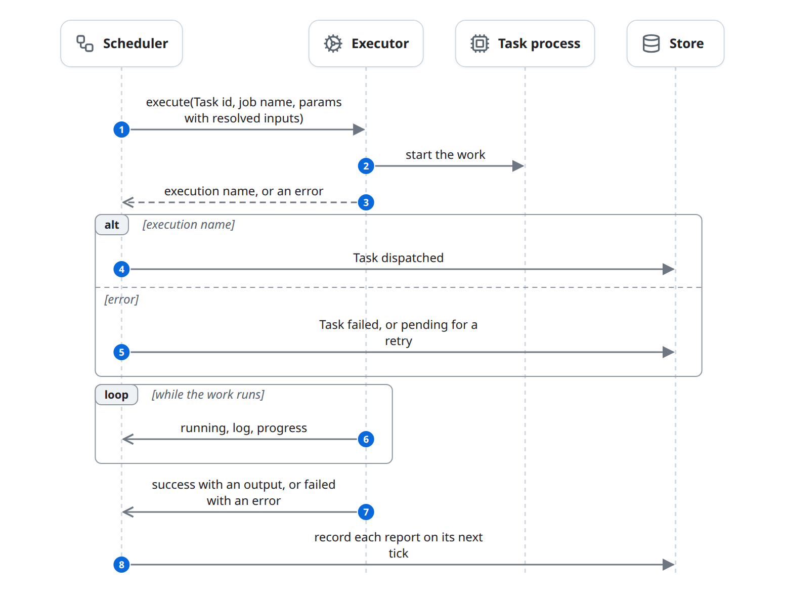
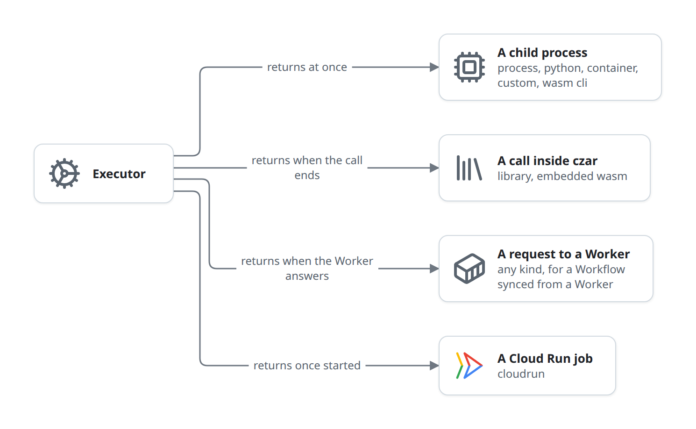
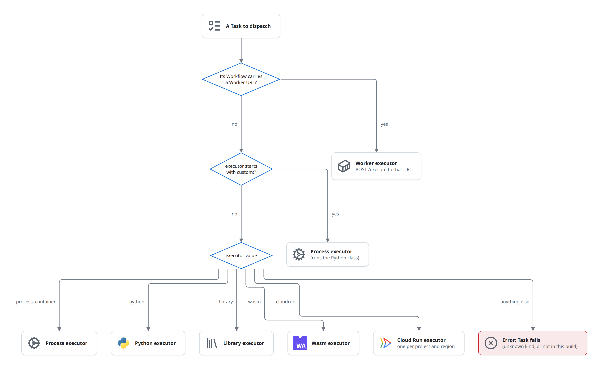

# Execute a task

The Scheduler hands a ready Task to an Executor, and the Executor starts the work and reports on it. The flow starts when the Scheduler calls `execute` and ends when the Executor has sent the Task's last StatusUpdate: `success` or `failed`. This is phase 4 of the [life of a run](life-of-a-run.md). This page is the contract every Executor follows; the variant pages only describe what differs.

## At a glance

| | |
|---|---|
| Starts | The Scheduler dispatching a ready Task ([schedule.md](schedule.md)) |
| Blocks | Scheduler, Executor, Task process, Worker, Job service, Store |
| Reads and writes | [Task](../domain-model.md#task); a Task's output may create [Deferred jobs](../domain-model.md#deferred-job) |
| Ends | The Executor has reported `success` (with an output) or `failed` (with an error), and the Scheduler has recorded it |

## The diagram

Every Executor follows the same contract: it starts the work, returns an execution name (or an error), reports while the work runs, and ends with one `success` or `failed` report. The Scheduler records each report on its next tick.

What "start the work" means, and when `execute` returns, depends on the kind of Executor. Each kind has its own page with its own diagram:

A child process returns at once and reports as the process runs ([execute-local.md](execute-local.md)). A library or embedded Wasm call runs inside `execute` and reports when it returns ([execute-local.md](execute-local.md#library)). A Worker request returns and reports only when the Worker answers, with no `running` report ([execute-worker.md](execute-worker.md)). A Cloud Run job returns once the execution has started and reports only its end, with no output ([execute-cloud-run.md](execute-cloud-run.md)).

## State changes

Executors never write to the Store. Every row below is written by the Scheduler, on the Executor's report.

| Entity | From | To | Caused by |
|---|---|---|---|
| Task | `pending` | `dispatched` | `execute` returned an execution name |
| Task | `pending` | `failed` | `execute` returned an error, with no retries left ([failures.md](failures.md)) |
| Task | `pending` | `pending`, `retry_at` set | `execute` returned an error, with retries left ([failures.md](failures.md)) |
| Task | `dispatched` | `running` | a `running` report |
| Task | `dispatched`, `running` | `success` | a `success` report whose output passes the `output_type` check |
| Task | `dispatched`, `running` | `failed` or `pending` | a `failed` report, or a `success` that fails the output check ([failures.md](failures.md)) |
| Task | `dispatched`, `running` | (stays) | a `success` report whose output lists deferred jobs ([deferred.md](deferred.md)) |

## Rules

### Choosing an Executor

- A Workflow synced from a Worker sends every Task to that Worker, whatever its `executor` ([execute-worker.md](execute-worker.md)).
- `custom:<name>` runs through the process executor ([task-sdks.md](../task-sdks.md#custom-executors)).
- The process, Python, library and Wasm executors are one shared instance each, serving all Tasks of their kind concurrently. Cloud Run has one per project and region. A Worker executor is made per call.
- Each kind is behind a cargo feature of `czar-executors`. A build without it fails the Task with "unavailable on this build" ([building-blocks.md](../building-blocks.md#executor)).

### Executor kinds

| `executor` | Runs | Result comes from | `execute` returns | Page |
|---|---|---|---|---|
| `process`, `custom:<name>` | A local command, or a Python class | Exit code and the last `CZAR_OUTPUT:` line | At once | [execute-local.md](execute-local.md) |
| `container` | `docker` or `podman run --rm` | Exit code and output line | At once | [execute-local.md](execute-local.md) |
| `python` | A Python function, through `uv run python` | Exit code and output line | At once | [execute-local.md](execute-local.md) |
| `wasm` with `wasm_mode: cli` | A module in a runtime process (`wasmtime`) | Exit code and output line | At once | [execute-local.md](execute-local.md) |
| `wasm` (default `wasm_mode: embedded`) | A module called inside czar | The function's return value | When the call ends | [execute-local.md](execute-local.md) |
| `library` | A shared library called inside czar | The function's return value | When the call ends | [execute-local.md](execute-local.md) |
| `cloudrun` | A Cloud Run job execution | Polling every 5 s | When the execution has started | [execute-cloud-run.md](execute-cloud-run.md) |
| any, for a Workflow from a Worker | `POST /execute` on the Worker | The Worker's answer | When the Worker answers | [execute-worker.md](execute-worker.md) |

### What `execute` gets and returns

- **Gets:** the Task id, a job name (the Task's `job_name`, else `command`, else `script`, else the Workflow's job name), and the Task's params after the Scheduler resolved its inputs: `task_input` (the resolved `inputs`), `env`, `secrets`, the command, file, module or function, `timeout_seconds`, `task_name`, `workflow_name`, `run_id`, and fan-out fields.
- **Returns:** an execution name (a fresh id for local work, the Cloud Run execution name), which the Scheduler stores on the Task; or an error, which fails the attempt.
- **Should return quickly.** `execute` is awaited inside the tick. An Executor that only returns when the work is done (library, embedded Wasm, Worker) holds a dispatch slot and delays the tick.

### StatusUpdates

An Executor reports through a channel the Scheduler gives it before each `execute`. A StatusUpdate names the Task and carries one status:

| Status | Carries | The Scheduler |
|---|---|---|
| `running` | Usually a first log line (`S running <task>: <what> (attempt n)`) | Sets the Task `running`, fires `task.start` Hooks |
| `log` | A log chunk | Appends it to the Task's logs |
| `progress` | `{"current", "total", "message"}` | Stores it on the Task |
| `success` | The output, possibly with a `deferred` list | See [schedule.md](schedule.md#recording-reports) |
| `failed` | An error message | Retries or fails ([failures.md](failures.md)) |

### How data travels

| What | Into the Task process | Out of the Task process |
|---|---|---|
| Input | `CZAR_INPUT_JSON` (process, Python, Wasm CLI, container, Cloud Run); a C string (library); memory (embedded Wasm) | |
| Run details | `CZAR_TASK_ID`, `CZAR_RUN_ID`, `CZAR_TASK_NAME`, `CZAR_WORKFLOW_NAME`, `CZAR_ATTEMPT`, `CZAR_PARALLEL_INDEX`, `CZAR_PARALLEL_COUNT`, `CZAR_EXECUTION_NAME` | |
| Output | | A stdout line `CZAR_OUTPUT:<json>`; the return value for library and embedded Wasm |
| Progress | | A stdout line `CZAR_PROGRESS:{"current", "total", "message"}` |
| Metrics | | A stdout line `CZAR_METRIC:<json>`, stored as an `M` log line |
| Logs | | Every other stdout line (`O`) and stderr line (`E`); czar's own lines are `S` |

The task side of this protocol, and what the SDKs add, is in [task-sdks.md](../task-sdks.md).

### What no Executor does

- **Write to the Store.** Only the Scheduler records.
- **Stop work.** No Executor can kill a Task: a timeout or a cancel changes rows, and the work goes on ([failures.md](failures.md), [control.md](control.md)).
- **Time out.** Timeouts are the Scheduler's ([failures.md](failures.md#rules)), except the Worker's fixed limits ([execute-worker.md](execute-worker.md)).

## Failure and edge cases

- **Unknown `executor`, or a kind missing from the build:** the Task fails at dispatch, with the reason as its error.
- **No output.** A `success` without a `CZAR_OUTPUT:` line has no output, which fails the Task only when it declares an `output_type` (and on a Worker, always).
- **Output too large for one line, or input too large for one environment variable,** fail in the Task process or at spawn.
- Known issues: [library and embedded Wasm failures are counted twice](../known-issues.md#some-failures-are-counted-twice); [SDK error results count as success](../known-issues.md#sdk-error-results-count-as-success); [cancel and timeouts do not stop work](../known-issues.md#cancel-and-timeouts-do-not-stop-work).

## In the code

1. Choosing: [manager.rs](../../../../crates/czar-executors/src/manager.rs) (`ExecutorManager::get_executor`), the trait in [executor_manager.rs](../../../../crates/czar-core/src/executor_manager.rs).
2. Calling: [task_execution.rs](../../../../crates/czar-core/src/task_execution.rs) (`execute_task`, `resolve_job_name`).
3. The contract: [executor.rs](../../../../crates/czar-core/src/executor.rs) (`Executor::execute`, `set_status_channel`), [events.rs](../../../../crates/czar-core/src/events.rs) (`StatusUpdate`).
4. Recording: [scheduler/processing.rs](../../../../crates/czar-core/src/scheduler/processing.rs) (dispatch batch), [scheduler/status_processing.rs](../../../../crates/czar-core/src/scheduler/status_processing.rs) (`process_status_updates`).
5. Shared helpers for running outside the Scheduler (the Worker): [dispatch.rs](../../../../crates/czar-executors/src/dispatch.rs).

## Related

- Parent: [schedule.md](schedule.md), inside the [life of a run](life-of-a-run.md).
- Variants: [execute-local.md](execute-local.md), [execute-worker.md](execute-worker.md), [execute-cloud-run.md](execute-cloud-run.md).
- Beside: [deferred.md](deferred.md) (when the output hands work off), [failures.md](failures.md), [task-sdks.md](../task-sdks.md).
