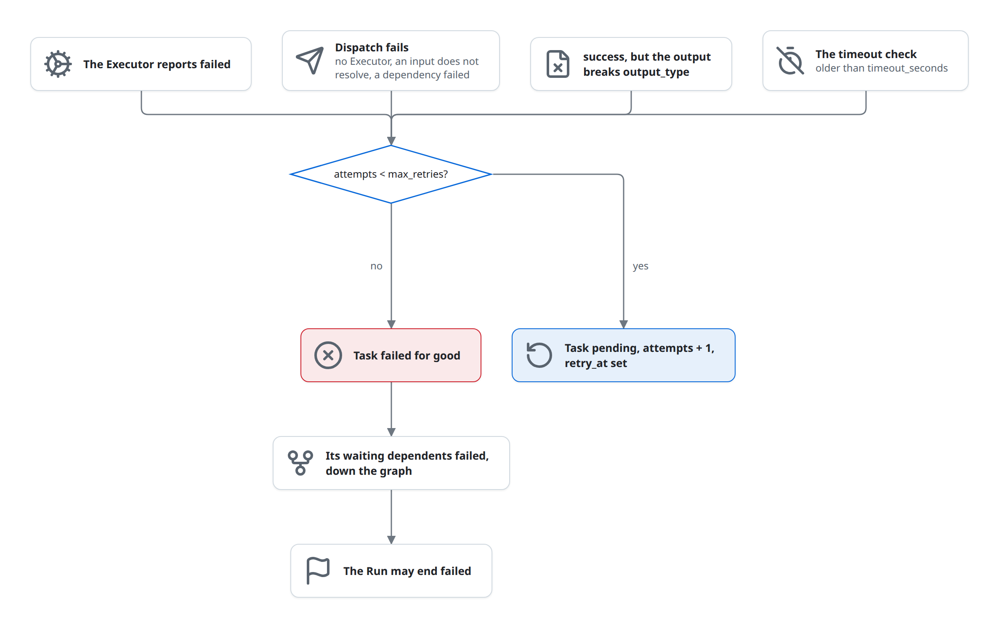
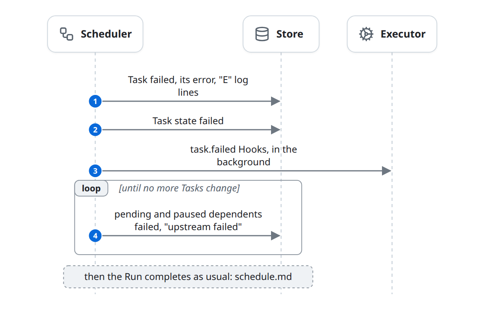
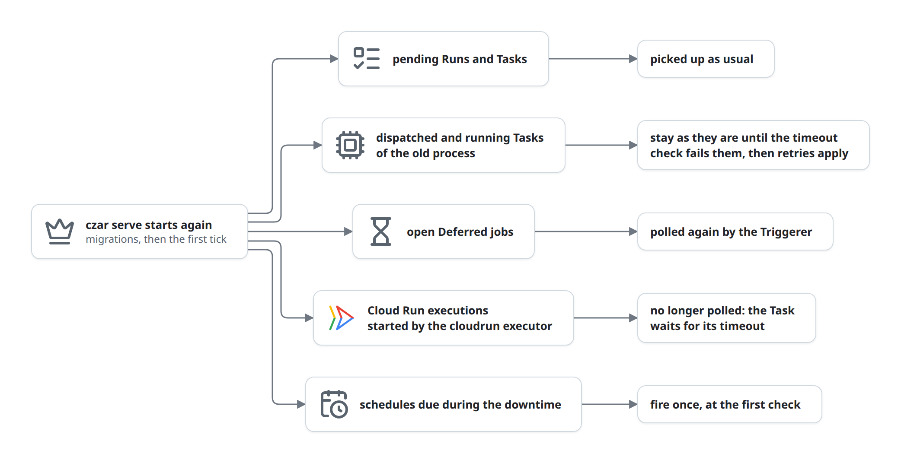

# Failures, retries, timeouts and restarts

A Task fails when its work fails, when it cannot be dispatched, when its output breaks its declared type, or when it runs past its timeout. The Scheduler then retries it, or fails it for good and fails the Tasks that wait on it. The flow ends with the Task back in `pending` for a retry, or `failed` with its dependents. It sits inside phases 3 and 4 of the [life of a run](life-of-a-run.md). This page also covers what a stopped and restarted Scheduler leaves behind.

## At a glance

| | |
|---|---|
| Starts | An Executor reports `failed`; a dispatch fails; an output fails its type check; a Task passes its timeout |
| Blocks | Executor, Scheduler, Store, Notifier |
| Reads and writes | [Task](../domain-model.md#task), [Run](../domain-model.md#run), [Task state](../domain-model.md#task-state) |
| Ends | The Task is `pending` with a retry time, or `failed`; its waiting dependents are `failed`; the Run may be `failed` |

## The diagram

Four things fail a Task. Each goes through the same retry decision; a failure with no retries left also fails the Tasks that wait on it.

A retry puts the Task back to `pending` with a `retry_at`; it is picked again once that time has passed ([retries](#retries)).

### A final failure

With no retries left, the Scheduler records the failure, fires `task.failed` Hooks, and fails the waiting dependents until nothing changes. If every Task of the Run has then ended, the Run becomes `failed`, its `run.failed` Hooks fire and notifications go out ([schedule.md](schedule.md#runs-complete)).

## State changes

| Entity | From | To | Caused by |
|---|---|---|---|
| Task | `dispatched`, `running` | `pending`, `retry_at` set, `attempts` + 1 | Scheduler: a failure with retries left |
| Task | `pending` | `pending`, `retry_at` set, `attempts` + 1 | Scheduler: a dispatch failure with retries left |
| Task | `dispatched`, `running` | `failed` | Scheduler: a failure with no retries left, or a timeout with no retries left |
| Task | `pending` | `failed` | Scheduler: a dispatch failure with no retries left, or a failed or cancelled dependency |
| Task | `pending`, `paused` | `failed`, error "upstream failed" | Scheduler: a dependency failed for good |
| Task state | any | `failed` | Scheduler: a Task failed for good |
| Run | `running`, `paused` | `failed` | Scheduler: every Task ended and one failed ([schedule.md](schedule.md#runs-complete)) |

## Rules

### Retries

- `retries` in the YAML (default 0) is the Task's `max_retries`. A failure while `attempts < max_retries` puts the Task back to `pending`, adds 1 to `attempts`, clears its output and times, keeps the error, sets `retry_at`, and adds the log line `S <task> failed, retrying (attempt n of max)`.
- The delay is `retry_delay` if set, else 1, 2, 4, 8 … seconds, capped at 60. The Task is not ready before `retry_at` ([schedule.md](schedule.md#when-a-task-is-ready)). The next attempt sees `CZAR_ATTEMPT = attempts + 1`.
- A Task that fails for good keeps its error in `error`, gets it appended to its logs as `E` lines, and fires `task.failed` Hooks. Hooks do not fire for the attempts that were retried.

### Upstream failure

- When a Task fails for good, every `pending` or `paused` Task that depends on it is set `failed` with "upstream failed", then their dependents, until nothing changes.
- A Task picked as ready with a `failed` or `cancelled` dependency fails at dispatch, unless it has `on_failure: run`.
- `on_failure: run` lets a Task start although a dependency failed, and a `ref` to that dependency's output resolves to `null`. Because of the first rule, it only takes effect when the dependency failed without going through the Scheduler's failure path, for example a failed Deferred job ([known-issues.md](../known-issues.md#on_failure-run-rarely-takes-effect)).
- The default, `on_failure: skip`, has no code behind it: dependents of a failed Task end `failed`, not `skipped`.

### Timeouts

- Every Task has `timeout_seconds` (YAML `timeout`, default 300). At most every 5 seconds the Scheduler loads `dispatched` and `running` Tasks and fails those older than their limit, counted from `started_at`, else `dispatched_at`, else `created_at`, with "timeout after Ns". Retries apply.
- Nothing stops the work. If it reports later, the report is applied to the Task, which may be on its next attempt by then ([known-issues.md](../known-issues.md#cancel-and-timeouts-do-not-stop-work)).

### Restart and shutdown

- **Shutdown.** `czar serve` has no signal handling and runs until it is killed. Child processes are not killed with it, and StatusUpdates still in the channel are lost. `czar run FILE` stops its own Scheduler when its Run ends or its `--timeout` (default 300 s) passes; on a timeout the Run is left as it is.
- **Restart.** There is no recovery step. A restarted Scheduler runs migrations and starts ticking:

## Failure and edge cases

- **Errors become the Task's `error`** and the last `E` log lines; the UIs show both.
- **One failure can count twice** with retries: [known-issues.md](../known-issues.md#some-failures-are-counted-twice).
- **Deferred job failures** fail the Task without retries ([deferred.md](deferred.md)).
- **A failing Hook** changes nothing, but its result can disturb other reports: [known-issues.md](../known-issues.md#hook-results-break-a-batch-of-status-updates).

## In the code

1. Sources: [scheduler/status_processing.rs](../../../../crates/czar-core/src/scheduler/status_processing.rs) (`process_status_updates`, `enforce_timeouts`), [scheduler/processing.rs](../../../../crates/czar-core/src/scheduler/processing.rs) (dispatch failures), [task_execution.rs](../../../../crates/czar-core/src/task_execution.rs) (`execute_task`, `task_runs_despite_failed_dependencies`), [status_processing_completion.rs](../../../../crates/czar-core/src/scheduler/status_processing_completion.rs) (`validate_task_output_contract`).
2. Retries: `get_task_retry_meta`, `reset_task_for_retry` (for example [czar-store-postgres tasks.rs](../../../../crates/czar-store-postgres/src/tasks.rs)), [task_execution.rs](../../../../crates/czar-core/src/task_execution.rs) (`retry_backoff_seconds`).
3. Upstream failure: `mark_tasks_failed_by_dependency`.
4. Completion and hooks: [status_processing_completion.rs](../../../../crates/czar-core/src/scheduler/status_processing_completion.rs) (`check_run_completions_batch`), [hooks.rs](../../../../crates/czar-core/src/hooks.rs), [notifications.rs](../../../../crates/czar-core/src/notifications.rs).
5. Startup and shutdown: [serve.rs](../../../../crates/czar-cli/src/commands/serve.rs), [execute.rs](../../../../crates/czar-cli/src/commands/execute.rs).

## Related

- Parent: [schedule.md](schedule.md), inside the [life of a run](life-of-a-run.md).
- Beside: [execute.md](execute.md), [deferred.md](deferred.md), [control.md](control.md) (cancel and manual retry).
