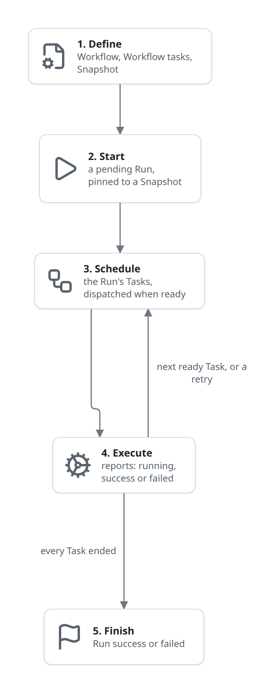
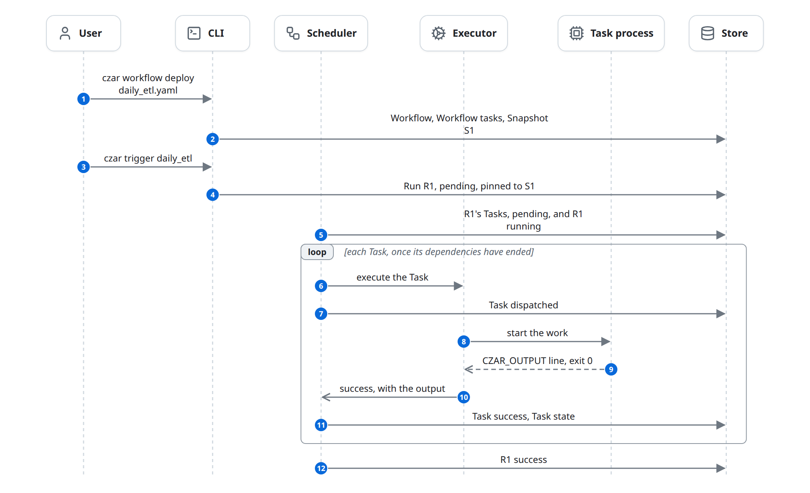

# Life of a run

This is the whole of czar in one flow: a workflow file becomes a stored Workflow, something starts a Run, the Scheduler runs its Tasks through Executors, and the Run ends. Each phase has its own page; this one shows how they connect.

It follows the example from the [domain model](../domain-model.md#an-example-first): `daily_etl` with tasks `extract` → `transform` → `load`, where `transform` hands a query to BigQuery.

## At a glance

| | |
|---|---|
| Starts | A User deploys a workflow file |
| Blocks | User, CLI, Compiler, API, Scheduler, Triggerer, Executor, Task process, Job service, Store |
| Reads and writes | Workflow, Workflow task, Snapshot, Run, Task, Deferred job, Task state |
| Ends | The Run is `success` or `failed` |

## The diagram

A Run goes through five phases. Each box names what the phase produces and links to its page; phases 3 and 4 repeat until every Task has ended.

Here is the same story as messages, for the happy path only: deployed and started from the CLI, every Task succeeds on the first try. Branches (starting from the UI or a schedule, retries, Deferred jobs, failures) are on the phase pages.

The box marks what runs inside one `czar serve` process. The Compiler is a library: it runs in whichever process applies the workflow, here the CLI, so it does not appear as a separate participant. The Store is the only thing the processes share; see [concepts](../concepts.md#the-database-is-the-only-shared-state).

## The phases

1. **[Define](define.md).** The Compiler parses and validates the YAML, compiles every task into a Workflow task, and stores a Snapshot of them. Re-deploying an unchanged file changes nothing; a changed file makes a new Snapshot that only new Runs use.
2. **[Start](start.md).** A Run is a row: the CLI, the API or the Scheduler (for a schedule) inserts it as `pending`, pinned to the Workflow's current Snapshot (CLI, schedule) or to a Snapshot of the chosen flow (the API, so every Run started from the UI or TUI). A selection of tasks is stored on the Run. Nothing runs yet.
3. **[Schedule](schedule.md).** The Scheduler's loop finds the pending Run, creates its Tasks from the Snapshot, and marks it `running`. On every tick (every 0.5 s when idle, sooner when a report arrives) it asks the Store for ready Tasks: `pending`, in a `running` Run, past their retry time, with every dependency ended. For each, up to 10 at a time, it evaluates `when`, resolves inputs from upstream outputs, and hands it to an Executor.
4. **[Execute](execute.md).** The Executor starts the work: a local process, a request to a remote Worker, or a Cloud Run job. It never writes to the Store; it reports `running`, logs, progress and the result back to the Scheduler over an in-memory channel, and the Scheduler records them. A Task may instead hand its work to a [Job service](deferred.md); then the Triggerer polls that service and the Task ends when the job does. A failure with retries left puts the Task back to `pending` with a retry time; a final failure fails the Tasks waiting on it ([failures](failures.md)).
5. **Finish** (in [schedule](schedule.md#runs-complete)). When every Task of the Run has ended, the Scheduler sets the Run to `success` (no Task failed) or `failed`, fires the Run's `run.success` or `run.failed` hooks, and sends failure notifications.

Beside these, at any time, a User can [observe](observe.md) the Run from the UI, TUI or CLI, and [cancel, pause, resume or retry](control.md) it. [Access](access.md) decides who may call the API and the Workers at all.

## State changes

| Entity | From | To | Caused by | Phase |
|---|---|---|---|---|
| Workflow, Workflow task, Snapshot | (none) | stored | Compiler | Define |
| Run | (none) | `pending` | CLI, API or Scheduler | Start |
| Run | `pending` | `running` | Scheduler | Schedule |
| Task | (none) | `pending` | Scheduler | Schedule |
| Task | `pending` | `dispatched` | Scheduler | Schedule |
| Task | `dispatched` | `running` | Executor report, recorded by the Scheduler | Execute |
| Deferred job | (none) | `pending` → `polling` → `completed` | Scheduler, then Triggerer | Execute |
| Task | `running` | `success` or `failed` | Executor report or Triggerer, recorded by the Scheduler | Execute |
| Task state | any | the Task's result | Scheduler | Execute |
| Run | `running` | `success` or `failed` | Scheduler | Finish |

The full lifecycles, with the transitions this happy path skips, are in the [domain model](../domain-model.md#lifecycles).

## Rules

- **One writer per decision.** Executors and the Triggerer report; only the Scheduler turns reports into Task and Run statuses.
- **Runs are pinned.** A Run's tasks come from its Snapshot; deploying again never changes a Run that exists.
- **Nothing calls the Scheduler.** The CLI and API start, cancel and pause Runs by writing rows; the Scheduler picks the change up on its next tick.

## Related

- [Flows](README.md): the map of all flows.
- [Building blocks](../building-blocks.md) and [domain model](../domain-model.md): the participants and entities used here.
- [Known issues](../known-issues.md): where the code doesn't yet keep these rules.
