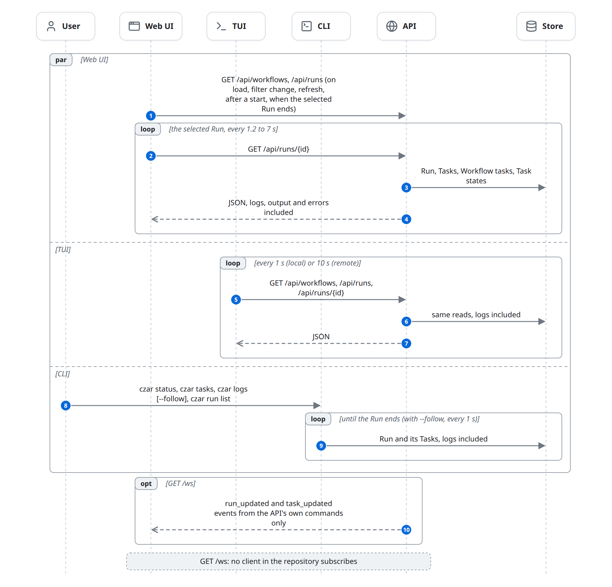

# Observe runs

People follow Runs in the Web UI, the TUI and the CLI. The Web UI and the TUI poll the API; the CLI reads the Store directly. None of them talks to the Scheduler: everything they show is a row the Scheduler wrote. The flow changes nothing and ends whenever the User stops looking. It happens beside the [life of a run](life-of-a-run.md).

## At a glance

| | |
|---|---|
| Starts | A User opens the Web UI or TUI, or runs `czar status`, `czar tasks`, `czar logs`, `czar run list`, `czar run status`, `czar run logs` |
| Blocks | User, Web UI, TUI, CLI, API, Store |
| Reads and writes | Reads [Workflow](../domain-model.md#workflow), [Workflow task](../domain-model.md#workflow-task), [Run](../domain-model.md#run), [Task](../domain-model.md#task), [Task state](../domain-model.md#task-state); writes nothing |
| Ends | When the User stops |

## The diagram

## State changes

| Entity | From | To | Caused by |
|---|---|---|---|
| (none) | | | This flow only reads. |

## Rules

### What the API returns

- `GET /api/workflows?limit&offset&search` and `GET /api/workflows/{name}`: visible Workflows, with their Workflow tasks, task groups and flows from the stored YAML.
- `GET /api/workflows/{name}/task-states`: each Workflow task's Task state.
- `GET /api/runs?limit&offset&search&status&workflow&since&until`: a page of Runs.
- `GET /api/runs/{id}`: the Run, its Tasks (status, times, progress, and unless `slim=true` also output, error and logs), and the Workflow graph with its Task states.
- The full list of routes is in [building-blocks.md](../building-blocks.md#api).

### Who polls how often

- **Web UI.** Lists load on start, when filters, search or page change, on manual refresh, after the UI starts a Run, and when the selected Run reaches an ended status. Only the selected Run is polled on a timer, in full: logs, output and errors included. The interval is 1.2 s on localhost (1.8 s on small screens), 5 s by default, 7 s on slow or data-saver connections, with backoff after errors; once the Run has ended and settled, 15 s.
- **TUI.** All calls run in a background task. A refresh is sent every second when the base URL is local, every 10 seconds otherwise. Run details come in full, logs included. A command's result shows in the status bar; a failed one as `<Action> failed: <error>`, for example "Cancel failed: HTTP status client error (409 Conflict) for url …".
- **CLI.** `czar status`, `czar tasks`, `czar logs` and `czar run list|status|logs` read the Store. `czar logs --follow` re-reads every second and prints new log text until the Run ends. `czar run FILE` does the same every 100 ms while it waits.

### Logs and progress

- A Task's logs are one text column, appended in batches by the Scheduler. Lines start with `S` (czar), `O` (stdout), `E` (stderr or the error) or `M` (metric), then a time ([execute.md](execute.md#how-data-travels)).
- Progress is a separate JSON field, `{"current", "total", "message"}`.

### The WebSocket

`GET /ws` streams `run_updated` and `task_updated` events. Only the API's own commands publish them (start, cancel, pause, resume); the Scheduler does not, so Task progress never appears there. No client in the repository subscribes.

## Failure and edge cases

- **Lag.** What a client shows is at most one poll interval plus one tick behind.
- **Web UI lists don't refresh on their own** while nothing is selected or ending.
- **Heavy detail calls.** `GET /api/runs/{id}` also loads the whole Workflow graph and its Task states on every call.
- **Errors.** The API answers 400 for a malformed id, 404 for an unknown Run or Task, 401 or 403 from [access](access.md).
- **Big logs are sent again on every poll** of the selected Run, since each poll is a full response.

## In the code

1. API: [api_routes.rs](../../../../crates/czar-web/src/api_routes.rs) (`list_runs`, `list_workflows`, `workflow_detail`, `workflow_task_states`, `load_visible_workflow`), [run_detail.rs](../../../../crates/czar-web/src/handlers/run_detail.rs) (`run_detail`), [api_realtime.rs](../../../../crates/czar-web/src/api_realtime.rs) (`websocket_handler`).
2. Web UI: [api/index.ts](../../../../crates/czar-web-react/src/api/index.ts), [useAppData.ts](../../../../crates/czar-web-react/src/hooks/useAppData.ts), [useRunDetailPolling.ts](../../../../crates/czar-web-react/src/hooks/useRunDetailPolling.ts), [usePollCadence.ts](../../../../crates/czar-web-react/src/hooks/usePollCadence.ts).
3. TUI: [app/event_loop.rs](../../../../crates/czar-tui/src/app/event_loop.rs), [app/worker.rs](../../../../crates/czar-tui/src/app/worker.rs), [api.rs](../../../../crates/czar-tui/src/api.rs).
4. CLI: [status.rs](../../../../crates/czar-cli/src/commands/status.rs), [tasks.rs](../../../../crates/czar-cli/src/commands/tasks.rs), [logs.rs](../../../../crates/czar-cli/src/commands/logs.rs), [execute.rs](../../../../crates/czar-cli/src/commands/execute.rs) (`RunLogStreamer`).

## Related

- Beside: [life-of-a-run.md](life-of-a-run.md).
- Neighbours: [control.md](control.md) (the commands the same clients send), [access.md](access.md) (how they authenticate).
