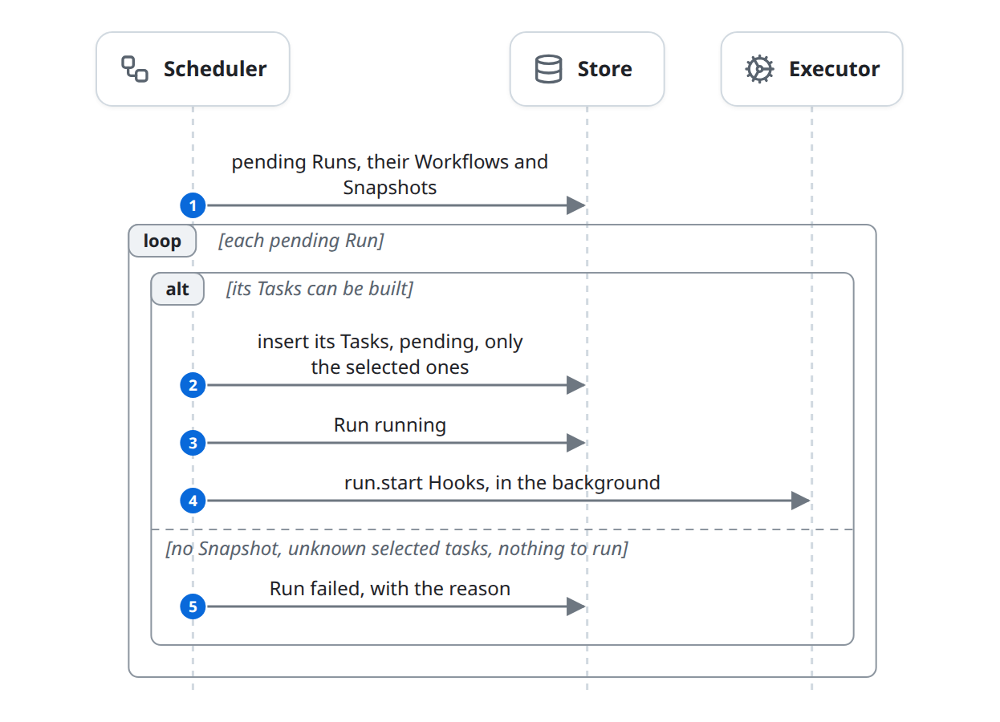
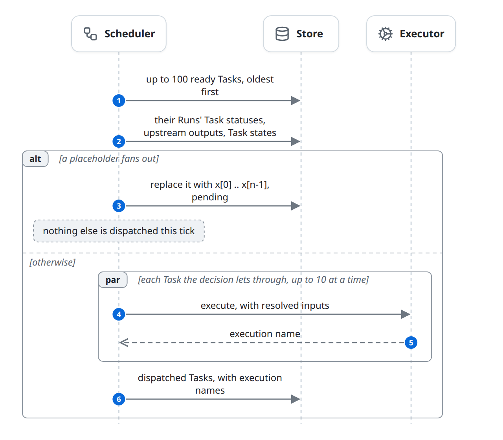
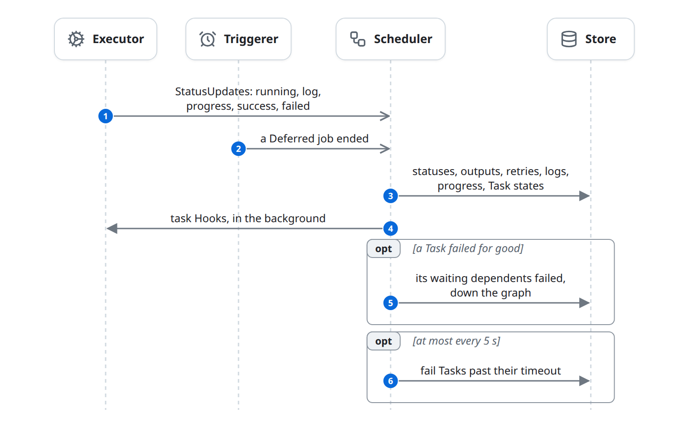
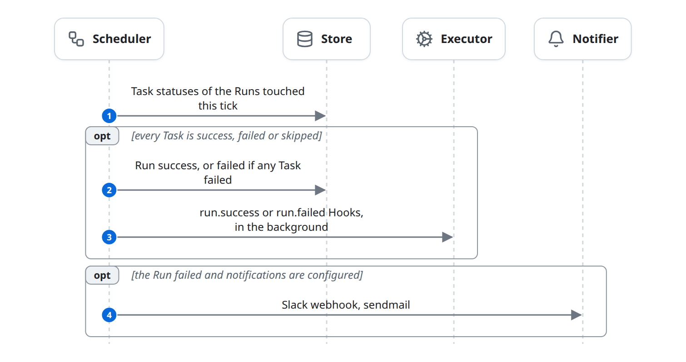
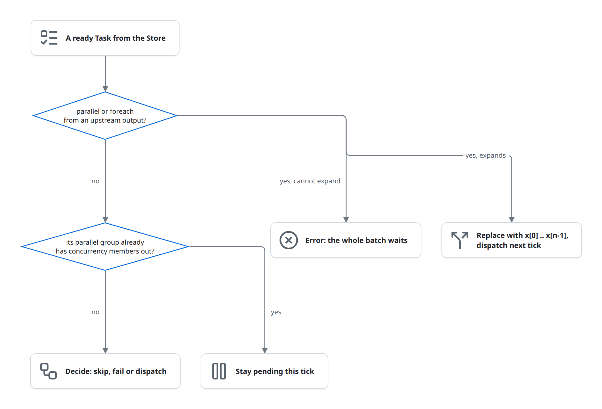
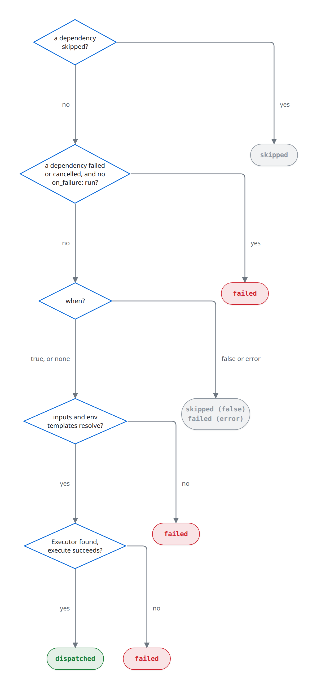

# Schedule: the tick

The Scheduler is a loop. Each pass, a tick, turns pending Runs into Tasks, dispatches the Tasks that are ready, records everything Executors and the Triggerer reported, and completes Runs whose Tasks have all ended. It starts when `czar serve` (or `czar run FILE`) starts and never stops on its own. This is phases 3 and 5 of the [life of a run](life-of-a-run.md); what an Executor does with a dispatched Task is in [execute.md](execute.md).

## At a glance

| | |
|---|---|
| Starts | The Scheduler's own loop: every 0.5 s when idle (`POLL_INTERVAL_SECS`), at once when the last tick found work or a StatusUpdate arrives |
| Blocks | Scheduler, Store, Executor, Triggerer, Notifier |
| Reads and writes | [Run](../domain-model.md#run), [Task](../domain-model.md#task), [Snapshot](../domain-model.md#snapshot) (read), [Task state](../domain-model.md#task-state), [Deferred job](../domain-model.md#deferred-job) (created), [Hook](../domain-model.md#hook) (read) |
| Ends | Never; each tick ends with the Store up to date with every report received |

## The diagram

One tick does four things in order, with the schedule and timeout checks around them. This overview is the whole loop; the parts below zoom into each step.

Starting due schedules is in [start.md](start.md#schedules), Triggerer results in [deferred.md](deferred.md), and the timeout check in [failures.md](failures.md#timeouts).

### Build Tasks

Every pending Run gets its Tasks, or fails if they cannot be built ([rules](#building-a-runs-tasks)).

### Dispatch

Ready Tasks are fanned out, or decided on and handed to Executors ([rules](#when-a-task-is-ready)). Tasks the decision skips or fails go straight to recording.

### Record reports

Everything Executors and the Triggerer reported since the last tick is written in batches ([rules](#recording-reports)).

### Finish Runs

Runs whose Tasks have all ended are completed, and failures are announced ([Runs complete](#runs-complete), [Hooks and notifications](#hooks-and-notifications)).

## State changes

| Entity | From | To | Caused by |
|---|---|---|---|
| Run | `pending` | `running` | Scheduler: it built the Run's Tasks |
| Run | `pending` | `failed` | Scheduler: it couldn't build the Tasks |
| Run | `running`, `paused` | `success` | Scheduler: every Task is `success` or `skipped` |
| Run | `running`, `paused` | `failed` | Scheduler: every Task has ended and at least one `failed` |
| Task | (none) | `pending` | Scheduler: building a Run's Tasks, or expanding a fan-out placeholder |
| Task | `pending` | (removed) | Scheduler: a fan-out placeholder replaced by its copies |
| Task | `pending` | `dispatched` | Scheduler: ready, and the Executor accepted it |
| Task | `pending` | `skipped` | Scheduler: `when` is false, or a dependency was skipped |
| Task | `pending` | `failed` | Scheduler: a dependency failed, or preparing or dispatching failed ([failures.md](failures.md)) |
| Task | `dispatched` | `running` | Scheduler, recording an Executor's `running` report ([execute.md](execute.md)) |
| Task | `dispatched`, `running` | `success` | Scheduler, recording an Executor's `success` report ([execute.md](execute.md)) |
| Task | `dispatched`, `running` | `pending`, `failed` | Scheduler, recording an Executor's `failed` report ([failures.md](failures.md)) |
| Task state | any | the ended Task's status, output and error | Scheduler: a Task ended `success`, `failed` or `skipped` |
| Deferred job | (none) | `pending` | Scheduler: a `success` report listed deferred jobs ([deferred.md](deferred.md)) |

## Rules

### Building a Run's Tasks

- All `pending` Runs are handled each tick. Their Tasks come from the Run's Snapshot, or from the Workflow tasks for a Run without one. Hook rows are left out. Run inputs are merged into every Task's workflow vars.
- The Run's selection is applied: Tasks outside it are not created ([start.md](start.md#selection)).
- A Run whose Tasks cannot be built (its Snapshot is missing, its selection names tasks that are not in the Snapshot, its Workflow has no compiled tasks) becomes `failed` with the reason in its `error`.
- All Tasks are inserted in one statement; a Task that already exists is left alone. The Runs become `running` and their `run.start` Hooks fire.

### When a Task is ready

The Store returns at most 100 ready Tasks per tick (`MAX_TASKS_PER_BATCH`), oldest first. A Task is ready when it is `pending`, its Run is `running`, its `retry_at` is unset or past, and every dependency in the same Run is `success`, `failed` or `skipped`. A dependency that is not in the Run (a selection Run) does not hold it back. A paused Run, or a dependency still `dispatched`, `running` or `cancelled`, does.

For each ready Task the Scheduler first handles fan-out and concurrency:

- **Fan-out.** A placeholder for `parallel: <ref>` or `foreach: <ref>` reads the count or the list from its upstream output and is replaced by `x[0]` .. `x[n-1]`, each with its index (and item), and downstream `depends_on` is rewritten to the copies. With `parallel_mode: cloud_run_tasks` it stays one Task with `task_count` set. When anything fanned out, the tick dispatches nothing else.
- **Concurrency.** Members of a `parallel` group are held back while `concurrency` of them are `dispatched` or `running`.

A fan-out that cannot expand (its output is missing, not a count, or an empty list) is an error for the whole batch ([known-issues.md](../known-issues.md#a-fan-out-error-blocks-dispatch)).

### Deciding a Task's fate

A Task that is neither a fan-out placeholder nor held back is skipped, failed or dispatched, in this order:

The rules behind each box:

- **Dependencies.** A `skipped` dependency skips the Task. A `failed` or `cancelled` dependency fails it, unless it has `on_failure: run` ([failures.md](failures.md#rules)).
- **`when`.** False skips the Task; an evaluation error (a missing field, an ordered comparison of non-numbers) fails it.
- **Inputs.** Bindings and env templates are resolved; a reference that does not resolve fails the Task.
- **Dispatch.** Up to 10 Tasks at a time (`MAX_CONCURRENT_DISPATCHES`) get an Executor and `execute` is called ([execute.md](execute.md)). `CZAR_ATTEMPT` is set to the attempt number. Dispatched Tasks are written as `dispatched`, with the Executor's execution name, in one batch.

### Inputs, references and conditions

`inputs` bindings are `{const: <value>}` or `{ref: <path>}`, resolved when the Task is about to be dispatched:

| Reference | Resolves to |
|---|---|
| `tasks.X.output[.field...]` | The output of Task `X` in this Run; `X` must be in `depends_on`. If `X` fanned out, a list of the copies' values, ordered by index. If `X` is not in this Run, its Task state's last successful output. If `X` is in the Run but has no output, the Task fails. |
| `vars.NAME` | A workflow var, with the Run's inputs merged in. |
| `parallel.index`, `parallel.count` | This copy's position and the number of copies. |
| `foreach.item[.field...]`, `foreach.index`, `foreach.count` | This copy's item and position. |

`env` values like `{{ tasks.X.output.field }}` (or `{{ X.field }}` for a dependency) resolve the same way and must end up a string, number or boolean. `parallel: <ref>` and `foreach: <ref>` also accept the short form `X.field`.

`when` is comparisons joined by `and`, `or`, `not` and parentheses. A value is a `tasks.X.output[.field...]` reference or a literal (integer, float, boolean, quoted string). `==` and `!=` compare JSON values, integers and floats as numbers. `<`, `<=`, `>`, `>=` need numbers on both sides. Task names with a `.` (every dbt task) cannot be referenced, because references are split on dots.

### Recording reports

Executors push StatusUpdates to the Scheduler over an in-memory channel ([execute.md](execute.md#rules)). Each tick takes everything waiting and records it in batches:

- `progress` is stored on the Task and changes nothing else.
- `log` text is appended to the Task's logs.
- `success` with a `deferred` list in its output creates one Deferred job per entry and leaves the Task as it is ([deferred.md](deferred.md)).
- `success` is checked against the Task's declared `output_type` when the Snapshot carries it; a mismatch turns it into `failed`. The output is stored.
- `failed` goes through retries and upstream failure ([failures.md](failures.md)).
- An ended Task (`success`, `failed`, `skipped`) updates its Task state and fires its task Hooks.
- Two reports for one Task in the same batch are merged so the ended status wins over `running`.

## Runs complete

After recording, the Scheduler counts the Tasks of every Run it touched. When every Task is `success`, `failed` or `skipped`, the Run becomes `failed` if any Task failed, else `success`, and its `run.success` or `run.failed` Hooks fire. A `cancelled` or `paused` Task keeps a Run from completing.

## Hooks and notifications

- **Hooks** are the Snapshot's `__hook__:<name>` rows, each for one event: `run.start`, `run.success`, `run.failed`, `task.start`, `task.success`, `task.failed` (after the last retry), `task.skipped`, optionally limited to some tasks. The Scheduler starts a matching Hook through a normal Executor (default `python`) in the background, with the event as its input: event, Hook name, Run id, Workflow name, and the Task name, error, output or failed Task names where they apply. A Hook has no Task row, is not retried, and its result changes nothing.
- **Notifications** go out when a Run becomes `failed` and `notifications.on_failure` is configured, in the `czar serve --config` file or, if that has none, in the project's `czar.yaml`. Slack gets a webhook POST; email goes through `sendmail -t` (`CZAR_SENDMAIL_BIN`, `CZAR_NOTIFICATION_EMAIL_FROM`). They are sent inside the tick.

## Failure and edge cases

- **One Scheduler per Store.** Nothing claims a Task between picking and recording it; a second Scheduler would dispatch it again.
- **A slow tick delays everything.** Dispatch waits for every `execute` call in the batch, and notifications are sent inside the tick, so an inline Executor, a Worker call or a slow Slack request holds up the loop.
- **A pending Run whose Workflow was deleted** is skipped every tick and stays `pending`.
- **Runs started through a flow Snapshot fire no Hooks** and skip the `output_type` check ([start.md](start.md#which-snapshot-a-run-pins)).
- Known issues: [a fan-out error blocks dispatch](../known-issues.md#a-fan-out-error-blocks-dispatch); [`when` cannot read a fanned-out Task](../known-issues.md#when-cannot-read-a-fanned-out-task); [Hook results break a batch of status updates](../known-issues.md#hook-results-break-a-batch-of-status-updates).

## In the code

1. The loop: [scheduler.rs](../../../../crates/czar-core/src/scheduler.rs) (`Scheduler::run`), settings in [config.rs](../../../../crates/czar-core/src/config.rs) (`OrchestratorConfig`).
2. Building Tasks: [scheduler/processing.rs](../../../../crates/czar-core/src/scheduler/processing.rs) (`process_pending_runs`), [run_building.rs](../../../../crates/czar-core/src/task_execution/run_building.rs) (`build_run_tasks_from_snapshot`, `filter_run_tasks_by_selection`).
3. Ready Tasks: `get_pending_tasks_with_workflow` (for example [czar-store-postgres tasks.rs](../../../../crates/czar-store-postgres/src/tasks.rs)), [scheduler/processing.rs](../../../../crates/czar-core/src/scheduler/processing.rs) (`process_pending_tasks`, `filter_tasks_by_parallel_concurrency`), [scheduler/dynamic_fanout.rs](../../../../crates/czar-core/src/scheduler/dynamic_fanout.rs) (`materialize_dynamic_fanout`).
4. Deciding and dispatching: [task_execution.rs](../../../../crates/czar-core/src/task_execution.rs) (`execute_task`, `resolve_bindings_for_task`), [ref_resolution.rs](../../../../crates/czar-core/src/task_execution/ref_resolution.rs), [condition.rs](../../../../crates/czar-core/src/condition.rs).
5. Recording: [scheduler/status_processing.rs](../../../../crates/czar-core/src/scheduler/status_processing.rs) (`process_status_updates`).
6. Completing: [scheduler/status_processing_completion.rs](../../../../crates/czar-core/src/scheduler/status_processing_completion.rs) (`validate_task_output_contract`, `check_run_completions_batch`).
7. Hooks and notifications: [scheduler/status_processing_hooks.rs](../../../../crates/czar-core/src/scheduler/status_processing_hooks.rs), [hooks.rs](../../../../crates/czar-core/src/hooks.rs) (`fire_task_hooks`, `fire_run_hooks`, `HookContext`), [notifications.rs](../../../../crates/czar-core/src/notifications.rs).

## Related

- Parent: [life-of-a-run.md](life-of-a-run.md).
- Before: [start.md](start.md). Children: [execute.md](execute.md), [deferred.md](deferred.md), [failures.md](failures.md).
- Beside: [control.md](control.md) (pause and cancel change what the tick picks), [observe.md](observe.md).
