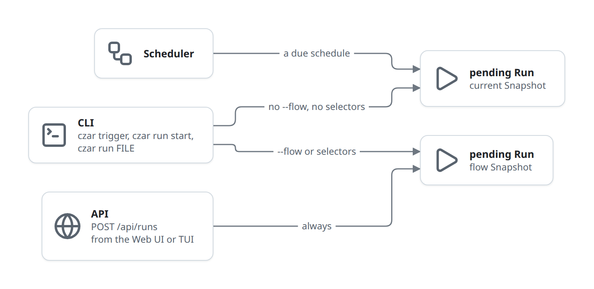
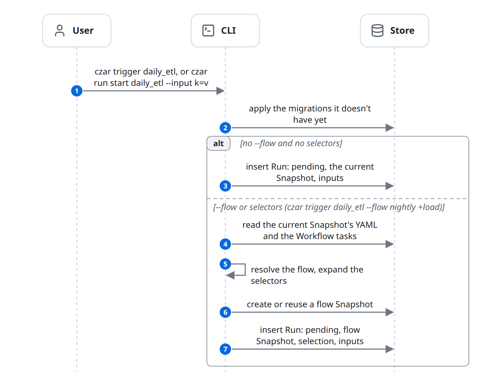
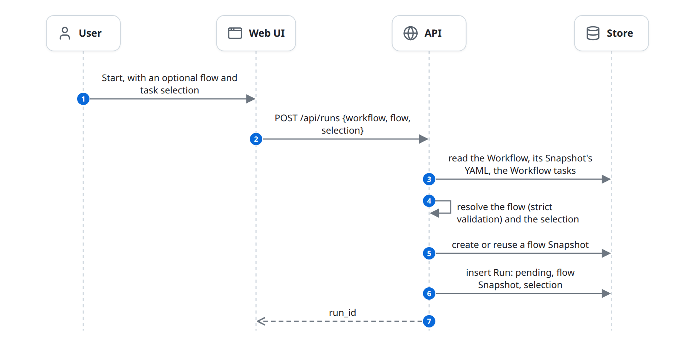
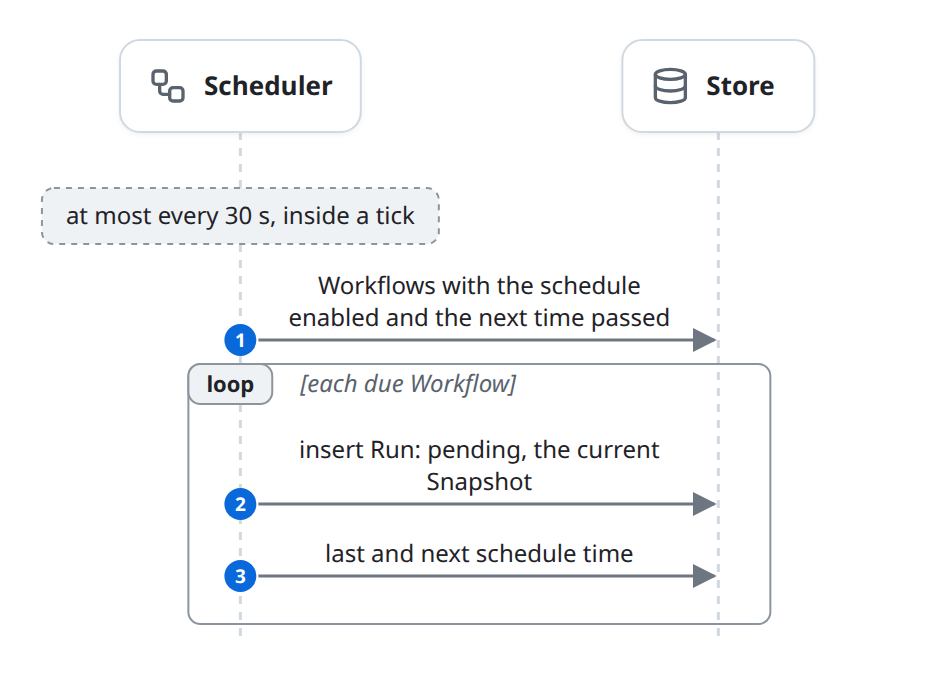

# Start a run

A trigger creates a Run: a User through the CLI, the Web UI or the TUI, or the Scheduler when a schedule is due. The flow ends with one `pending` Run pinned to a Snapshot, with an optional task selection and run inputs. Nothing runs yet; this is phase 2 of the [life of a run](life-of-a-run.md), and the Scheduler picks the Run up in [schedule.md](schedule.md).

## At a glance

| | |
|---|---|
| Starts | A User (`czar trigger`, `czar run start`, `czar run FILE`, Start in the Web UI or TUI), or a due schedule |
| Blocks | User, Web UI, TUI, CLI, API, Scheduler, Store |
| Reads and writes | [Workflow](../domain-model.md#workflow) (read; schedule times), [Snapshot](../domain-model.md#snapshot) (read; created for flows), [Workflow task](../domain-model.md#workflow-task) (read), [Run](../domain-model.md#run) (created) |
| Ends | A `pending` Run in the Store |

## The diagram

Three blocks start Runs. Which Snapshot the new Run pins depends on who starts it and whether a flow or selection is given ([rules](#which-snapshot-a-run-pins)). Every path ends with a `pending` Run that waits for the Scheduler's next tick ([schedule.md](schedule.md)).

### From the CLI

The CLI first applies any migrations the database doesn't have yet, so a new database gets its tables. Without `--flow` or selectors it then only inserts a row. With them, it resolves the flow from the stored YAML first and stores a flow Snapshot ([selection](#selection), [run inputs](#run-inputs)).

### From the Web UI or TUI

Both call `POST /api/runs`; the TUI sends only the workflow name. The API always stores a flow Snapshot, even without a flow.

### From a schedule

The Scheduler checks for due schedules inside its tick ([schedules](#schedules)).

## State changes

| Entity | From | To | Caused by |
|---|---|---|---|
| Run | (none) | `pending`, `triggered_by` = `manual` | CLI: `czar trigger`, `czar run start` |
| Run | (none) | `pending`, `triggered_by` = `cli-execute` | CLI: `czar run FILE` |
| Run | (none) | `pending`, `triggered_by` = `ui` | API: `POST /api/runs` (Web UI and TUI) |
| Run | (none) | `pending`, `triggered_by` = `schedule` | Scheduler: a due schedule |
| Snapshot | (none) | created, or an identical one reused | API: every `POST /api/runs`; CLI: `--flow` or selectors |
| Workflow | `next_scheduled_at` passed | last and next schedule time updated | Scheduler: a due schedule |

## Rules

### Which Snapshot a Run pins

- **The current Snapshot**, stored when the Workflow was applied: `czar trigger` and `czar run start` without `--flow` or selectors, `czar run FILE` without them, and scheduled Runs. It holds every Workflow task, the Hooks, and the Python output signatures.
- **A flow Snapshot**: every `POST /api/runs` (also without a flow), and the CLI with `--flow` or selectors. It is built from the current Snapshot's YAML and the Workflow tasks: the flow's tasks (all of them when no flow is named), each copied from its Workflow task with the flow's `retries`, `timeout` and `inputs` overrides applied. Identical flow Snapshots are reused.
- A flow Snapshot is not the same as the current one: it has no Hooks and no output signatures, it cannot hold a task with a static `parallel: N`, and it ignores the flow's `env`, `retry_delay` and `on_failure` overrides. See [known-issues.md](../known-issues.md#flow-snapshots-drop-hooks-signatures-and-some-overrides).

### Selection

A selection narrows a Run to some of the Snapshot's tasks. It is stored on the Run (`task_selection`) and applied when the Scheduler builds the Run's Tasks; the Snapshot still holds the whole flow.

| Mode (API `selection.mode`) | Tasks in the Run |
|---|---|
| `exact` | Only the requested tasks |
| `upstream` | The requested tasks and everything they depend on |
| `downstream` | The requested tasks and everything that depends on them |
| `full` (the API default) | The downstream set and everything those depend on |

- The API takes `selection.task_names` and `selection.group_names` (task groups are expanded to their tasks). A flow without a selection is stored as an `exact` selection of the flow's tasks.
- The CLI takes positional selectors, resolved before the Run is stored: `task` (only it), `+task` (and its upstream), `task+` (and its downstream), `+task+` (both), with optional depths such as `2+task` or `task+1`. Wildcards are rejected.
- A selected Task whose dependency is not in the Run reads that dependency's output from its [Task state](../domain-model.md#task-state).

### Run inputs

`czar run start NAME --input key=value` (repeatable; the value is parsed as JSON when it can be; `--inputs` also works) stores run inputs on the Run. They are merged into the workflow `vars` of every Task, so `ref: vars.key` sees them.

### Schedules

- The Scheduler checks for due Workflows at most every 30 seconds: `schedule_enabled`, a `schedule`, and `next_scheduled_at` unset or in the past. It creates one Run each and stores the next time.
- A schedule is a cron expression, parsed with the `croner` crate: five fields (`0 2 * * *` is 02:00 daily), optionally with seconds in front (`0 0 2 * * *`), or a shorthand such as `@daily`. Weekday 0 and 7 are Sunday. Times are UTC.
- `schedule_enabled` starts false. Only `czar workflow deploy`, `czar workflow update --schedule-enabled true` and `PATCH /api/workflows/{name}/schedule` turn it on ([define.md](define.md#rules)).
- Changing or re-enabling a schedule does not reset `next_scheduled_at`; a time in the past fires once at the next check.
- Downtime is not backfilled: a missed slot fires once, at the next check.
- Workflows hidden by the definitions-root rule are skipped ([define.md](define.md#failure-and-edge-cases)).

## Failure and edge cases

- **Unknown Workflow** is a CLI error or HTTP 404. **Unknown flow, task or group** is a CLI error or HTTP 400; nothing is stored.
- **A Workflow without a stored YAML** (applied before Snapshots kept it) cannot start a flow or a selection, and `POST /api/runs` answers 400 "re-apply the workflow definition".
- **`POST /api/runs` validates strictly,** so a Workflow applied relaxed (worker sync, or `validation.enabled: false`) can be refused here.
- **An invalid cron expression,** or one that never matches (February 30th), is logged on every check and never creates a Run.
- **`czar run FILE` with another Scheduler running:** it waits about one second to see whether the other Scheduler takes the Run; see [building-blocks.md](../building-blocks.md#processes-in-a-deployment).

## In the code

1. CLI: [trigger.rs](../../../../crates/czar-cli/src/commands/trigger.rs) (`Trigger`, `build_flow_selection`, `build_snapshot_tasks_for_flow`, `build_run_launch_json`), [run.rs](../../../../crates/czar-cli/src/commands/run.rs) (`RunStart`, `parse_run_input`), [selection_spec.rs](../../../../crates/czar-cli/src/commands/selection_spec.rs) (`expand_selectors`), [execute.rs](../../../../crates/czar-cli/src/commands/execute.rs).
2. API: [api_routes_start_run.rs](../../../../crates/czar-web/src/api_routes/api_routes_start_run.rs) (`start_run`), [workflow_groups.rs](../../../../crates/czar-web/src/workflow_groups.rs) (`resolve_flow_workflow_from_source_yaml`, `build_snapshot_tasks_for_flow`).
3. Selection: [run_building.rs](../../../../crates/czar-core/src/task_execution/run_building.rs) (`resolve_task_selection`), [models.rs](../../../../crates/czar-core/src/models.rs) (`RunTaskSelection`, `RunLaunchConfig`).
4. Schedule: [schedule_processor.rs](../../../../crates/czar-core/src/schedule_processor.rs) (`process_scheduled_triggers`), called from [scheduler.rs](../../../../crates/czar-core/src/scheduler.rs).
5. Store: `create_run_with_snapshot_and_selection`, `get_due_scheduled_workflows`, `update_workflow_schedule_times` (for example in [czar-store-postgres runs.rs](../../../../crates/czar-store-postgres/src/runs.rs) and [workflows.rs](../../../../crates/czar-store-postgres/src/workflows.rs)).

## Related

- Parent: [life-of-a-run.md](life-of-a-run.md).
- Before: [define.md](define.md). After: [schedule.md](schedule.md).
- Beside: [control.md](control.md) (retry puts a Run back to `pending`), [access.md](access.md) (who may call `POST /api/runs`).
