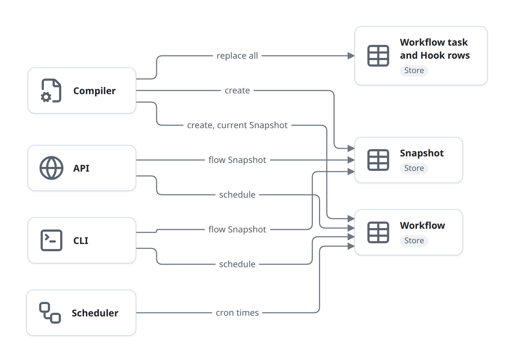
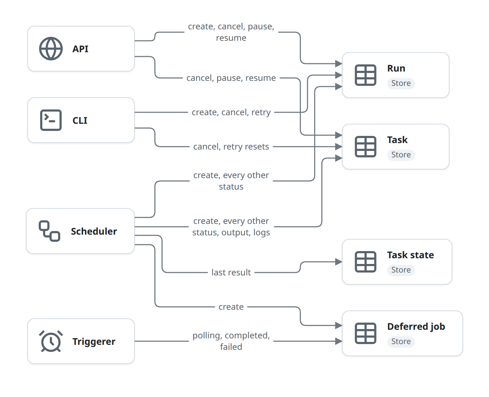

# Storage

The Store holds every entity in [domain-model.md](domain-model.md) except Worker registrations. The Scheduler, the API and the CLI never call each other; they read and write these tables. This page says which backend you get, which building block writes which entity, and how the backends differ. Column-level detail is in [schema.md](../schema.md).

## Backends

Every backend implements the `Database` trait ([database.rs](../../../crates/czar-core/src/database.rs)) with its own hand-written queries. The Postgres, SQLite and file crates wire the trait to their methods with a macro in `delegation.rs`; D1 implements it directly under [database/](../../../crates/czar-store-d1/src/database/).

| Backend | Crate | Selected by | Notes |
|---|---|---|---|
| SQLite | [czar-store-sqlite](../../../crates/czar-store-sqlite/) | `DATABASE_URL=sqlite:...`, or the default `sqlite://$HOME/.czar/czar.db?mode=rwc` | Creates the parent directory. Pool of 5 connections, WAL journal, `foreign_keys = ON`, `synchronous = NORMAL`. |
| Postgres | [czar-store-postgres](../../../crates/czar-store-postgres/) | `DATABASE_URL=postgres://...` | Pool size from `DB_POOL_SIZE` (default 10). Multi-row inserts and status updates are single statements. |
| Cloudflare D1 | [czar-store-d1](../../../crates/czar-store-d1/) | `--db-backend d1` or `CZAR_DB_BACKEND=d1`, with `CZAR_D1_ACCOUNT_ID`, `CZAR_D1_DATABASE_ID`, `CZAR_D1_API_TOKEN` (optional `CZAR_D1_BASE_URL`) | Each statement is one HTTP request to the D1 `/query` endpoint. Not in the default build (`d1` feature). |
| Files | [czar-store-file](../../../crates/czar-store-file/) | Not selectable from any binary | One JSON file per record under a base directory (default `.czar/db`): `workflows/`, `runs/`, `tasks/`, `workflow_tasks/`, ... No locking. For embedding czar as a library, and for tests. |

How a binary picks one:

1. `--db-backend`, else `CZAR_DB_BACKEND` (`postgres`, `sqlite` or `d1`).
2. Else the only backend compiled in.
3. Else the scheme of `--database-url` or `DATABASE_URL` (`postgres://`, `postgresql://`, `sqlite:`).
4. Else SQLite, when no URL is set.

Setting `CZAR_DB_TRACE` when starting `czar serve` wraps the Store in a tracer that prints call counts and timings to stderr as `DB_TRACE: {json}` every 2 seconds.

## Entities and who writes them

| Entity | Table | Written by | Read by |
|---|---|---|---|
| Workflow | `workflows` | Compiler (create, flow list, Worker stamp, current Snapshot); CLI and API (schedule); Scheduler (cron times) | Everyone |
| Workflow task, Hook | `workflow_tasks` | Compiler (replaced as a whole on every apply) | Scheduler (Runs without a Snapshot, output signatures), API (graph, flow Snapshots) |
| Snapshot | `workflow_snapshots` | Compiler; API (`POST /api/runs`); CLI (`--flow`, selectors). Immutable, unique per content hash. | Scheduler (Task rows, Hooks, signatures), API (flows and groups from the stored YAML) |
| Run | `runs` | Created by CLI, API and Scheduler (cron); status by Scheduler, API, CLI | Everyone |
| Task | `tasks` | Created and advanced by Scheduler; cancelled by API and CLI; paused and resumed by API; reset by `czar run retry` | Scheduler, API, CLI |
| Task state | `workflow_task_states` | Scheduler on every ended Task; API on cancel | Scheduler (outputs of Tasks not in the Run), API |
| Deferred job | `deferred_jobs` | Created by Scheduler, advanced by Triggerer | Triggerer |

The same, as two pictures. The first shows the entities that describe a Workflow; they change when a workflow is applied, and when a Run is started for a flow.

The API and CLI create a flow Snapshot when a Run starts ([start](flows/start.md)), and change a Workflow's schedule.

The second shows the entities that change while a Run goes on. The Scheduler writes most of them; the API and CLI only for User commands ([control](flows/control.md)), and the API also writes Task states when it cancels.

## Write rules

- **Run timestamps.** `started_at` is set once, on the first `running`. `finished_at` is set on `success`, `failed` and `cancelled`, and cleared by any other status, for example when `czar run retry` sets the Run back to `pending`.
- **Task counters and timestamps.** Moving to `failed` adds 1 to `attempts`, and so does a retry reset. `dispatched_at` and `started_at` are set once.
- **Guards.** Postgres' batch Task status update refuses to move a `success` or `failed` Task to a non-terminal status. SQLite and D1 have no such guard. Nothing else checks the current status in SQL: the API reads the status, decides, then writes; the Scheduler writes what Executors report. See [flows/control.md](flows/control.md).
- **Inserting Tasks** uses `ON CONFLICT (run_id, task_index) DO NOTHING`, so building a Run's Tasks twice never duplicates them.
- **Logs** are one text column per Task. Appends keep the first 2,000,000 characters of the existing text and add the new chunk (all three SQL backends).

## Migrations

- Postgres and SQLite each have their own numbered history, applied by `sqlx::migrate!`: [migrations](../../../crates/czar-store-postgres/migrations/) and [migrations_sqlite](../../../crates/czar-store-sqlite/migrations_sqlite/). D1 has one file, [001_init.sql](../../../crates/czar-store-d1/migrations/001_init.sql), applied by its own runner that records names in `__czar_d1_migrations`. The file backend only creates its directories.
- Only `czar init`, `czar serve` (and `czar dev`) and `czar-web` run migrations. Every other command expects the schema to exist, so run `czar init` or start the server once against a new Store.

## Failure and edge cases

- **One Scheduler per Store.** Ready Tasks are read without claiming them (no `FOR UPDATE SKIP LOCKED`), so two Schedulers would both dispatch them.
- **Partial writes.** Applying a Workflow is several separate writes ([flows/define.md](flows/define.md)). On D1 nothing is a transaction, so any multi-statement operation can stop halfway.
- **D1 parameter cap.** Large Runs may not fit in one D1 statement: [known-issues.md](known-issues.md#d1-inserts-all-tasks-of-a-run-in-one-statement).
- **Large rows.** Listing Tasks and the timeout check read whole Task rows, logs included, which can be megabytes per Task.
- **Four implementations.** A new `Database` method has to be written for Postgres, SQLite, D1 and files. The backend test suites ([czar-tests](../../../crates/czar-tests/) and the backend crates' `tests/`) are the only check that they agree.

## In the code

- [database.rs](../../../crates/czar-core/src/database.rs): the `Database` trait and its repository traits.
- [czar-store lib.rs](../../../crates/czar-store/src/lib.rs) and [bootstrap.rs](../../../crates/czar-store/src/bootstrap.rs): feature-gated re-exports, URL defaults, the project `czar.yaml` and its `env_file`.
- [czar-cli bootstrap.rs](../../../crates/czar-cli/src/bootstrap.rs), `resolve_backend`; `czar-web` has a copy in [main/bootstrap.rs](../../../crates/czar-web/src/main/bootstrap.rs).
- [czar-store-sqlite core.rs](../../../crates/czar-store-sqlite/src/core.rs), `SqliteDatabase::new`, `run_migrations`.
- [czar-store-postgres tasks.rs](../../../crates/czar-store-postgres/src/tasks.rs): `get_pending_tasks_with_workflow_impl`, `batch_update_task_status_impl`, `mark_tasks_failed_by_dependency_impl`.
- [czar-store-d1 client.rs](../../../crates/czar-store-d1/src/client.rs) and [migrations.rs](../../../crates/czar-store-d1/src/migrations.rs).
- [database/tracing.rs](../../../crates/czar-core/src/database/tracing.rs): `TracingDatabase`.

## Related

- [schema.md](../schema.md): columns and the generated schema.
- [building-blocks.md](building-blocks.md#store): the Store as a building block.
- [domain-model.md](domain-model.md): what each entity means.
