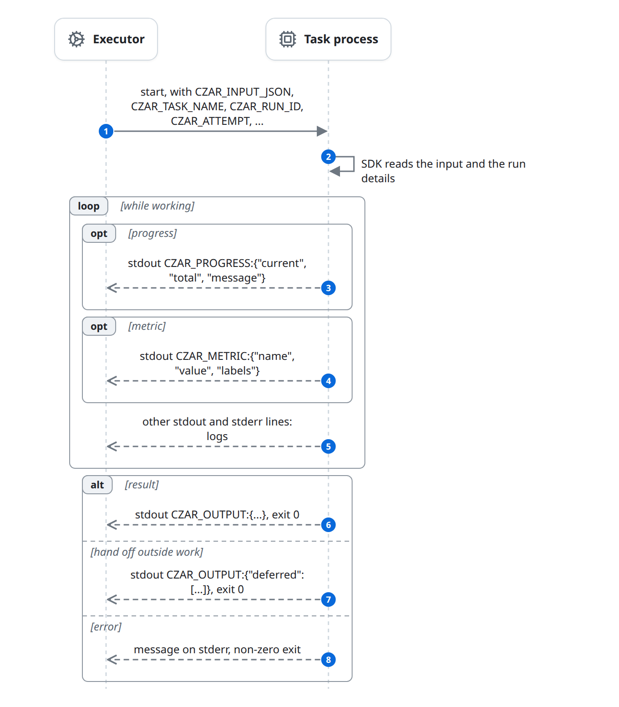

# Task SDKs and the task protocol

A Task process never calls czar. It reads its input from an environment variable and prints its result as one line on stdout. The Rust and Python SDKs are thin helpers over that text protocol; any program that follows it is a valid Task process. `echo 'CZAR_OUTPUT:{"rows": 3}'` is a complete task.

The text protocol is what lets the same task code run unchanged as a local process, in a container, on a Worker or in a Cloud Run job, in any language, with no network access to czar. The Executor side (how czar reads these lines) is in [flows/execute.md](flows/execute.md).

## The protocol

| Direction | Channel | Content |
|---|---|---|
| In | `CZAR_INPUT_JSON` | The Task's resolved `inputs` as a JSON object. Only set when the Task has `inputs`. |
| In | `CZAR_TASK_NAME`, `CZAR_WORKFLOW_NAME`, `CZAR_RUN_ID`, `CZAR_TASK_ID`, `CZAR_EXECUTION_NAME`, `CZAR_ATTEMPT`, `CZAR_PARALLEL_INDEX`, `CZAR_PARALLEL_COUNT` | Run details. Fan-out copies get their `foreach` item through `inputs` bindings such as `foreach.item`. |
| In | The Task's `env` and secret files | As configured in the workflow; the rest of czar's own environment is inherited. |
| Out | stdout `CZAR_OUTPUT:<json>` | The result. The last valid one wins, and it counts only if the process exits 0. |
| Out | stdout `CZAR_PROGRESS:{"current": n, "total": n, "message": "..."}` | Progress, shown in the UIs. |
| Out | stdout `CZAR_METRIC:{"name": "...", "value": ..., "labels": {...}}` | Stored as an `M` log line; czar does not interpret it. |
| Out | Other stdout lines, stderr lines | Logs (`O` and `E` lines). |
| Out | Exit code | Non-zero fails the attempt. |

Library and embedded Wasm tasks have no process. They receive the input JSON as an argument and return one string: `CZAR_OUTPUT:<json>` or plain JSON.

## Rust

Task crates depend on one crate, [czar](../../../crates/czar/). It re-exports `#[task]` from [czar-macros](../../../crates/czar-macros/), which is separate only because Rust requires procedural macros in a crate of their own.

| Task kind | Written as | What it generates |
|---|---|---|
| Process binary (also the Wasm CLI mode) | `#[czar::task]` on `fn(input)` or `fn(input, ctx: Context)` | A `main` that reads the input, calls the function, and prints `CZAR_OUTPUT:`. A returned `Err` prints "Task error: ..." to stderr and exits 1. `async fn` is rejected. |
| Process binary, by hand | `run_task(f)` or `run_task_with_context(f)` | The same, without the attribute. |
| Shared library (`executor: library`) | `czar_task_library!(f)` | Exports `czar_task_run` and `czar_task_free`. `czar_task_library!(f, symbol)` exports a custom symbol (YAML `function`); add `czar_task_library_free!()` once. |
| Embedded Wasm (`executor: wasm`) | `czar_task_wasm!(f)` in a `cdylib` | Exports `czar_alloc`, `czar_task_run` and `czar_free` ([wasm.rs](../../../crates/czar/src/wasm.rs)). |

- **Input.** `read_input` ([lib.rs](../../../crates/czar/src/lib.rs)) uses `CZAR_UPSTREAM_JSON` (wrapped as `{"upstream": ...}`) if set, else `CZAR_INPUT_JSON`, else one line from stdin. czar never sets `CZAR_UPSTREAM_JSON`, and a Task without `inputs` has no `CZAR_INPUT_JSON`, so it reads stdin, which it inherits from czar.
- **Context.** `Context::from_env` holds the run details above plus `raw_input`. `ctx.log().info(...)` (and `warning`, `error`, `debug`) prints log lines, `ctx.metrics().record(name, value, labels)` prints `CZAR_METRIC:`, and `ctx.progress(current, total, message)` prints `CZAR_PROGRESS:`.
- **Library and Wasm errors.** The generated code returns `{"error": "..."}` for a null pointer, invalid UTF-8, an input that does not parse, or an output that does not serialize. The Executors do not treat that shape as a failure: see [known-issues.md](known-issues.md#sdk-error-results-count-as-success). Nothing catches panics: a panic in a library task aborts czar.

## Python

The `czar` package ([python-sdk/](../../../python-sdk/)) is optional. The `python` executor runs task functions through a runner that ships inside czar, [run_task.py](../../../crates/czar-executors/runtime/python/run_task.py), started with `uv run python` in the task's project.

- **Calling the function.** The runner imports `CZAR_TASK_FILE` or `CZAR_TASK_MODULE` and calls `CZAR_TASK_FUNCTION` (default `main`). With a dict input it passes keys as keyword arguments when the function has more than one parameter, or one parameter whose name is an input key. Otherwise it passes the whole input as one argument, built through the parameter's annotation when it can.
- **Context.** A parameter annotated with a class named `Context`, or an unannotated parameter named `ctx` or `context`, receives a context: `czar.Context` when the package is installed, else a built-in fallback with the same fields. Fields: `run_id`, `workflow_name`, `task_name`, `task_id`, `execution_name`, `attempt`, `parallel_index`, `parallel_count`, `raw_input`, `upstream`; helpers `ctx.log(...)` (and `.debug/.info/.warning/.error`, printed to stdout with a level prefix), `ctx.metrics.record(...)` and `ctx.progress(current, total, message)`.
- **Result.** `None` prints no output line. Objects with `model_dump()` or `dict()` are converted; dates and times become ISO strings. Anything else that `json.dumps` cannot encode raises `TypeError` and fails the task.
- **Progress bars.** The runner patches `tqdm` so its bars print `CZAR_PROGRESS:` lines. `CZAR_TQDM_BRIDGE=0` turns this off. `czar.czar_progress(current, total, message)` prints one directly.
- **Markers.** `@czar.task` and `@czar.executor` only tag a function or class; they do not change how it is called.
- **dbt.** `czar.dbt.run_node` is the function that dbt-import Tasks run ([flows/define.md](flows/define.md#dbt-imports)).

### Custom executors

`executor: custom:<name>` runs [run_executor.py](../../../crates/czar-executors/runtime/python/run_executor.py). The project `czar.yaml` maps `<name>` under `executors:` to a `type: module:Class` and an optional `config`. The runner builds `Class(config)` (or `Class()` when there is no config), then calls its `run` method, passing by parameter name: `config_file`/`config_path` (the task's `config_file`), `ctx`/`context`, `upstream`, and `task_input`/`input`/`params`/`payload` (the input). An exception prints `Type: message` to stderr and exits 1.

## Deferrables

A Task process that starts a long outside job returns a `deferred` list instead of waiting, and czar creates one Deferred job per entry; see [flows/deferred.md](flows/deferred.md).

| Job | `service_type` | Python class | Rust struct |
|---|---|---|---|
| BigQuery job | `bigquery` | `BigQueryJob` | `BigQueryJob` |
| Cloud Run job execution | `cloudrun` | `CloudRunJob` | `CloudRunJob` |
| Dataproc job | `dataproc` | `DataprocJob` | `DataprocJob` |
| HTTP status URL | `custom_http` | `CustomHttp` | `CustomHttp` |

- **Python** ([deferrables.py](../../../python-sdk/czar/deferrables.py)): return `{"deferred": [job.to_dict()]}`. `to_dict()` adds `service_type` and `job_id`, and renames `CustomHttp`'s `completion_field`/`completion_value` to the `status_field`/`success_value` the tracker reads. Returning the object itself fails: [known-issues.md](known-issues.md#python-tasks-cannot-return-a-deferrable-object).
- **Rust** ([deferrables.rs](../../../crates/czar/src/deferrables.rs)): `TaskResult::deferred(...)` and `TaskResult::mixed(data, ...)` build the list. They are rejected today: [known-issues.md](known-issues.md#rust-sdk-deferrables-are-rejected).

## The `czar-cli` wheel

[python-cli/](../../../python-cli/) builds the `czar-cli` package with maturin (`bindings = "bin"`), which installs the native `czar` binary itself as the console command. There is no Python wrapper process, so signals reach `czar` directly.

## Failure and edge cases

- **Three copies to keep in step.** Context fields, job types and log format exist in the Rust SDK, the Python package, and the runner's fallback context. A new field needs all three.
- **Invalid output lines.** A `CZAR_OUTPUT:` line with invalid JSON is logged as an ordinary line; the task keeps any earlier valid output, or has none.
- **Large inputs.** Input travels in one environment variable, so very large inputs can hit the operating system's limit and the task fails to start.
- **Output size.** The output is one line held in memory by the executor and stored in one column.

## Related

- [flows/execute.md](flows/execute.md) and [flows/execute-local.md](flows/execute-local.md): the Executor side of this protocol.
- [flows/deferred.md](flows/deferred.md): what happens to Deferred jobs.
- [building-blocks.md](building-blocks.md#task-process): the Task process as a building block.
