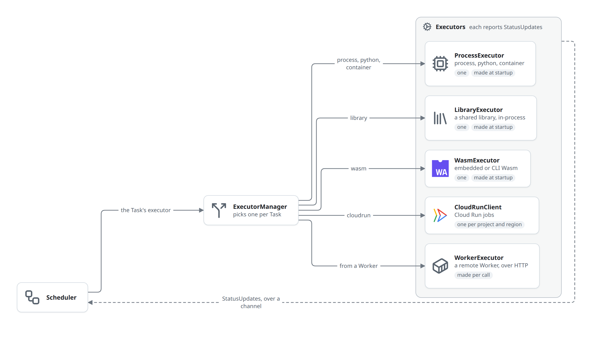

# czar-executors

_Updated at: 2026-05-22_

Execution backends and the executor manager. Implements [`czar-core::Executor`](../../../crates/czar-core/src/executor.rs).

## Design

> Static executors (`ProcessExecutor`, `LibraryExecutor`, `WasmExecutor`) are created once at startup.
> `CloudRunClient` is created dynamically and cached per `(project, region)` key.
> `WorkerExecutor` is created per call when a workflow carries remote-worker metadata.

## Owns

- `ExecutorManager`: per-task executor selection and caching
- `ProcessExecutor`: local process runner for scripts and Python tasks
- `LibraryExecutor`: host shared-library task runner
- `WasmExecutor`: embedded and CLI-style wasm execution
- `CloudRunClient`: Cloud Run execution client (feature-gated)

## Behavior Summary

- Scheduler sets a `StatusUpdate` channel on each executor instance.
- Executors send updates when tasks start or finish.
- `ExecutorManager` selects the backend based on task `executor_type`.

## Files

| File | Purpose | Updated | File SHA |
|------|---------|---------|----------|
| [Cargo.toml](../../../crates/czar-executors/Cargo.toml) | Executor crate manifest with process, library, wasm, embedded-wasm, worker, and Cloud Run feature flags. | 2026-03-14 | b11bf4f |
| [runtime/python/inspect_task.py](../../../crates/czar-executors/runtime/python/inspect_task.py) | Embedded helper script that inspects Python task functions and emits their input/output signature as JSON. | 2026-03-12 | 87e0db8 |
| [runtime/python/run_task.py](../../../crates/czar-executors/runtime/python/run_task.py) | Embedded Python task runner that loads task modules/files, bridges progress/output, and serializes results back to the process executor. | 2026-03-12 | fa4eb77 |
| [src/cloud_run/mod.rs](../../../crates/czar-executors/src/cloud_run/mod.rs) | Cloud Run executor module wiring. | 2026-03-12 | 84e274b |
| [src/cloud_run/client.rs](../../../crates/czar-executors/src/cloud_run/client.rs) | Cloud Run executor client that starts jobs, maps params to container env overrides, polls execution state, and emits status updates. | 2026-03-12 | 84e274b |
| [src/lib.rs](../../../crates/czar-executors/src/lib.rs) | Executor module wiring and public re-exports for backend implementations. | 2026-03-14 | 82835ce |
| [src/library/mod.rs](../../../crates/czar-executors/src/library/mod.rs) | Dynamic-library executor module wiring. | 2026-03-12 | 167e952 |
| [src/library/executor.rs](../../../crates/czar-executors/src/library/executor.rs) | Dynamic-library executor that calls host-native task entrypoints and reports success/failure via status updates. | 2026-03-12 | 167e952 |
| [src/manager.rs](../../../crates/czar-executors/src/manager.rs) | Runtime executor selection and feature-gated backend resolution. | 2026-03-14 | 13e891b |
| [src/manager/tests.rs](../../../crates/czar-executors/src/manager/tests.rs) | Unit tests for executor selection and disabled-backend error paths. | 2026-03-14 | cf80344 |
| [src/process.rs](../../../crates/czar-executors/src/process.rs) | Local process executor for shell commands and Python tasks, including env setup and status streaming. | 2026-03-14 | 2f75419 |
| [src/process/support.rs](../../../crates/czar-executors/src/process/support.rs) | Shared process-executor helpers for env extraction, command resolution, compile-resolved uv Python startup, and PYTHONPATH assembly. | 2026-03-12 | f062f02 |
| [src/process/tests.rs](../../../crates/czar-executors/src/process/tests.rs) | Shared test harness for process-executor unit coverage, including temp project setup and status-update collection helpers. | 2026-03-12 | 24e4de5 |
| [src/process/tests/basics.rs](../../../crates/czar-executors/src/process/tests/basics.rs) | Basic process-executor tests for env extraction, command resolution, and Python command setup. | 2026-03-14 | 9e0bc5d |
| [src/process/tests/execution_core.rs](../../../crates/czar-executors/src/process/tests/execution_core.rs) | Core process-executor tests for stdout/stderr handling, failures, spawn errors, and no-channel execution behavior. | 2026-03-12 | f60b5f5 |
| [src/process/tests/execution_python.rs](../../../crates/czar-executors/src/process/tests/execution_python.rs) | Python execution tests covering module/file runners, datetime serialization, uv setup, and tqdm progress bridging. | 2026-03-12 | d386aed |
| [src/python_runtime.rs](../../../crates/czar-executors/src/python_runtime.rs) | Python runtime orchestration and environment/bootstrap helpers. | 2026-03-12 | 6cac05b |
| [src/python_runtime/tests.rs](../../../crates/czar-executors/src/python_runtime/tests.rs) | Tests that embedded Python runtime scripts are written to the cache directory and stale cached content is overwritten on re-request. | 2026-03-12 | 857da57 |
| [src/wasm/mod.rs](../../../crates/czar-executors/src/wasm/mod.rs) | Wasm executor entrypoint that selects embedded vs CLI execution and shares status/update plumbing. | 2026-03-25 | current |
| [src/wasm/embedded.rs](../../../crates/czar-executors/src/wasm/embedded.rs) | In-process wasm execution through wasmtime embedding for library-style wasm tasks. | 2026-03-25 | current |
| [src/wasm/support.rs](../../../crates/czar-executors/src/wasm/support.rs) | Shared helpers for wasm env construction and runtime detection. | 2026-03-25 | current |
| [src/wasm/tests.rs](../../../crates/czar-executors/src/wasm/tests.rs) | Wasm executor tests covering embedded mode and CLI-runtime behavior. | 2026-03-25 | current |
| [src/worker/mod.rs](../../../crates/czar-executors/src/worker/mod.rs) | Remote-worker executor module wiring. | 2026-03-12 | c2655f0 |
| [src/worker/executor.rs](../../../crates/czar-executors/src/worker/executor.rs) | Remote-worker executor that forwards execute requests over HTTP and emits success/failure/deferred results back to the scheduler. | 2026-03-12 | c2655f0 |
| [tests/test_library.rs](../../../crates/czar-executors/tests/test_library.rs) | Integration tests for the dynamic library executor path. | 2026-02-11 | b376ce6 |
