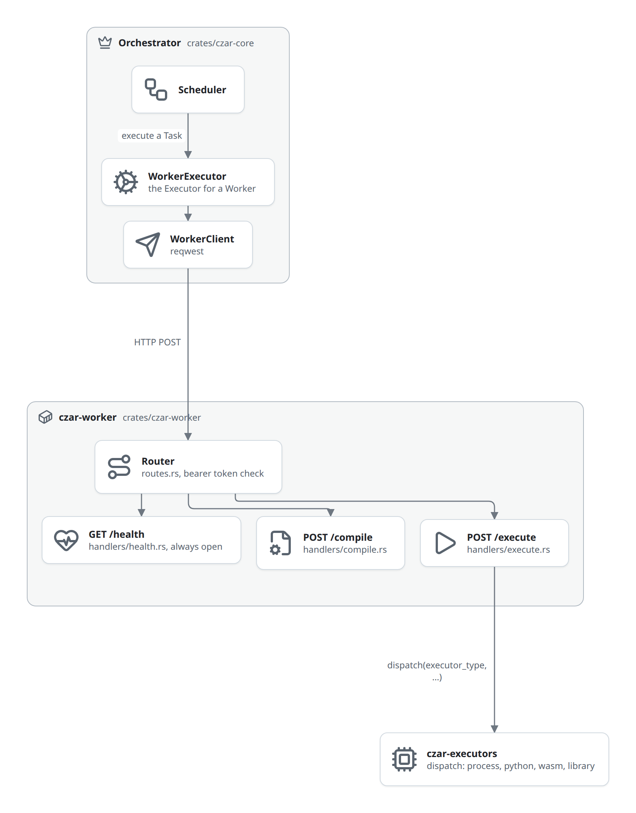

# czar-worker internals

_Updated at: 2026-09-29_

`czar-worker` (`crates/czar-worker`) is an Axum HTTP server binary that executes workflow tasks on behalf of the orchestrator. This page covers implementation details for contributors.

## Scope

`czar-worker` owns:
- loading and compiling workflow assets present locally on disk
- executing local backends (`process`, `python`, `library`, `wasm`)
- returning results as synchronous HTTP responses

It does not own scheduler state, database-backed orchestration, or remote backends like `cloudrun` that need cloud-scoped config and polling.

## Architecture overview



## HTTP endpoints

When started with `--auth-token` (or `CZAR_WORKER_AUTH_TOKEN`), `/compile` and `/execute` require `Authorization: Bearer <token>` and answer `401` otherwise (`auth.rs`, applied in `routes.rs`). `/health` is always open.

### GET /health

Returns `{"status":"healthy","service":"czar-worker"}`. Used for container readiness probes.

### POST /compile

**Request**: no body. The worker always compiles the workflow at `WorkerState::workflow_path` (fixed at startup from `--workflow-path`).

**Response** (`CompileResponse`):
```json
{
  "workflow": { /* WorkflowDefinition */ },
  "tasks": [
    { "name": "task_name", "executor": "process", "depends_on": [] }
  ],
  "source_yaml": "name: my_workflow\n..."
}
```

`source_yaml` is the raw workflow source so the orchestrator can register the workflow definition; it is `null` if the source could not be read.

Pipeline:
1. Load YAML from `WorkerState::workflow_path`
2. If a `generate:` directive is present, run the generator (Python or native process) to produce the YAML
3. Parse into `WorkflowDefinition` and validate against the task catalog
4. Compile into `CompiledWorkflow` DAG
5. Return the task list with names, executor kinds, and dependency edges

The scheduler stores this DAG in the database; it does not re-compile on every run.

### POST /execute

**Request** (`ExecuteRequest`):
```json
{
  "task_id": "uuid",
  "task_name": "task_name",
  "executor_type": "process|python|library|wasm|cloudrun|container",
  "params": { /* executor-specific params */ }
}
```

**Response** (`ExecuteResponse`):
```json
{ "status": "success", "output": { /* CZAR_OUTPUT value */ }, "deferred": [] }
// or
{ "status": "failed", "error": "message" }
```

Execution is synchronous: the HTTP response is not returned until the task finishes (or times out).

## Executor dispatch

`handlers/execute.rs::execute_handler` contains no executor logic of its own. It rejects an unknown `executor_type` up front (`RequestedExecutorType::known()`), then forwards everything to `czar_executors::dispatch::dispatch()`:

```rust
pub async fn dispatch(
    executor_type: ExecutorType,
    working_dir: Option<String>,
    workflow_root: Option<PathBuf>,
    task_id: Uuid,
    task_name: &str,
    params: Option<serde_json::Value>,
) -> Result<serde_json::Value, String>
```

`dispatch` is a single `match` over `ExecutorType` that constructs the concrete executor from `czar-executors`:

| `ExecutorType` | Backend |
|----------------|---------|
| `Process`, `Container` | `ProcessExecutor`: runs `params.command` (falls back to the task name) |
| `Python` | `PythonExecutor` |
| `Library` | `LibraryExecutor`: requires `params.library_path` |
| `Wasm` | `WasmExecutor` |
| `CloudRun` | `CloudRunClient`: only compiled in when the `cloudrun` feature is enabled |

The worker is built with the `local-executors` feature set (`process`, `library`, `wasm-embedded`), so `cloudrun` is **not** compiled into the worker: a `cloudrun` request falls through to the catch-all arm and returns `"Executor type 'cloudrun' is not available in this build"`.

## StatusUpdate flow

Executors report progress over an `mpsc::UnboundedSender<StatusUpdate>`. `dispatch::execute_with_terminal_updates` creates that channel, sets it on the executor, calls `executor.execute()`, then runs `dispatch::wait_for_terminal_update`, which drains the receiver until it sees a `success` update (returns the output JSON) or a `failed` update (returns the error) for the task.

The whole wait is wrapped in a 30-second `TERMINAL_UPDATE_TIMEOUT`; exceeding it returns an `"Execution timed out waiting for completion"` error. The worker is therefore synchronous from the orchestrator's point of view: the HTTP response is not sent until the task reaches a terminal state.

```rust
pub struct StatusUpdate {
    pub task_id: Uuid,
    pub status: String,          // "running" | "progress" | "success" | "failed"
    pub output: Option<Value>,
    pub error: Option<String>,
    pub log: Option<String>,
    pub progress: Option<Value>,
}
```

## Executor implementations

`dispatch` builds the concrete executor types from `czar-executors`, the same implementations the in-process scheduler uses. The worker passes them its `working_dir` and the workflow root (the workflow file's parent directory):

- **`ProcessExecutor`** (`process` / `container`): spawns `params.command` as a local process and reads typed output from `CZAR_OUTPUT:` stdout lines.
- **`PythonExecutor`** (`python`): runs the task file through `uv run python`; resolves the Python project root by walking up to the nearest `pyproject.toml`.
- **`LibraryExecutor`** (`library`): loads a native shared library (`.so`/`.dylib`/`.dll`) via FFI and calls the exported task symbol; `params.library_path` is resolved against `working_dir`.
- **`WasmExecutor`** (`wasm`): embedded (in-process `wasmtime`) or CLI (`wasm_mode: cli`) execution.

See [design/native-executors.md](../design/native-executors.md) for the full behavior of the process, library, and wasm executors.

## WorkerState

```rust
pub struct WorkerState {
    pub workflow_path: String,   // absolute path to workflow.yaml
    pub working_dir: String,     // base directory for relative asset paths
}
```

Both fields come from CLI flags and are immutable for the lifetime of the server. There is no other shared mutable state; the worker is fully stateless across requests.

## Orchestrator integration

The orchestrator side lives in `czar-core`:

- `src/worker_client.rs`: `WorkerClient`: thin reqwest wrapper with 5-minute timeout; calls `/compile` and `/execute`, sending the worker's configured `token` as a bearer token
- `src/executor.rs`: `WorkerExecutor`: implements the `Executor` trait using `WorkerClient`; bridges the HTTP response to `StatusUpdate` channel events that the scheduler consumes

```rust
pub struct WorkerClient {
    client: reqwest::Client,
    worker_url: String,   // e.g. "http://127.0.0.1:8081"
}
```

The scheduler holds an `ExecutorManager` that caches `WorkerExecutor` instances keyed by worker URL. Multiple concurrent tasks can be dispatched to the same worker (each request is independent).

## Feature flags

```toml
[features]
default         = ["local-executors"]
process         = ["czar-executors/process"]
library         = ["czar-executors/library"]
wasm            = ["czar-executors/wasm"]
wasm-embedded   = ["wasm", "czar-executors/wasm-embedded"]
local-executors = ["process", "library", "wasm-embedded"]
```

Building without a feature disables the corresponding executor (the dispatch arm returns an unsupported error rather than a compile error).

## Path resolution summary

| Context | Base path |
|---------|-----------|
| `params.command` | `WorkerState::working_dir` |
| `params.task_file` (Python) | workflow file's parent directory |
| `params.library_path` | `WorkerState::working_dir` |
| `params.wasm_module_path` | workflow file's parent directory |
| `generate.script` | workflow file's parent directory |

## Testing

Tests live alongside each module:

| File | Coverage |
|------|----------|
| `src/main/tests/` | Server startup, CLI/config, health endpoint |
| `src/handlers/compile/tests.rs` | Workflow compilation, dynamic generators, validation errors |
| `src/execute/tests.rs` | Endpoint dispatch, unsupported executor errors |
| `src/execute/tests/process.rs` | Process executor, CZAR_OUTPUT parsing |
| `src/execute/tests/python.rs` | Python task file resolution, module execution |
| `src/execute/tests/wasm.rs` | WebAssembly module execution |
| `src/execute/tests/wait_updates.rs` | StatusUpdate channel timeout behavior |

Integration tests spin up a real Axum server on a random port and make actual HTTP requests; there is no mocking of the HTTP layer.
