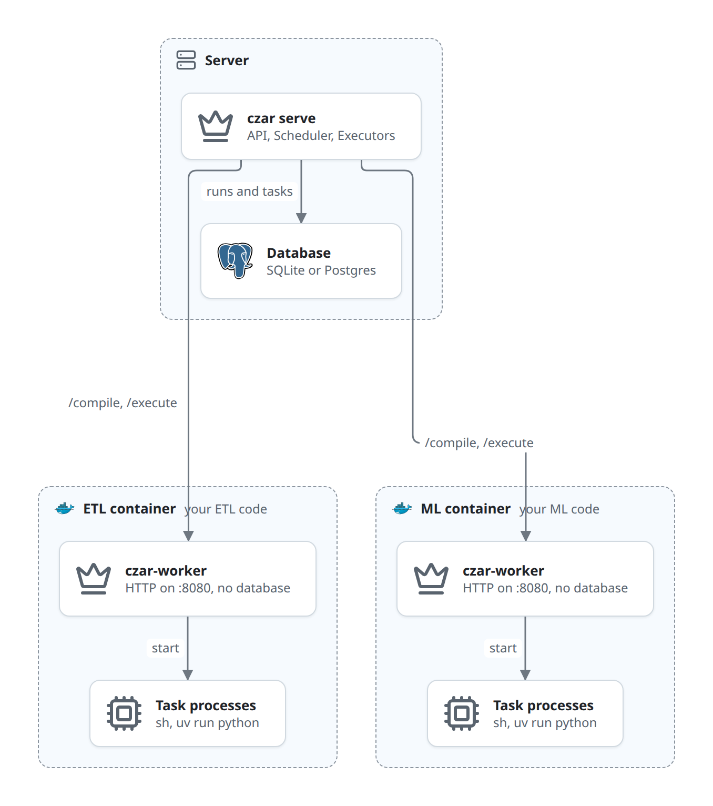

# Remote Workers

_Updated at: 2026-10-02_

`czar-worker` is a standalone HTTP server binary that executes workflow tasks. You package it into a container image alongside your workflow YAML and task files; the czar orchestrator drives it remotely over HTTP.

## When to use

Use `czar-worker` when your tasks need a self-contained environment (specific Python packages, native libraries, or binaries) that you want to ship as a container image rather than install on the host.

If your tasks run fine as local processes or Python scripts on the host, you do not need this.

## How it works



The orchestrator imports the worker's workflow (`POST /compile`), then sends every task of that workflow to the worker (`POST /execute`) and records the answer. The full flow, its rules and its limits are in [execute-worker.md](architecture/flows/execute-worker.md); the HTTP contract is in [czar-worker-api.md](czar-worker-api.md).

## Building and distributing a worker image

A worker image bundles three things: the `czar-worker` binary, your `workflow.yaml`, and your task files.

```dockerfile
FROM debian:bookworm-slim

# Copy czar-worker binary (built separately or pulled from releases)
COPY czar-worker /usr/local/bin/czar-worker

# Copy workflow and task assets
WORKDIR /app
COPY workflow.yaml .
COPY tasks/ tasks/

ENTRYPOINT ["czar-worker", "--workflow-path", "/app/workflow.yaml", "--working-dir", "/app"]
```

For Python workflows that need packages:

```dockerfile
FROM python:3.12-slim

COPY czar-worker /usr/local/bin/czar-worker
COPY --from=ghcr.io/astral-sh/uv:latest /uv /uvx /bin/

WORKDIR /app
COPY pyproject.toml uv.lock ./
RUN uv sync

COPY workflow.yaml .
COPY tasks/ tasks/

ENTRYPOINT ["czar-worker", "--workflow-path", "/app/workflow.yaml", "--working-dir", "/app"]
```

Build and push like any other image:

```bash
docker build -t ghcr.io/your-org/your-workflow:latest .
docker push ghcr.io/your-org/your-workflow:latest
```

## Registering the worker with czar

List the worker under `workers:` in the orchestrator config file (`czar serve --config`), or in a separate file passed with `czar serve --workers-file` (or `CZAR_WORKERS_FILE`):

```yaml
workers:
  - url: http://worker:8081
    name: etl-worker          # optional display name
    poll_interval_secs: 60    # optional re-sync interval
    token_env: CZAR_WORKER_ETL_TOKEN   # variable holding the worker's --auth-token
```

`token_env` names an environment variable that holds the token, so the token doesn't sit in the config file (set it the way you set other secrets: a Docker or Kubernetes secret, a systemd credential). `token: <value>` also works, but then anyone who can read the file can read the token.

## Authentication

`/execute` runs arbitrary commands, so a worker reachable beyond localhost must require a token. Start it with `--auth-token <TOKEN>` (or `CZAR_WORKER_AUTH_TOKEN`) and give the orchestrator's worker entry the same token, through `token_env`. The worker then answers `401` to `/compile` and `/execute` requests without `Authorization: Bearer <TOKEN>`; `/health` stays open for readiness probes. The worker logs a warning when it binds a non-loopback address without a token.

Tokens are only read from the workers config: workers registered at runtime through `POST /api/workers` cannot use one.

## CLI reference

```
czar-worker [OPTIONS]
  --addr <addr>              Bind address  (default: 127.0.0.1:8081)
  --workflow-path <path>     Path to workflow YAML  (default: workflow.yaml)
  --working-dir <path>       Base directory for task assets  (default: .)
  --auth-token <token>       Require this bearer token on /compile and /execute
                             (env: CZAR_WORKER_AUTH_TOKEN)
```

## Supported executors

The orchestrator sends every task to the worker as a `process` task, and the worker runs it with czar's process executor. Shell commands and Python tasks (`file` or `module`) work, and `container` tasks work when Docker or Podman is on the worker. `library`, `wasm` and `cloudrun` tasks run as shell commands and fail. A task must print a `CZAR_OUTPUT:` line and finish within 30 seconds. See [known-issues.md](architecture/known-issues.md#worker-tasks-always-run-as-process).
